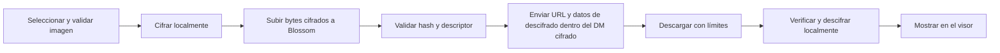

# Imágenes cifradas en DMs — plan

Base: `master` / `530439a` (#421). Rama: `dm-encrypted-images`.
Estado: propuesta; no implementado.

## Alcance y tamaño

DMs individuales en Android y escritorio, una imagen por mensaje. Reutilizar
selector, pegado, vista previa y visor. Los canales de comunidad conservan su
transporte y su política de archivos.

| Concepto | Decisión propuesta |
|---|---|
| Límite actual del cliente | 2 MiB |
| Límite inicial de la nueva función | 10 MiB de imagen antes del cifrado |
| Máximo efectivo | El menor entre el límite del cliente y el del servidor, descontando el sobrecoste del cifrado |
| Decodificación | Mantener límites de dimensiones, píxeles y memoria independientes de los bytes comprimidos |
| Servidor | Preferencia `dm_blob_server`; reutilizar el selector existente y verificar soporte de binarios cifrados antes de elegir el predeterminado |

`chat_image.rs` limita actualmente las lecturas también por el máximo de las
comunidades: separar esa restricción para admitir exactamente 10 MiB en DMs sin
aumentar los límites de los canales. 20 MiB sería una ampliación posterior, no
un máximo universal del protocolo.

## Flujo

## Implementación por etapas

| Etapa | Cambios | Condición de aceptación |
|---|---|---|
| 1. Contrato | Adoptar mensajes de archivo NIP-17 `kind 15`, dentro de los sellos y gift wraps existentes. Fijar vectores de clave, nonce, tag y codificación antes de implementar; NIP-17 no precisa todos esos detalles binarios | Vector reproducible entre Rust y una implementación independiente; `kind 14` sigue funcionando |
| 2. Criptografía | Nuevo módulo `nostr/dm_image.rs`; AES-256-GCM mediante biblioteca mantenida, clave aleatoria de 32 bytes y nonce de 12 bytes por imagen. Blob propuesto: ciphertext más tag de 16 bytes; sin clave en URL ni cabeceras | Descifrado idéntico al original; clave incorrecta o bytes alterados fallan antes de mostrar nada |
| 3. Blossom | Añadir subida binaria a `nostr/blossom.rs`, `application/octet-stream`, hash del ciphertext y descriptor verificado. Autorización BUD-11 con expiración, hash y dominio, Base64url sin padding y `X-SHA-256`. No usar `/media`, que puede transformar imágenes | Servidor de prueba recibe únicamente ciphertext; rechazos, redirecciones y errores se manejan sin publicar un DM roto |
| 4. Cola durable | Trabajo de adjunto persistente antes de subir; ciphertext en disco y clave/metadatos sellados con el almacén de la cuenta. Reutilizar los mismos bytes cifrados al reintentar. Después de subir, usar la outbox existente de gift wraps para destinatario y remitente | Cerrar y reabrir durante subida o publicación recupera el envío, sin duplicar mensajes ni regenerar claves en cada reintento |
| 5. Recepción | Extender `nip17.rs` y `service.rs` para validar `kind 15`, participantes, algoritmo, longitudes y metadatos. Descargar en Rust, verificar hash cifrado, autenticar GCM y verificar hash del original antes de validar la imagen | Imagen visible en ambos equipos y recuperable desde los relays en otro dispositivo de la misma cuenta |
| 6. Interfaz | Retirar el rechazo actual de imágenes en DMs; estados preparando/subiendo/enviando/error, reintentar y cancelar. Reutilizar visor mediante recursos locales, sin cargar la URL Blossom directamente en un `` | La interfaz sigue respondiendo y los mensajes de texto mantienen su orden. Si se permite texto acompañante, enviarlo como `kind 14` separado y relacionado; conservar el borrador ante fallos |
| 7. Ciclo de vida | Caché por cuenta con límites y caducidad; almacenar ciphertext o caché sellada, no imágenes privadas en claro en la caché pública de emojis. Aplicar bloqueo, solicitudes de DM y borrados antes de descargar. Adaptar borrado a `kind 15`, también cuando llega antes de la imagen | Cambiar de cuenta no muestra recursos ajenos; borrar cancela descargas y evita que un replay restaure la imagen |

## Datos y privacidad

El rumor cifrado incluye URL, tipo real, algoritmo, clave, nonce, hashes y tamaño.
Blossom sólo recibe el archivo cifrado como binario. No publicar eventos de
metadatos con esos secretos, miniaturas sin cifrar ni hashes del original fuera
del DM. Cada nuevo envío obtiene una clave y nonce nuevos, incluso para una foto
repetida. No reutilizar la pareja clave/nonce para una miniatura distinta.

La outbox actual persiste gift wraps ya cifrados; no sirve por sí sola para
recuperar una subida que todavía no tiene URL. El trabajo previo necesita su
propia persistencia protegida. No registrar claves, rumores completos ni
contenido descifrado.

El cifrado oculta la imagen, pero el proveedor puede observar IP, tamaño y la
clave pública utilizada para autorizar la subida. Borrar del chat no puede
retirar una copia que el destinatario ya guardó; gestionar el borrado del blob
es una operación independiente.

## Verificación antes de publicar

- Límites exactos de 10 MiB, ciphertext, dimensiones y descargas sin tamaño declarado.
- Integridad, claves/nonce inválidos, MIME falso, imagen corrupta y mezcla de cuentas.
- Caída de red, 401/413/415/429, timeout, descriptor falso y archivo desaparecido.
- Reinicio entre cifrado, subida y publicación; reintentos idempotentes y cancelación.
- Recepción propia, destinatario, otro dispositivo, replies y borrado fuera de orden.
- Rechazar descargas automáticas de desconocidos bloqueados o solicitudes sin aceptar.
- URLs HTTPS y redirecciones limitadas; impedir destinos locales/privados arbitrarios y no reenviar autorización a otro host.
- Servidor Blossom controlado que admita binarios; después, prueba real Android ↔ Windows con datos móviles y Wi-Fi.
- Pruebas pertinentes de Rust, Clippy y compilación Android. Los clientes antiguos que sólo leen `kind 14` no recibirán representación de imágenes; nunca recurrir a subida en claro para compatibilidad.

## Fuentes

- [NIP-17: mensajes privados y archivos](https://github.com/nostr-protocol/nips/blob/master/17.md).
- [BUD-02: subida de blobs sin modificar bytes](https://github.com/hzrd149/blossom/blob/master/buds/02.md).
- [BUD-11: autorización Nostr](https://github.com/hzrd149/blossom/blob/master/buds/11.md).
- [Límites publicados por blossom.nostr.build](https://blossom.nostr.build/): anuncia 20 MiB gratuitos; no demuestra por sí solo aceptación de ciphertext.
