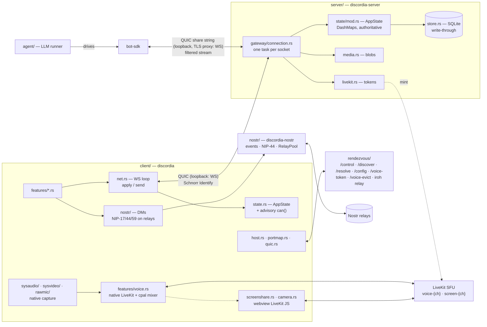

# Map

Where things are, so a reader greps once instead of three times. `CLAUDE.md`
carries the rules and invariants; this carries where to open, what moves
together and how the parts connect.

Symbols, never line numbers: a symbol can be grepped and a number goes stale.

## Do not read these whole

These hold most of the tree. Grep the variant or the `fn` name instead.

| File | Lines |
|---|---|
| `client/src/features/voice.rs` | 5377 |
| `server/src/state/mod.rs` | 4809 |
| `server/src/gateway/connection.rs` | 4547 |
| `protocol/src/lib.rs` | 4311 |
| `client/src/state.rs` | 4035 |
| `client/src/features/screenshare.rs` | 3853 |
| `client/src/features/chat.rs` | 3768 |
| `server/tests/owner_controls.rs` | 3457 |
| `client/src/net.rs` | 3012 |
| `client/src/features/channels.rs` | 2648 |
| `client/src/nostr/service.rs` | 2465 |
| `client/src/features/activities.rs` | 2063 |
| `server/src/store.rs` | 1844 |
| `client/src/identity.rs` | 1314 |
| `client/src/features/guild_settings.rs` | 1145 |
| `client/src/features/discord_import.rs` | 1102 |
| `client/src/update.rs` | 1075 |

Everything else: `wc -l` answers faster than a list here could stay true.

## Entry points

| To find | Open | At |
|---|---|---|
| Encrypted DM images | `client/src/nostr/dm_image.rs`, `features/dm_images.rs`, `nostr/service.rs`, `nostr/nip17.rs` | AES-256-GCM before Blossom upload; NIP-17 kind 15 inside the existing gift wraps, captions as related kind-14 replies. Optional sender-generated previews are separately encrypted and uploaded before the original; old descriptors remain valid. Durable encrypted upload jobs; cancellation markers prevent resurrection. Binary HTTPS pins public DNS addresses and bounds redirects/downloads. Only accepted conversations load images. The file-server selector is independent of emoji uploads |
| DM edits and deletions | `client/src/nostr/service.rs`, `nostr/nip17.rs`, `state.rs`, `settings.rs` | Encrypted change rumors stay off the gateway. `apply_dm_change` validates recipients and authors, with bounded pre-original candidates keyed by target and author. Tombstones persist; pending operations recover and retry. Empty emoji tags clear previous mappings |
| Android guild media/history reception | `client/src/net/background_socket.rs`, `server/src/gateway/connection.rs` | The native transport accepts the server's full frame size; its byte queue holds two maximum frames and keeps the frame-count cap. `scripts/build-android.py --gateway-diagnostics` (`DISCORDIA_GATEWAY_DIAGNOSTICS=1` at compile time) builds payload-free USB traces |
| Stream controls on video | `client/assets/stream-controls.js`, `stream-viewer.css`, `features/screenshare.rs`, `features/stream_viewer.rs`, `scripts/test-stream-controls.cjs` | Tile headers/footers overlay the video in app, popouts and full screen; per-tile hide timers, kept under focus or a volume drag. Touch reveals controls without triggering video actions |
| Desktop guild rail | `client/src/features/workspace.rs`, `features/workspace_layout.rs`, `features/guilds.rs`, `client/src/app.rs`, `grid-layout/src/item.rs` | A docked rail (`dock_of`) holds `ClientSettings::rail_size` px as the window resizes; "Done rearranging" saves it. `RailDock` docks it Left/Right/Top/Bottom and fits the other panels into the rest. `.dxf-guilds-frame` is a size container (CSS in `app.rs`): wider than tall, the rail is a row. `GridItem` `min_w_px`/`min_h_px` go below the free-mode floor |
| Voice invitation dialog | `client/src/features/voice_invite.rs`, `client/assets/voice-invite.css` | Channel card, search, per-person send/Open DM. Queued means queued, not delivered |
| XP bar repainting | `client/src/features/channels.rs`, `features/profiles.rs`, `scripts/test-xp-bars.cjs` | Background longhands (trap 31); the regression runs the pinned Dioxus interpreter in Chromium |
| Android settings | `client/src/features/settings_mobile.rs`, `features/settings_dialog.rs`, `features/settings_microphone.rs`, `assets/mobile.css`, `scripts/test-mobile-settings.cjs` | Bottom tabs General, Audio, Video, App. Video refreshes native cameras on entry |
| Native image transport | `client/src/image_assets.rs`, `features/profiles.rs`, `features/chat.rs`, `client/src/app.rs` | Avatars, banners and chat images use per-window asset URLs, not base64 in DOM edits. Equal payloads share storage; registrations hold weak references; expired ones return 404. Base64 conversion runs off the UI thread. GIF bytes are preserved |
| Image memory measurement | `tools/image-memory-probe`, `tools/image-memory-probe/dm_server.rs`, `scripts/measure-image-memory.cjs`, `scripts/check-image-memory.cjs`, `scripts/summarize-image-memory.cjs`, `scripts/measure-unified-images.cjs`, `scripts/check-unified-images.cjs`, `scripts/summarize-unified-images.cjs`, `scripts/check-progressive-images.cjs`, `scripts/summarize-dm-server-images.cjs` | Windows/WebView2 A/B probes on the PID-scoped profiler; `dm_server.rs` runs the production `chat_image` helpers. Reports go to `target/image-reports/`. GPU process private commit is not VRAM |
| Shared chat previews | `image-policy/`, `client/src/features/image_attachment.rs`, `features/chat.rs`, `features/dm_images.rs`, `server/src/media.rs`, `gateway/connection.rs`, `docs/UNIFIED_IMAGE_POLICY.md` | Policy in the doc. Communities negotiate `FetchImagePreviews` and cache quota-accounted sidecars; DMs make encrypted local previews after decrypting originals. The full viewer requests the original explicitly. Preview/original keys share `MediaCache` limits. Server conversions run outside the socket loop under global and per-connection caps |
| Progressive picture upload (server) | `server/src/state/mod.rs`, `gateway/connection.rs`, `state/image_upload_tests.rs` | `BeginImageUpload` stores the preview and shows progressive sessions a provisional `MessageCreate`; no row until `CompleteImageUpload` commits. Every exit from `pending_image_uploads` is `end_image_upload`: a commit sends `MessageCreate` to all, an `UploadCancel` sends `MessageDelete` to progressive sessions and the sender's socket. No expiry; a socket's end cancels its own |
| Image header bounds | `image-policy/src/bounds.rs`, `server/src/media.rs` (`decode`) | Every image upload (chat, avatar, banner, icon, emoji, sticker) is read from its headers, never decoded: ≤16384 px a side, ≤2²⁸ px, ≤2000 frames, ≤2³⁰ px×frames → `StoreError::ImageBounds`. GIF canvas includes frames drawn past the screen; APNG takes the larger of `acTL`/`fcTL`; AVIF reads `ispe`/`tkhd`/`stsz`. Blobs stored before it are not rechecked |
| Expanded image zoom | `client/src/features/image_viewer.rs`, `client/assets/image-viewer.js`, `image-viewer.css`, `scripts/test-image-viewer.cjs` | One desktop/Android viewer. Progressive sessions show the preview while the original loads and keep zoom/pan; session/attempt tokens reject stale replies |
| Speaking indicator visibility | `client/src/state.rs`, `features/channels.rs`, `features/members.rs` | `connected_voice_channel` gates speaking/quality rings to the connected media channel; member rows show mute/deafen badges without a speaking ring |
| Chat opening and document styles | `client/src/features/chat.rs`, `client/src/features/markup.rs`, `client/src/app.rs`, `scripts/test-chat-scroll.cjs` | A Channel/DM change reaches the page as `data-chat-channel` on the scroller. Opening stays pinned until rows exist, then goes to the "New messages" line (`data-chat-unread`, from `AppState::unread_from`, which `mark_channel_read`/`mark_dm_read` set from the mark *before* moving it), else where the conversation was left (`__dxfChatScrollSaved`, this session only), else the bottom. A guild channel with no rows and no `history_loaded` draws `HistorySkeleton` until its page lands or `HISTORY_PATIENCE` passes (a refused fetch names no channel), then "No messages yet.". Only a message from the last 10 s slides in (`dxf-msg-in`). Plain lines share one text node; closed emoji pickers copy no image payloads. Static styles mount under the memoized `AppHead`, outside reactive dialogs |
| Selects, checkboxes, radios | `client/src/app.rs` (`BASE_CSS`), light theme's `color-scheme` in `THEMES` | Drawn app-wide; call sites set only size and colours. A select's arrow is its `background-image`, so an inline `background:` shorthand erases it — use `background-color`. `color-scheme` makes the system menu match the theme; Chromium (WebView2) draws the list itself under `appearance: base-select`, WebKit and touch keep the system picker |
| Android tab swipe navigation | `client/src/features/mobile_workspace.rs`, `client/assets/mobile-pager.js`, `client/assets/mobile.css`, `scripts/test-mobile-pager.cjs`, `scripts/test-mobile-pager-browser.cjs` | Native scroll-snap pager; Rust gets selection/preview/settled events. Button destinations survive late scrollend; DM navigation is immediate. Chat/Channels keep DOM and scroll; Members mounts only when selected or peeking. Tabs, Back and resize share the pager bridge |
| Shared media cache memory | `client/src/media_cache.rs`, `client/src/net.rs` | `EmojiBlobs` shares bytes between LRU entries and queued disk writes. Android and desktop have separate budgets; pending results are entry-bounded and overflow retries through existing requests. Budgets exclude WebView decoded images. Anything drawn from it — guild emoji, banner, rail icon — goes to the page as `image_assets::cached_uri`, an `/image-data/` path the cache's `Arc` keeps resolvable, never as a `data:` URL; DM emoji tags still carry the bytes (`guild_emojis_of` vs `guild_emoji_uris_of`) |
| Android responsiveness and idle rendering | `scripts/measure-android.mjs`, `scripts/measure-android-startup.mjs`, `client/src/features/mobile_workspace.rs`, `client/src/identity.rs`, `scripts/test-globe.mjs`, `client/assets/globe.js`, `client/assets/mobile.css` | Both scripts take `--package com.discordia.app.debug`; JSON under `target/android-perf`. Mobile Chat/Channels stay mounted as hidden inert panels. Identity load verifies the derived pubkey; plaintext migration skips encrypted files. Logo/globe stop idle animation |
| Android chrome and Back navigation | `client/assets/mobile.css`, `client/src/app.rs`, `client/src/features/home.rs`, `features/workspace.rs` (`MobileMenu`), `features/mobile_workspace.rs`, `client/src/mobile_back.rs`, `client/assets/android-back.js`, `client/android/MainActivity.kt` | An Android workspace has no header: Disconnect, Appearance (`AppearancePanel` as a sheet), Agents, Server Settings, Settings and Your connection (`TopologyDialog`) open from the bottom bar's More as a FAB menu; a dot on More marks Reconnecting. Agents, Server/Guild Settings, Integrations and the topology dialog carry `dxf-sheet*` classes and fill the screen like Settings (`mobile.css`); each registers a `SETTINGS` Back handler. Home's header and the narrow-desktop workspace header share geometry; `scripts/test-home-header.cjs` checks it (Playwright; `NODE_PATH`, optional `BROWSER_PATH`). The composer's hint row is desktop-only. Back routes through scoped priority handlers: Settings and the sheet dialogs → More menu/Appearance sheet (`OVERLAY`) → Social conversation → Social or mobile tabs → workspace ordered disconnect; Home with no handler backgrounds the task. `scripts/test-android-back.cjs` |
| Android media UI and capture budget | `client/src/features/mobile_workspace.rs`, `client/src/sysvideo/android.rs`, `client/src/sysvideo/mobile_budget.rs`, `client/android/MainActivity.kt`, `vendor/dioxus-desktop/src/protocol.rs`, `vendor/dioxus-desktop/src/android_edits.js` | Media sits above the guild chat; hidden panels stop video subscriptions, not publishing. `mobile_budget.rs`: admission precedes I420 conversion; measured cost, thermal status and low memory lower the budget; resolution recovers before FPS; missing or idle counters never authorize an increase. Capture geometry follows the default display and MediaProjection resize callbacks (`scripts/test-android-capture.py`). Edit sockets take ArrayBuffers; bytes apply before acknowledgement, exactly once, with a timer fallback while animation frames are suspended. `net/background_socket.rs` keeps heartbeat/Ping/Pong on Tokio, independent of WebView acks. `service_task.rs` registers services with `vendor/dioxus-desktop/src/service_tasks.rs`, polled natively only after a DOM ack stalls. `quic/network_monitor.rs` forwards default-network callbacks to iroh off the UI executor |
| Release platform selection | `.github/workflows/ci.yml`, `scripts/release-tag.cjs`, `scripts/test-release-tag.cjs`, `docs/OPS.md` | Linux publishes only its server (AppImage paused; client CI stays). Pushes reserve an exact-commit tag before compiling; superseded runs skip publication, reruns reuse the tag. Publication rechecks the tag and requires every binary with a verified minisign signature |
| Android release publishing | `.github/workflows/ci.yml`, `scripts/build-android.py`, `scripts/sign-android.py`, `scripts/test_android_release.py`, `client/android/webrtc.init.gradle`, `client/android/release-signing.sha256`, `docs/OPS.md` | dx's `android-release` Cargo profile. PRs never use signing secrets; master signs, verifies the certificate and publishes with the other minisign-verified assets |
| Android platform adapters and packaging | `client/src/android.rs`, `client/src/file_dialog.rs`, `client/android/MainActivity.kt`, `client/android/AndroidManifest.xml`, `client/android/DioxusForegroundService.kt`, `client/src/sysvideo/android.rs`, `client/src/syscamera.rs`, `client/Dioxus.toml`, `client/android/res/`, `scripts/build-android.py`, `docs/MOBILE_PLAN.md` | JNI/Keystore, WebRTC, permissions, clipboard, documents, locale. MediaProjection/Camera2 push I420 over JNI. One foreground service declares mic/camera/projection types and holds a renewable wake lock; ActiveVoice owns a scoped BackgroundCall; camera/projection wait for service confirmation. Launch mode must be singleTask — Tao owns one process-wide native context; packaging verifies it, plus DEX/JNI/branding. Downloads use ContentResolver |
| Accept DM from guild voice (desktop/Android) | `client/src/voice_handoff.rs`, `features/account.rs`, `features/workspace.rs`, `features/dm_call.rs`, `features/dm_call_tests.rs` | DM calls ring during guild voice. Accept enters Switching, waits for WebView/native teardown and the server's leave confirmation, then accepts; a replaced route, timeout or cancellation cannot start the DM. End during Switching does not rejoin. Outgoing DM calls stay blocked in guild voice |
| Voice channel DM invitations | `features/voice_invite.rs`, `features/channels.rs`, `features/server_rail.rs`, `features/account.rs`, `features/chat.rs`, `state.rs`, `net.rs` | Invitation cards and external-member codes share one expiry, filtered on insertion and by timer. Home and Social send connection requests through an account-owned inbox. The pending guild/channel/code resumes at Ready and the matching `GuildJoined`; disconnect clears it. Sends recheck access |
| Android call notification controls | `client/src/call_notifications.rs`, `features/account.rs`, `features/workspace.rs`, `features/dm_call.rs`, `client/android/DioxusForegroundService.kt`, `MainActivity.kt` | Account-owned native task routes mic/audio/hangup to guild voice or DM calls. Intents carry call/session/state tokens so stale buttons cannot reach a replacement call. Packaging verifies the JNI export |
| Android screen audio | `client/src/sysaudio/android.rs`, `client/src/sysaudio/pcm.rs`, `client/android/DioxusPlaybackCapture.kt`, `client/android/MainActivity.kt`, `features/screenshare.rs`, `features/voice.rs` | AudioPlaybackCapture (API 29+) reuses the screen capturer's MediaProjection, excludes this app's UID and rides the encrypted screen-audio track; projection stop stops it. Packaging verifies the class and JNI exports |
| Interface languages | `client/src/i18n.rs`, `client/locales/messages.json` | English source messages fall back verbatim. `ClientSettings.language` defaults to the OS. `Locale` is a ROOT-owned signal shared with Social and Streams. Translate labels at render, never member messages/names. Built-in activity pages take the launch language into their content hash. `scripts/test-translations.mjs` checks keys, arguments, literal labels and plurals |
| Stream decoder diagnostics | `client/src/features/channels.rs`, `features/screen_stats.rs` | Known decoder names map to GPU or CPU; others stay unknown (power-efficiency flags prove nothing). Replacement views cannot inherit rates |
| Voice connection diagnostics | `client/src/connection_routes.rs`, `features/channels.rs`, `features/voice_menu.rs`, `features/voice_network.rs`, `client/assets/voice-tooltip.js` | `VoiceQualitySignal` only in voice-channel occupant rows. RTT is this client's ping to the SFU, never the participant's. Missing SFU quality does not imply a missing connection: recent inbound RTP or outbound packet rates label receiving/sending, with the quality rating explicitly unreported; ping and cumulative counters alone cannot prove traffic. Outbound loss needs feedback matching the current mic's local ID and SSRC. `VoiceSignal` keeps its SVG in a leaf so updates cannot erase an open tooltip; tooltips use the top-layer popover (trap 22). `scripts/test-voice-tooltip.cjs` |
| Moderator voice moves | `protocol/src/lib.rs`, `client/src/features/channels.rs`, `features/voice_drag.rs`, `client/assets/voice-drag.js`, `voice-drag.css`, `server/src/state/mod.rs`, `server/src/gateway/connection.rs` | `MoveMembers` holders drag occupants onto voice channels (pointer drag, hit test at drop; short clicks open profiles). The client rechecks before `MoveVoice`; the server validates moderation, visibility, guild and voice ownership under its lock. Moves keep mute/deafen, clear camera/share, evict the old room. `scripts/test-voice-drag.cjs`, `server/tests/voice_move.rs` |
| Game image in the profile popup | `client/src/presence/artwork.rs`, `features/profiles.rs` | Xbox/Steam artwork beats executable icons; `xbox.rs` reads local manifests; `detect.rs` caches hits/misses. `Activity.image` carries a small PNG; no remote fetch |
| Animated profile/community images | `client/src/image_edit.rs`, `features/image_editor.rs` | Picker and decoder share shape-specific original caps. `crop_image` reuses fitting unchanged GIFs and streams cropped frames to fit the budget, keeping timing. `MAX_IMAGE_BYTES` caps profile/community artwork and default DM/sticker uploads; community chat images follow the guild file policy; emoji have their own cap |
| Community upload size policy | `protocol/src/lib.rs`, `client/src/chat_image.rs`, `features/chat.rs`, `features/chat_tools.rs`, `server/src/media.rs`, `server/src/state/chat_tools.rs`, `server/src/state/mod.rs`, `server/src/gateway/connection.rs`, `server/src/sanitize.rs` | `FilePolicy`; ManageGuild may raise it to `MAX_GUILD_UPLOAD_BYTES`. Picker, clipboard encoding, server validation/storage, frame envelope, downloads and archive sanitization share that ceiling — change together. Profiles/stickers/DMs keep their own limit |
| Chat files, stickers, pins and search | `client/src/features/chat.rs`, `client/src/features/chat_tools.rs`, `server/src/state/chat_tools.rs` | `Composer`'s **+** offers Image or File; a file goes as `SendFile`, the draft kept until `FileUploadResult`. `FileAttachment` is the card (`.dxf-file-*` styles in `app.rs`). `ChatTools` is the header's search, pins and file-limit popovers. `StickerPicker` sits beside the emoji button. Download opens only the destination folder. A result's time (`MessageRow::on_jump`) sets `AppState::message_jump`; `ChatView` fetches pages back until the message is loaded, and `JUMP_JS` centres and flashes it |
| File expiration and host storage | `server/src/store.rs`, `server/src/media.rs`, `server/tests/chat_tools.rs` | Members upload without a special role; read-only, slowmode, visibility, membership and file policy still gate it. Metadata outlives expiry. `live_file_channels` gates downloads; `sweep_files` reclaims unreferenced `.bin` blobs under `durable_writes`. Windows marks files as Internet downloads; no malware scanner |
| Chat tools with older hosts | `protocol::ServerMessage::Ready`, `client/src/net.rs`, `features/chat.rs` | `Ready.chat_tools` defaults to false; tools and file/pin actions mount only when supported |
| What a `ServerMessage` does to the client | `client/src/net.rs` | `fn apply` — one arm per variant, exhaustive |
| Image attachment metadata | `protocol::ImageMetadata`, `server/src/media.rs`, `server/src/store.rs`, `client/src/features/chat.rs`, `image-policy` (`shown_size`) | Optional sanitized basename and dimensions as shown (EXIF orientation applied) through storage, history and search; DM descriptors use the same. `image_attachment::frame` reserves the box from them before a picture loads — fitted into 400×300, a fixed 240px height without them. Sizes stored before `shown_size` are pre-orientation: a rotated photo is letterboxed |
| What the server does with a `ClientMessage` | `server/src/gateway/connection.rs` | `handle_connection`, then ~50 `ClientMessage::` arms. `Phase` is the socket's login state: `Phase::admits` refuses all but Identify before it, `Phase::identify` registers under the key, `Phase::end` unregisters (`handshake_tests.rs`) |
| Every wire type | `protocol/src/lib.rs` | grep the variant name; ~70 of them |
| Starting a server or rendezvous: flags, config file, `setup` | `server/src/bin/discordia-server/`, `rendezvous/src/run.rs`, `site/public/install.sh` | `ServerOptions` (`options.rs`) and `run::Options` are each one struct that is the clap flags, their variables and the TOML table, merged by `or` (flag > env > file); `drop_empty_env` runs before parsing because compose passes `${VAR:-}`. `serve.rs` is the old `main`; `share` prints the `quic://` string from `quic-secret` without minting one. `publish.rs` registers on each `publish_to` rendezvous as a `HostKey` derived from `quic-secret`, through `server/src/rendezvous.rs` — the host side of `/control` (`register`, `maintain`, `Signer`), shared with the desktop host, whose `client/src/rendezvous.rs` only makes `Identity` a `Signer`. `setup/` turns `Answers` into `Step`s (`native.rs` systemd, `docker.rs` compose) that `--dry-run` prints; `config_for` is the one place a role becomes config, and a rerun starts from the existing file so keys setup does not manage survive. The `cli` feature (default) gates the binary; the client embeds the library without it |
| Server state mutation + permissions | `server/src/state/mod.rs` | `durable_writes`, `durable`, Store transactions (trap 2) |
| Client state + advisory `can()` | `client/src/state.rs` | `AppState`, `use_app_state`, `use_gateway` |
| Selective member/profile updates | `client/src/features/members.rs`, `features/profiles.rs`, `client/src/media_cache.rs`, `assets/activity-clock.js` | `MemberSources` compares metadata/voice/subtitle domains before notifying row selectors. Avatars/banners share bytes through `MediaCache::get_shared`. `ProfileActivity` isolates game changes; elapsed clocks tick only while focused and visible |
| UI update benchmarks | `client/src/features/ui_update_bench.rs`, `scripts/measure-ui-memory.py`, `scripts/test-activity-clock.mjs` | Ignored `benchmark_selective_ui` (VirtualDom time, CPU, DOM edits; no paint) and `benchmark_ram_ui`; `measure-ui-memory.py` is the Windows collector |
| DMs end to end | `client/src/nostr/service.rs`, `nostr/delivery.rs` | `spawn_nostr`; `Routes::ready_at` skips the discovery wait for known kind-10050 inboxes. Pending wraps survive restart and retries reuse event ids; relay acceptance is not a read receipt. `Senders` (trap 33). Ignored `measure_encrypted_dm_publication_latency` |
| Nostr connection recovery | `nostr/src/relay.rs`, `client/src/nostr/mod.rs` (`wakeups`), `android.rs`, `dm_notifications.rs` | Android resume/network callbacks coalesce refreshes through `RelayPool::connect_with_wakeups`; each pool cancels stale sockets, dials or backoff and reissues its subscriptions. Pool ownership stops recovery tasks. `scripts/test-android-network.py` runs the real Kotlin callback registration |
| DM call history | `client/src/nostr/call_history.rs`, `nostr/service.rs`, `features/dm_call.rs`, `features/chat.rs` | NIP-17 kind 14 records with encrypted `discordia-call` metadata: the caller attests attempt/missed, the callee answered/declined/busy. One row per caller + call id; accepted overrides a late missed, and does not prove media connected. Encrypted outbox with an event id per outcome. Synced read marks dismiss native alerts only through the read timestamp. After process death: the Android push row |
| Android DM notifications, process alive | `client/src/dm_notifications.rs`, `client/android/DioxusDmNotifications.kt`, `features/account.rs`, `features/settings_dialog.rs` | Opt-in; a generic native alert, never the body. Notifications and call controls use `android::notification_command` and the Java UI queue, bypassing Wry's bounded pipe while its native looper is suspended; `scripts/test-android-notification-dispatch.py`. Visibility prevents marking a background chat read; taps open the account's inbox DM without ending voice. Synced read marks dismiss native alerts only through the read timestamp. Posting is `DioxusNotifier`'s, shared with push; the Notifications setting's DMs toggle (`push.json`) also gates these. After process death: the Android push row |
| Windows tray notifications | `client/src/windows_notifications.rs`, `client/src/dm_notifications.rs`, `features/dm_call.rs`, `features/settings_dialog.rs` | WinRT toasts for calls and DMs while minimized or in the tray. `windows_notifications/identity.rs` registers the Start-menu AUMID at startup and through the installer's `--register-notifications`, before single-instance acquisition; another executable's shortcut is never retargeted. No message content; activation focuses the inbox chat |
| DM ICE discovery | `client/src/features/dm_call.rs`, `features/dm_call_tests.rs` | `local_description` waits for gathering to a deadline, then tries what it collected; an empty set fails; incomplete gathering never reports end-of-candidates |
| Account lifetime | `client/src/features/account.rs` | `AccountView` owns shared state, Nostr and call alerts across Home/server changes; `clear_server_session` removes guild data, keeping DMs, calls and audio preferences. Joining guild voice still requires ending a DM call |
| Private DM voice calls | `client/src/features/dm_call.rs`, `features/voice_direct.rs`, `nostr/calls.rs` | `spawn_service` owns consent, devices, deadlines and native WebRTC; `voice::direct::Audio` reuses mic DSP and playback. Freshness uses the learned sender clock offset (trap 18). NIP-59 call signals never enter chat history or its outbox; retries reuse the event id; cancelled ids suppress delayed invitations. Incoming calls need a contact or existing DM (`DmStanding::Inbox`); guild voice and DM calls are exclusive. Input changes reopen only capture and keep the published track; output changes reopen playback; a failed open stops transmission, warns and retries. `dm_call_tests.rs` checks decoded peer audio |
| Social window | `client/src/features/social_window.rs`, `features/home.rs` | Desktop Home opens or focuses one native Social window; Android shows Social inside Home's WebView. Only the visible conversation marks the DM pane open. Closing it keeps calls. `CallAlert` belongs to the account owner, so Social does not re-ring. ROOT-owned `AppState` (trap 32) |
| Microphone test | `client/src/features/voice_mic_test.rs`, `features/voice_mic_setup.rs`, `features/settings_mic_status.rs`, `features/settings_dialog.rs` | Local playback and meter without joining voice; reuses capture, DSP and output selection; disabled during calls. The shared status card reports opened devices, mute/deafen/device errors and sustained peaks |
| Voice and audio settings | `client/src/features/settings_microphone.rs`, `features/settings_audio.rs`, `features/settings_dialog.rs` | One tab owns input/output, profiles, the test, mic volume and quality. Output changes invalidate device-bound calibration |
| Microphone profiles and calibration | `client/src/mic_profile.rs`, `features/settings_microphone.rs`, `features/voice_calibration.rs`, `features/voice_mic_setup.rs`, `docs/VOICE_PROFILES.md` | Presets share one DSP config across guild/DM/local tests. Calibration records locally, compares production DSP candidates and plays them back before Apply; it is tied to device/backend/output. Custom persists as `mic_custom_config`. PCM stays in memory. Unsafe or no-improvement results hide Apply |
| Microphone noise suppression | `client/src/denoise.rs`, `features/voice_dsp.rs`, `features/settings_microphone.rs` | One suppressor, none while muted. RNNoise pauses when it runs slow; `AppState::denoise_fallback` reports it and Retry bumps `denoise_retry`, which the capture loop reads to rebuild. A separate RNNoise `Vad` scores the post-echo hop (`speech=`) and may drive voice activation through `features/voice_activity.rs` (hysteresis, lead-in with original capture stamps). Mute and settings erase retained sound without dropping its capture time (trap 38) |
| Microphone gain and saturation | `client/src/agc.rs`, `features/voice_dsp.rs`, `vendor/webrtc-sys/src/apm.cpp` | libwebrtc's AGC2 in a second APM after noise suppression, shared by guild calls, DMs and tests. `agc_gain_db` in a recording is measured out/in; AGC2 reports none. Manual volume follows AGC, then `agc::Limiter`, per sample, state in `Processor`. Speech tests use `agc::tests::speech` — AGC2 ignores tones |
| Native echo cancellation | `client/src/echo.rs`, `features/voice_dsp.rs` | `Reference` resamples actual mixed playback; echo/high-pass runs before denoise, gate, AGC, trim and limiter. Natural with headphones bypasses echo, high-pass and the gate |
| Poor voice connections | `client/src/features/voice_network.rs`, `voice_network_tests.rs` | Loss never lowers the voice bitrate. Mono Opus is `VoiceAudioEncoder` (`vendor/webrtc-sys/src/voice_audio_encoder.cpp`), which always tells Opus to expect loss so FEC rides every packet; stereo stream audio keeps libwebrtc's encoder. Bitrate applies live through `set_max_bitrate`. Uplink loss caps native screen/camera bitrate (`voice_uplink_congested`). NetEq discards include unused RED blocks — never divide them by RTP packets to infer loss. Server quality does not say which direction fails. Gates feed silence (trap 38). `voice loss:` log lines; ignored `a_live_sender_negotiates_fec_and_takes_a_new_ceiling_without_reconnecting` starts the bundled SFU |
| Recording a call to debug its level | `client/src/voice_record.rs`, `voice_record/playback.rs`, `voice_record/microphone.rs`, `settings_dialog::CallRecording`, `denoise_gate_loop`, `consume_remote_track`, `voice_network::spawn_stats_task` | Diagnostics → *Record calls* writes `<config dir>/voice-recordings/<local time>/`; files and columns in `docs/AUDIO_DIAGNOSTICS.md`. `mic-dsp.csv` holds processing levels; `recv-<who>-<kind>` is NetEq output before mixing; `playback-mix`/`playback-out` are before/after the limiter; `playback.csv` sample offsets reveal missing blocks; `net-*.csv` counters are cumulative, absent in DMs. Callbacks only fill bounded queues; files open on workers |
| Microphone and activity defaults | `client/src/settings.rs`, `features/account.rs` | Missing saved fields take platform defaults; explicit disabled preferences stay disabled. System bypass applies only where supported |
| Voice preferences on entry | `VoiceSession::join_message`, `net::apply`, `server::state::set_voice_channel` | Optional `JoinVoice.preferences` applies mute/deafen before the first broadcast |
| Native voice regression tests | `client/src/features/voice_audio_tests.rs`, `voice_speech_tests.rs` | Gain, mute, deafen, room-tone AGC, buffering and resampling; opt-in human speech through the production worker exports WAV comparisons |
| Native sample-rate conversion | `client/src/features/voice.rs`, `features/resampler_tests.rs`, `client/src/sound_decode.rs` | `AudioResampler` (Rubato) at capture/playback/file boundaries; equal rates bypass. Tests compare against a test-only Rubato 0.16.2 |
| Stream playback volume | `stream_audio::playback_gains`, `ScreenShareBridge`, `AudioControls::sync_stream_gains`, `features/voice_subscriptions.rs` | Watch-level volume/mute/deafen drives native and WebView audio even with every tile detached. Native rooms opt out of automatic subscription; voice/soundboard subscriptions are independent. Unsubscribe cancels decoding and drops its mixer queue. LiveKit's remote-track diff forgets inactive transceivers so resubscription emits a fresh track in single/dual PC mode. Viewer-only rooms stay silent. `scripts/test-stream-audio.mjs`; CI runs the opt-in `bundled_sfu_preserves_screen_audio_source` over immediate/delayed reselection |
| Voice, capture, mixing | `client/src/features/voice.rs`, `features/voice_activity.rs`, `features/voice_playback_recovery.rs`, `client/src/playback_limiter.rs` | Every remote track goes through `AudioResampler::adaptive`; `voice_drift.rs` nudges its ratio to hold the mixer queue at target, because device and playout clocks differ and dropping samples wobbled pitch. An overfull queue is cut once with a crossfade; an emptied track waits for a reserve and fades in. Your own soundboard and clips bypass recovery. An output-rate change clears queued PCM under the mixer lock; stale-rate pushes are rejected. `next_playback_sample` sums gains; the final mix goes through a lookahead limiter, and echo reference uses its output. For capture grep `ScreenAudioRoom`, `NativeVideoRoom`, `ScreenVideoRoom`, `forward_mic` |
| Audio RED under E2EE | `vendor/livekit/src/rtc_engine/rtc_session.rs`, `vendor/livekit/src/room/participant/local_participant.rs` | A track without explicit `red: false` offers opus+RED, so the publisher sends the redundancy (the SFU cannot synthesize it over encrypted frames). Ignored `audio_red_survives_end_to_end_encryption` |
| Native track teardown errors | `vendor/webrtc-sys/src/peer_connection.rs`, `src/peer_connection.cpp`, `include/livekit/peer_connection.h`, `client/src/features/native_teardown.rs` | Track removal returns a structured `RtcError` across CXX, keeping libwebrtc's `what()` format |
| The first screen | `client/src/features/home.rs` | `HomeView`; Windows leaves branding to the native title bar; the form is `connect::ConnectForm` |
| Public servers on a globe | `client/src/features/globe.rs` | `Globe` — `globe_geometry.rs` makes land dots from `assets/globe-land.bin`; `assets/globe.js` draws Canvas on demand and suspends while hidden; `connect::BrowseTab` feeds it every saved rendezvous's `/discover`, merged; the Create tab reuses it in `pick` mode to place a host's pin, pre-placed by `tzgeo::guess` |
| Experience, and the two numbers it makes | `server/src/state/mod.rs` | `award_xp` (trap 20); `LevelingEditor` offers no channel with `access`. `adjust_xp` is the hand-made change (`AdjustXp`: `XpChange::Set`/`Add`, floored at 0, refused for a bot), under `ManageXp`. The store rejects values above `i64::MAX` before committing. Cross-server XP uses `client/src/xp_ledger.rs` for saturated sums in `xp/<pubkey>.json` (legacy `xp.json` has no owner and stays unassigned), `nostr/xp.rs` signs and paces (`Publisher`), `features/leveling.rs` joins the two, and its `progress` is the bar |
| What a guild calls its ranks, and who may say | `client/src/features/guild_leveling.rs` | `LevelingEditor` — the draft is the settings dialog's, so it saves with everything else. A `LevelTier` has a name, colour and a required emoji (`channels::TopicEmojiPicker`; `sanitize_leveling` fills `DEFAULT_TIER_EMOJI` when blank) |
| DM peer profile panel | `client/src/features/members.rs`, `features/profiles.rs`, `features/guilds.rs`, `features/mobile_workspace.rs`, `client/src/state.rs` | `MembersPanel` mounts `ProfileCard` in DM mode, without guild ranks/roles. `preferred_dm` keeps an explicit DM or picks the newest inbox conversation |
| How ranks show | `client/src/features/members.rs`, `client/src/features/chat.rs`, `client/src/state.rs` | A member row draws only a right-hand `LvN`; `MemberSort::Rank` groups online members under `group_by_rank` headers. In chat, `rank_of` colours a ranked author's name (else `signature_accent`) and adds the rank emoji, its name in a `features::tooltip::Tooltip` (never the browser's `title`), the picture's own title dropped by `EmojiText { untitled }`. The key-verified ✓ is only in the profile card |
| Profile and chat image selection | `client/src/file_dialog.rs`, `features/profiles.rs`, `features/chat.rs`, `client/android/MainActivity.kt` | Native document picker. Profile reads are bounded and sniff MIME from bytes; a shared avatar/banner generation discards stale picker results. Chat keeps its own limits and composer generation guard. Cancelling keeps the draft and never sends |
| Home account avatar | `client/src/profile.rs`, `features/account.rs`, `features/home.rs`, `features/profiles.rs`, `assets/mobile.css` | The account button prefers the personal cached avatar. A device holding only the server's copy recovers the local avatar from its bytes without changing timestamps, publishing, replacing one or undoing a newer deletion |
| Account names | `client/src/features/account.rs`, `client/src/profile.rs`, `client/src/nostr/profile.rs`, `client/src/nostr/service.rs`, `server/src/gateway/connection.rs`, `server/src/state/mod.rs` | The key file's name has no edit time, so devices sync it through the synced profile: `RenameAccount` stamps `LocalProfile::name` and publishes it, and `AccountView` applies a newer one through the unstamped `on_rename`. Kind 0 waits for every relay's replay (`OwnName`, `newest_name`) so a stale device cannot republish an old name. Human Identify refreshes every persisted membership before Ready and MemberJoin. Shared-server roster names beat Nostr metadata |
| Owner permissions and self roles | `client/src/features/members.rs`, `client/src/state.rs`, `server/src/state/mod.rs`, `server/tests/owner_controls.rs` | Ownership grants every permission regardless of roles; the owner may edit their own roles. Only the owner sees "Adjust XP…" (`can_adjust_xp`, `XpAdjust`), though the server accepts `AdjustXp` from any `ManageXp` holder |
| Owner and operator badges | `client/src/features/members.rs`, `features/profiles.rs`, `server/src/state/mod.rs` | `MemberRow` draws a crown for `owner_pubkey` and a blue screen for `Profile::operator`, which only `shown_profile` sets: false under `hide_operator`, so a hidden operator is not one on the wire. `profiles_snapshot` adds a stub for an operator with no saved profile. `hide_guild_owner` hides only the crown; `owner_pubkey` is still sent. `ProfileEditor` shows each toggle only to an owner or operator; `LocalProfile` carries both to every server |
| A profile on a second device | `client/src/profile.rs`, `client/src/nostr/profile.rs`, `nostr/service.rs`, `nostr/src/relay.rs`, `server/src/state/mod.rs` | Caches at `profiles/<pubkey>.json`, written atomically; legacy `profile.json` moves once. The cache goes to every server on connect, stamped `updated_at`; avatar/banner references are reused only when their SHA-256 matches local bytes; `set_profile`/`newer_profile` reject stale edits. Saving publishes kind 30078 `discordia:profile`, NIP-44 to ourselves, pictures by hash on `emoji_blob_server` (`Picture::Unshared` when off or failed). Only EOSE for `SUB_DM` completes replay. `AccountView` loads `profile::Pictures` into `AppState::account_pictures` before Home mounts; `Avatar`/`ProfileBanner` fall back to them when no server profile exists; `IdentityCard` reuses `Avatar`. `adopt_profile` bumps `AppState::profile_synced_at`, which `WorkspaceView` sends to the server |
| Channel dividers | `client/src/features/channels.rs`, `server/src/state/mod.rs` | One list in `position` order, every kind dragged among every other; `Category` is drawn as a `Divider` (`ChannelKind::is_divider`). No messages, call or topic; `DividerLabel` per `Channel::divider`: `Title` or `Centered`. `UpdateChannel { divider: None }` keeps the style |
| What someone is playing, and who says so | `client/src/presence/mod.rs` | `PresenceService` owns RPC tasks and `ScanWorker`; `detect.rs` scans and picks up custom-game edits without restarting. `processes.rs` (ToolHelp on Windows, sysinfo elsewhere), `installed.rs` (Steam, Epic, Ubisoft manifests), `ipc.rs::listen` owns connected games (trap 19). Session teardown cancels listeners and wakes the scanner |
| Registering additional games | `client/src/features/settings_dialog.rs` | Activity tab: `GameDetectionOverrides`; pairs persist in `detect_extra`, override the catalogue and reach an enabled detector on its next scan |
| Guild settings, and what its one Save writes | `client/src/features/guild_settings.rs` | `GuildSettingsDialog` — every field is a draft signal; `save_all` sends only the messages whose values moved. `GuildTab` only chooses which drafts show, so one Save covers every tab. The Roles entry opens it on `GuildTab::Roles` (`roles::RolesEditor`, which saves per role) for someone with Manage roles alone. The member-list order is a `Leveling` field chosen on the Roles tab and saved at once; `AppState::members_of` sorts by it and `members::group_by_top_role` heads each role. A role's `position` only orders display — `ReorderRoles` grants nothing |
| The settings dialog | `client/src/features/settings_dialog.rs`, `settings_microphone.rs`, `client/assets/settings.css` | `SETTINGS_TABS` + `SettingsTab`. Audio owns output/app sounds/soundboard; Microphone owns input and processing. Mounted at the workspace root (trap 22). `AppState::audio_settings` opens it |
| Text, chat emoji and reaction sizes | `client/src/features/appearance.rs`, `client/src/ui_size.rs`, `client/src/features/chat.rs` | Text, chat emoji and reaction emoji scales persist independently (`SizeKind`); text rules do not scale panel geometry. Grapheme clusters keep joined emoji whole. `EmojiText { reaction: true }` reads the reaction slider at `REACTION_EMOJI_EM`; `EmojiText { compact: true }` (topics) ignores both at `COMPACT_EMOJI_EM`. A message's emoji are 22px inline and 48px when the message is only emoji (`emoji::jumbo`, at most `JUMBO_MAX`), both against 14px text and centred on it: `MessageContent` sets `--dxf-emoji-em` rather than threading a flag through the markup. Hovering one shows `EmojiHover`, a top-layer popover placed by `voice-tooltip.js` (trap 22); unicode names come from `EMOJIS` only |
| Last text channel | `client/src/channel_selection.rs`, `settings.rs`, `features/account.rs`, `state.rs` | One remembered text channel per server origin and guild, restored on reconnect before history is fetched; else the first text channel. Voice and DM selections never replace it |
| Personal guild order | `client/src/features/guilds.rs`, `client/src/ui_size.rs` | Local drag order; saved IDs beat the default owner-first order. The drag is pointer-based, not HTML5 DnD, which Windows disables while wry's file-drop handler is installed. The same pointer drag reorders channels (`features/channels.rs`) and roles (`features/roles.rs`) |
| Other servers on the guild rail, and switching to one | `client/src/known_servers.rs`, `client/src/features/server_rail.rs`, `client/src/features/guilds.rs`, `client/src/features/account.rs`, `client/src/net.rs` | `servers.json` holds each server's mode and its guilds, including photo references, at the last Ready (`use_server_rail`). Other servers' photos load asynchronously from the existing disk media cache; misses keep initials and never fetch from the connected server. `net::probe` checks one without signing in: rendezvous listing for a code, QUIC handshake for a share string, TCP for `wss://`. A click runs `SwitchHost`: probe → confirm if a call or hosted server would end → `Leaving` (trap 17) → `on_switch`. `AccountView` keeps the last session as `Fallback` and reconnects if the new one ends before Ready (`undo_switch`); `open_guild_on_ready` picks the guild. Dialogs mount at the `WorkspaceView` root (trap 22) |
| Where this session's data goes | `client/src/features/topology.rs` | `TopologyDialog` — per-leg, per-session; opened from the transport chip |
| Panel arrangements | `client/src/features/workspace.rs`, `features/stream_layout.rs` | `LAYOUT_TEMPLATES` + `LayoutButton`; `persist_layout` writes cell/free snapshots. Watching opens a Streams grid item above chat; normal and watching arrangements persist separately; stopping or detaching every watch restores the normal one |
| The website | `site/` | Next.js 16 static export (`output: "export"`), no Tailwind. `components/Globe.tsx` redraws the globe in three.js from `lib/land.ts`, the land mask as base64 — regenerate it from `client/assets/globe-land.bin`, never edit. `lib/release.ts` is the one GitHub releases request, shared by the hero and `Downloads.tsx`. Layout, nav, footer and scroll reveals are in `app/layout.tsx`; design values and their `globals.css` tokens are `.claude/skills/site-design` (the client's Ember palette and fonts, copied, not shared). Deploy: `.github/workflows/site.yml` or `site/deploy.sh`; `docs/OPS.md` "The website" |
| Panel drag rendering | `grid-layout/src/item.rs`, `grid-layout/src/grid.rs` | `GridItem` derives snap transforms/z-order through a Rust memo; pointer moves update `Interaction`. No JavaScript style mutations |
| Watching several screen shares | `client/src/features/screenshare.rs`, `client/src/features/stream_viewer.rs` | `ScreenWatchWindow` is the Streams grid module; keyed tiles share its measured size. Full screen overlays the viewport without changing the saved rectangle (`assets/stream-viewer.css` in `AppHead`); a WebView Escape listener exits it because native key events may be consumed (`client/tests/stream_fullscreen.cjs`). Inline visibility is reset explicitly because Dioxus keeps omitted properties. `use_stream_drag` guards the self preview; `grid_style` maximizes 16:9 area. `use_popouts`, owned by the workspace, opens one native window for detached screens; closing it docks them. Generation-tagged commands reject old windows. `#viewer` (trap 10) |
| Stream viewers | `VoiceState::{screen_watching,camera_watching}`, `SetScreenWatching`, `SetCameraWatching`, `screenshare::StreamViewers`, `features/sounds.rs`, `features/workspace.rs` | The workspace reports watches once per account. The server accepts only active other sharers or cameras in the same channel, deduplicates and masks hidden voice states. Camera viewing and viewer events use distinct sound cues |
| Selecting a screen share | `client/src/features/screenshare.rs` | `ScreenSourcePicker` mounts `ScreenShareDialog`; `ScreenSourceTile` loads a PNG through `sysvideo::thumbnail`, few native captures at once. Source, resolution, FPS and audio are drafts until Share. `source_resolution_notice` explains limits above the source; native preferences stay fixed for the active room/target/voice epoch. `ScreenSelfPreview` debounces focus/visibility before changing its preview subscription. `sysvideo/windows.rs` Windows Graphics Capture, `sysvideo/macos.rs` ScreenCaptureKit, `sysvideo/android.rs` MediaProjection (its consent dialog is the picker); `selected_capture_settings` feeds the native publisher |
| GIF playback | `client/assets/gif-playback.js`, `client/src/app.rs` | `AppHead` installs one observer per window, Social included. GIFs swap to a PNG poster or Giphy still off screen, hidden or unfocused; `data-gif-hover` also requires hover. `scripts/test-gif-playback.mjs` |
| Cropping avatars and banners | `client/src/image_edit.rs`, `client/src/features/image_editor.rs` | Native decoding, EXIF orientation, preview and crop/export run in `spawn_blocking`; the WebView draws preview and controls. Avatars keep PNG alpha; JPEG banners flatten on white |
| Copying keys and invites | `client/src/clipboard.rs` | `copy_text` writes the native clipboard through arboard; a thread-local owner keeps X11 contents alive. Copy buttons report success only after the write |
| Text context menu | `client/src/text_menu.rs`, `client/assets/text-menu.js`, `text-menu.css`, `client/tests/text_menu.cjs` | `AppHead` installs a body-level menu in main, Social and Streams windows; its listener runs on body before the release document-level native-menu blocker. Message actions come from the existing toolbar buttons. Native clipboard replies cannot edit dismissed menus or unmounted fields |
| Personal saved messages | `client/src/bookmarks.rs`, `features/bookmarks.rs`, `client/assets/bookmarks.css` | Account-owned ROOT state shared with Social. Encrypted per identity under `bookmarks/<pubkey>.sealed`, written atomically before UI success, never sent anywhere. Author names resolve at render |
| Reacting with a guild emoji | `server/src/gateway/connection.rs`, `client/src/features/chat.rs` | `React { emoji }` carries `:code:` unchanged; `reaction_emoji` accepts it only for an emoji of the channel's guild and cuts anything else short, so a reaction never stores a code nobody can draw. `MAX_MESSAGE_REACTIONS` per message; toggles run under `durable_writes` and go out as one entry (`ReactionUpdate`, replayed by `protocol::apply_reaction`), never the list. `GuildReactionPicker`; `EmojiText` renders the pill. `server/tests/reactions.rs` |
| A channel topic | `client/src/features/channels.rs`, `client/src/features/chat.rs` | `Channel::topic` under a voice row and in the chat header, through `EmojiText { compact: true }`. `TopicEmojiPicker` appends a guild emoji or one of `EMOJIS`; `TOPIC_MAX_CHARS` mirrors the server's `sanitize::TOPIC` |
| Custom emoji in a DM | `client/src/emoji.rs`, `client/src/nostr/nip17.rs`, `client/src/features/chat.rs`, `client/src/features/profiles.rs` | Only *saved* emoji travel: right-click a custom emoji to open `EmojiSaveForm`; `AppState::save_emoji` keeps it under the person's shortcode and copies the picture to `emoji::saved_dir`; `use_saved_emoji_persistence` writes `ClientSettings::saved_emoji`; `SavedEmojiSection` lists and removes them; `use_saved_emoji_pictures` loads them. `dm_emoji_tags` turns `:code:`s into NIP-30 `emoji` tags on the kind 14 rumor — the entry's `blossom_url`, filled on first use by `nostr::blossom::upload` (BUD-02, kind 24242 auth, hash checked; meanwhile a `NostrCmd::Hold` that `Send { replaces }` swaps out, later sends waiting in `dm_send_queue`) to `ClientSettings::emoji_blob_server` (default `blossom::PRESETS[0]`; `connect::BlobServerField`), else a data URL under `DM_INLINE_MAX`/`DM_INLINE_BUDGET` so the wrap fits NIP-44, else text with a toast. On receipt `emoji_tags` fills `AppState::dm_emoji` (memory only) and `EmojiText { extra }` draws them |
| DM order and unread badges | `client/src/state.rs`, `client/src/features/channels.rs`, `client/src/features/home.rs`, `client/src/features/workspace.rs` | `AppState::dms_by_recency(DmStanding::Inbox)` orders both DM lists, each row with its `dm_unread` badge. `note_dm_arrival` counts only when the conversation is off screen: `dm_pane_open` is the drawer's state on Home (`social()`) and true under `WorkspaceView`. `mark_dm_read` clears the count and moves the watermark replay is checked against. Muting is in the row's context menu (`dm_menu.rs`; Android's long press is the same event) |
| DM requests (#311) | `client/src/state.rs`, `client/src/features/dm_requests.rs`, `client/src/nostr/nip51.rs` | `AppState::dm_standing`: muted (kind 10000) → dropped in `service::insert_message`; accepted, contact or non-bot roster member → inbox; else a request, never counted in `dm_unread` nor rung. Writing or `NostrCmd::Open` accepts; `use_dm_standing_persistence` keeps accepted (guild-mates included, since rosters vanish on Home), ignored and a blocked cache in `ClientSettings`. `RequestList` is the Social Requests tab and the workspace DM list's Requests section; Block is `NostrCmd::SetMute` (trap 9) |
| Editing a message | `server/src/state/mod.rs`, `server/src/store.rs`, `client/src/features/chat.rs`, `client/src/state.rs`, `server/tests/message_edit.rs` | `EditMessage` → `AppState::edit_message`: author only, still a member who sees the channel, read-only unless `writes_when_read_only` (shared with `SendMessage`); `Store::edit_message` refuses emptying a message with nothing attached. `MessageUpdate` goes to `channel_audience` with `edited_at`; a refused edit sends the author the stored text. The client shows it at once (`edit_locally`, `pending_edits` clock); `MessageRow` draws "(edited)". Server channels only |
| Reply quotes | `client/src/features/chat.rs` (`MessageRow`, `groups_with`), `client/src/app.rs` (`.dxf-reply-*`) | A reply always heads its own group so `.dxf-reply-spine` runs from its avatar to the quote (small avatar, `@name` in rank colour, excerpt). Clicking sets `message_jump` with the reply's own time: an original not already held is not fetched |
| Popovers closing on an outside press | `client/src/features/dismiss.rs` | `use_dismiss(open)` returns a key; put `data-dismiss` = key on the toggle and the panel. A capture-phase `pointerdown` on the document closes it, so a press in another grid panel counts (a `fixed inset-0` overlay cannot, trap 22). Composer emoji/attach/stickers/GIFs, the channel emoji chooser and Activities use it; context menus keep their overlays |
| Icon button tooltips | `client/src/app.rs` (`[data-tip]`), `features/chat_tools.rs` (`ToolButton`) | `data-tip` draws a styled hover label in CSS instead of `title`; it opens below and leftward to stay inside the chat panel, `data-tip-side=top` above (composer). The element needs `relative`. Chat header icons and Stickers use it; multi-line explanations keep `title`. A reaction pill lists who reacted (`chat.rs` `reactors`: you first, 12 names, then a count) with `data-tip-wrap`, which anchors left and wraps; it opens upward because the pill's `dxf-pop` transform is a stacking context the next message would cover |
| Message formatting | `client/src/features/markup.rs`, `client/src/features/chat.rs`, `server/src/state/mod.rs` | `MessageContent` → `Markup`: `inline` reads `**bold**`, `*italic*`/`_italic_`, `__underline__` everywhere; a channel with `Channel::markdown` (`UpdateChannel { markdown: Some(_) }`, Manage channels, text only) uses `markdown` — pulldown-cmark, `__` still underline. HTML stays text, images become links, only http(s) links open. `PlainRun` keeps URL, mention and emoji handling; `spaced_mentions` keeps a name with spaces whole. `.dxf-md` styles live in `app.rs` |
| GIFs | `client/src/giphy.rs`, `features/gif_picker.rs`, `features/chat.rs` (`MessageContent`, `send_gif`) | A pick sends `giphy::link` as ordinary text, guild or DM, apart from the draft. A message that is only a GIPHY link renders as `GifEmbed`, rebuilt from the id (`embed_url`) so a reader never fetches a sender's address; on load failure the link shows. Trending is cached and search debounced: the built-in key's quota is shared by every install |
| Typing a message | `client/src/features/chat.rs`, `client/src/features/chat_mentions.rs`, `client/tests/chat_composer.cjs` | `Composer`'s children belong to `COMPOSER_JS` (trap 34). Selecting a DM or text channel requests focus (`composer_focus_key`), except on Android (soft keyboard); the Send button cancels `mousedown` so sending keeps the keyboard up. On Android a message's action bar is hidden (`dxf-msg-bar`, `mobile.css`) and a long press opens `text-menu.js`'s menu, which clicks the hidden buttons by `data-context-action`; a leftward swipe (`assets/swipe-reply.js`, `client/tests/swipe_reply.cjs`) focuses the composer inside the gesture and clicks the row's Reply — rows take `touch-action: pan-y pan-left` so the rightward page turn stays native. Ctrl/⌘+B, I, U insert `**`, `*`, `__` — marks, never `<b>`, which serialization drops. Emoji chips serialize to `:code:`. `active_token` finds `:ab…` at the caret; `emoji_suggestions` ranks guild emoji and `EMOJIS`. `@` opens member completion and inserts the canonical username. The emoji popover (`ComposerEmojiPicker`, 40px cells, `.dxf-emoji-*` in `app.rs`) opens on `ClientSettings::recent_emoji` (`recent_picks` drops ones this conversation cannot send); its search filters by name, Enter takes the first match, Escape returns to the field; ↑↓, Tab and Escape steer suggestions while `suggest(true)`; picker buttons and suggestions cancel `mousedown` so the field keeps its caret |
| Attaching chat images | `client/src/chat_image.rs`, `client/src/features/chat.rs` | Clipboard RGBA becomes bounded PNG; drop/picker files are read and validated in Rust under the guild file policy (DMs their own cap) — a drop inside its handler (`read_dropped`), since a macOS screenshot thumbnail's file is gone moments later; keyed composers and request generations discard stale loads. The WebView only signals paste and shows previews |
| Notification and UI sounds | `client/src/native_sounds.rs`, `client/src/features/sounds.rs`, `features/settings_audio.rs`, `client/src/net.rs` | Rust synthesizes and caches tones in a CPAL worker; one app-volume control covers them. Account-owned `MessageSounds` reads `AppState::account_is_dnd`; DND stops passive alerts and rings, not own-action cues or the soundboard. Voice join alerts follow participant state transitions during entry and active calls; a full worker queue keeps one pending join cue. Callbacks neither allocate nor block |
| Camera capture and publication | `client/src/syscamera.rs`, `client/src/camera_preview.rs`, `client/src/features/voice_camera.rs`, `client/src/features/camera.rs`, `client/src/features/camera_setup.rs`, `client/src/camera_quality.rs` | Root-mounted setup preview; `CameraQuality` normalizes saved values and derives the encoding budget. `preview_controller` serializes device changes and acknowledges release before publication (no SFU track for the preview). The first voice connection advances the media epoch but must not cancel setup; a changed call closes it. `NativeVideoRoom` (trap 10). A browser camera publishes once per webview room (`cameraRoom`), since a start racing the rejoin republish would publish twice and time out; it waits for the channel key (trap 29). Android captures with Camera2 into the native publisher. `camera_preview_bridge.cjs`, `camera_publish_bridge.cjs` |
| Keys on this machine | `client/src/identity.rs` | `detected` derives and deduplicates pubkeys, skipping unreadable keys; `sign_in` / `forget`; one file per key under `identities_dir()` (default `config_dir()/identities/`, `identities-dir` overrides), `identity.json` names the active one |
| Host connection routes | `client/src/features/host_connections.rs`, `client/src/host.rs`, `client/src/net.rs`, `server/src/connection_routes.rs`, `server/src/state/mod.rs`, `server/src/quic.rs` | The host's Server button lists advertised routes apart from authenticated connections. Local-only `GatewayShutdown::connections` snapshots selected QUIC paths (IPv4, IPv6, relay); no IP addresses shown, no wire message. `server/tests/bot_quic.rs` |
| Who a connection counts against | `server/src/admission.rs`, `server/src/state/mod.rs` (`admit`), `server/src/http.rs`, `server/src/lib.rs` (`serve_router_with`), `server/src/quic.rs` (`serve_connection`), `server/src/sfu_proxy.rs` | `Origin`; `Limits` holds every share and its defaults are production's, lowered by tests through `ServerConfig::admission`. `Budget`/`Slot` give a slot back on drop. Trap 4. Tests: `server/tests/gateway_limits.rs`, `sfu_proxy.rs`, `quic::tests` |
| Gateway admission and diagnostics | `client/src/net.rs`, `client/src/features/connect.rs`, `client/src/features/workspace.rs`, `server/src/gateway/connection.rs` | `gateway_ready` waits for admission before profile/heartbeat writes. Failed sends recover buffered server reasons; `ConnectionErrorPanel` copies the diagnostics. Reconnects hide the banner for host stops and unattributed interruptions. `PRE_IDENTIFY_FRAME_BYTES` (trap 4) |
| Keys at rest | `client/src/keyvault.rs` | `seal`/`unseal`, `backend()` (trap 23) |
| Seeing the phrase again | `client/src/features/connect.rs` | `RecoveryPhrase` on `IdentityCard`; only the home screen mounts the card |
| A key in Google Drive | `client/src/google_drive.rs`, `google_drive/loopback.rs`, `client/src/identity_backup.rs`, `features/google_backup.rs`, `client/android/DioxusDriveAuth.kt` | Desktop: loopback OAuth with PKCE (`loopback.rs`). Android: Play services `AuthorizationClient`, polled through `android::drive_access_token`; Google matches the APK by package and signing SHA-1, so nothing is compiled in. Scope `drive.appdata` only, token used for one action and dropped. `identity-<pubkey>.json` in the hidden app folder: `protection: none` holds the nsec (and phrase) in the clear, `password` holds NIP-49 under the person's NFKC password. `open` refuses a scrypt cost above `MAX_LOG_N` before deriving (`keyvault::cost`) and a key that is not the one the file names. `GoogleBackup` sits on `IdentityCard`; `GoogleSignIn` is a setup step. Desktop hides both without `GOOGLE_OAUTH_CLIENT_*` (`docs/OPS.md`) |
| Which rendezvous are browsed, asked and published on | `client/src/features/connect.rs`, `client/src/settings.rs`, `client/src/net.rs` | `ClientSettings::rendezvous_servers` is all browsed: `BrowseTab` merges each `/discover` and keys a row and pin by rendezvous + code, since a code is unique only within one. A picked row joins on its own rendezvous; a typed code goes to `net::find_code`, first to resolve. A host registers on one, `publish_rendezvous` (else the first). `RendezvousList` adds by host + port + wss; `settings::split_rendezvous` parses a pasted URL, `normalize_rendezvous` gives one spelling, `rendezvous_label` shows it |
| Actual chat and voice connection routes | `client/src/connection_routes.rs`, `client/src/route_reporting.rs`, `client/src/quic.rs`, `client/src/features/workspace.rs` | `watch_route` follows selected QUIC paths; `selected_media_route` follows selected WebRTC pairs; a peer-reflexive remote has no address, so family and protocol come from the local candidate. A reactive reporter sends on route/voice changes, never on a timer. `ConnectionRouteReport` carries labels only; the gateway checks membership and vocabulary before forwarding. `grep 'voice route:' <config dir>/logs/discordia.log` on host and caller follows one call end to end |
| Choosing the keys folder | `client/src/features/identity_setup.rs` | `FolderSettings` — the cog on the setup screen; `DetectedIdentities` rescans on every render, `rev` forces one |
| Inviting people to a guild | `client/src/features/invite.rs`, `features/guilds.rs`, `features/channels.rs`, `server/src/state/mod.rs` | `can_invite` (the server's rule in `get_or_create_invite`) shows Invite people; `InviteDialog` (root-mounted via `GuildDialog::Invite`) asks `CreateInvite { rotate: false }` and pairs the code with `server_addresses`: a remote's dialled URL (never loopback), a rendezvous code and its `quic://` (`AppState::resolved_share`), or a self-host's code and share. `WorkspaceView` provides `SessionMode` as context |
| Add a guild | `client/src/features/guild_hub.rs`, `client/assets/guild-hub.css` | The rail's + opens root-mounted `AddGuildDialog`; Create / Explore / Discord panels stay mounted to keep drafts. Gated joins hand off to the root rules dialog. `catalog_revision` marks responses, empty catalogs included; `guild_join_confirmation` tells fresh acknowledgements apart. CSS via `include_str!` |
| Bringing a Discord server over | `client/src/features/discord_import.rs` | `read_plan` fetches with a bot token, `flatten_channels`/`plan_roles` map, `run_import` replays `CreateGuild`→`SetGuildProfile`→`CreateChannel`→`CreateRole`→`CreateGuildEmoji` one write at a time; embedded as `DiscordImportPanel` in `guild_hub::AddGuildDialog` via `GuildDialog::AddGuild` |
| CPAL device configuration and callback recovery | `client/src/audio_device.rs` | Saved selections match ALSA PCM names and other backends' description names (trap 24). `rawmic/windows.rs` owns WASAPI events across startup errors; a timed-out opener returns without joining a blocked driver, and late opens release their devices. Default RAW inputs follow endpoint-ID notifications |
| A device that stays busy after voice | `client/src/features/voice.rs` | `pick_device`, and the `Drop` impls of `MicCapture` / `PlaybackMixer` (trap 24); `client/src/audio_diag.rs` prints CoreAudio's view in debug builds |
| Capture audio queues | `client/src/audio_queue.rs`, `client/src/sysaudio/frames.rs`, `client/src/features/voice.rs` | Fixed blocks, bounded queues and nonblocking offers for mic/DSP and system audio; stale blocks are discarded before DSP. `FrameCutter` reuses its partial block and counts drops for the Windows silence clock |
| Bundled voice server size and integrity | `server/build.rs`, `server/src/livekit_bundle.rs` | Build gzips the SFU and emits size/SHA-256; `ensure_binary` reuses a verified cache or decompresses with bounds and checks before rename, in `spawn_blocking`. `wait_for_ready` sends credentials only once `listener::holder` shows the media port is the child's (`/proc`, `lsof`, `netstat`), then requires an authenticated room listing. A failed SFU clears `LiveKitConfig::local_sfu`: no local token, admin call or `/sfu` tunnel. Port locks live in `ownership::lock_root` (`$XDG_RUNTIME_DIR` or a per-uid temp name), a directory this user must own. Ignored `real_sfu_readiness_requires_the_configured_credentials`. `LIVEKIT_BUNDLE_SKIP` makes an empty bundle. `build.rs` pins the LiveKit version; every key `config_yaml` writes must exist in that version's schema — the server exits on an unknown one, which the host reports as "local voice server failed to start" (`skip_external_ip_validation` needs ≥ 1.13) |
| Bisecting audio without the app | `client/examples/bt_probe.rs` | `cpal`, `livekit`, `room` modes; `room` spawns the bundled LiveKit on loopback |
| Which accent wins, and where | `client/src/features/workspace.rs`, `client/src/features/guilds.rs`, `client/src/features/accent_palette.rs`, `client/assets/accent-palette.css` | `guild_accent_to_apply`, `workspace_accent_style` (trap 21). The guild menu opens the root-hosted `GuildDialog::Accent` palette; Apply checks the guild and permission before sending. `accent_palette::tests`, `scripts/test-accent-palette.cjs` |
| Activities | `client/src/features/activities.rs`, `client/src/activity_window.rs` | `ActivityHost` opens an activity through `activity_window::open` (trap 35). Desktop opens the picker from the chat header's `ActivityButton` (dice) through the `ActivityPicker` context `WorkspaceView` provides; mobile from its tab. `use_activity_instance_watch` fetches the guild's instances once (`FetchGuildActivityInstances` replaces every channel of that guild), resumes after reconnect and idles outside a Ready session; pushes keep the rest current. Served from `dxapp://<bundle hash>/` under `content_policy`; `HARDEN_JS`; `SDK_JS` is `window.discordia.call`; `call_allowed`, `handle_rpc` checks consented capabilities; `on_event`. `client/tests/activity_sdk.cjs` |
| Chat scroll policy | `client/src/features/chat.rs`, `client/src/features/chat_scroll.rs`, `scripts/test-chat-scroll.cjs` | `SCROLL_JS` owns following and the reading anchor, inside ResizeObserver (scroller + `#dxf-chat-content`) and MutationObserver callbacks — after layout, before paint, so no wrong frame shows. Rust never moves the scroller: a deciding round trip painted at least one frame off the bottom per change. At the bottom means within 2px. Following ends only on a person's input (wheel/touch/keys/scrollbar, `__dxfChatScrollLeave` for jumps) or an upward move with no change in content height — a shrink clamps the scroller up too. Sending (`follow_bottom`) resumes it. While not following, the first visible row keeps its place through prepends and reflow. Rust gets page positions (`ScrollSample`) only to choose which `MessagePage`s mount (`page_states`) |
| The soundboard | `client/src/features/soundboard.rs`, `client/src/native_sounds.rs` | `SoundSettings` uploads several files (`checked`, `UPLOAD_SPACING` keeps the batch under the write limit) and previews through `native_sounds::play_clip`. `SoundboardPopover` plays; Manage guild gets a **+** to `GuildDialog::Sounds`; `WorkspaceView` closes it on outside click or Escape; right-click or `soundboard_adjusting` shows the volume slider. `sound_decode.rs` decodes (Symphonia; Opus through `vendor/webrtc-sys/src/soundboard_decoder.{rs,cpp}`), `VoiceCmd::PlaySound` reaches `soundboard_loop` in `voice.rs`, which publishes `soundboard` (traps 28, 38); listeners use `TrackKind::of` and `soundboard_pct`. The gateway only stores the library and relays `SoundPlayed` |
| Who sees a voice channel or divider | `server/src/state/mod.rs` | `can_see_channel` for `ChannelKind::can_be_hidden`; `send_voice_state`, `viewers_of`, `channel_sight`, `apply_sight_change`, `voice_state_seen_by` (trap 30). Tests: `server/tests/hidden_channels.rs`, `hidden_xp.rs`. Configured in `client/src/features/channel_access.rs` |
| What one guild may put in a member's Ready | `server/src/state/mod.rs` (`snapshot_for`), `protocol/src/lib.rs`, `server/src/sanitize.rs`, `server/tests/guild_limits.rs` | Ready is one frame and the client drops one over `gateway::MAX_FRAME_BYTES`, so every manager-growable collection is capped: `MAX_CHANNELS_PER_GUILD` (dividers too; also the leveling allowlist, own ids only), `MAX_ROLES_PER_GUILD`, emoji, sounds, installs, `MAX_COMMAND_SET_BYTES` per app. Colours stored as `canonical_hex_color` gives them. Profiles are the reader's guild-mates' only (`profiles_of`). Import trims to the same caps. A new collection in Ready belongs in `a_guild_at_every_cap_still_fits_in_its_members_ready` |
| A ban | `server/src/state/mod.rs` (`ban_member`), `server/src/store.rs`, `client/src/net.rs` | Canonical key (trap 12), at most `MAX_GUILD_BANS`; startup lowercases older rows. The moderator gets `GuildBanUpdate`, one entry; the list only answers `FetchBans`. `AppState::audit` applies `sanitize::audit` caps. `server/tests/bans.rs` |
| Taking someone out of a call, or turning them down | `server/src/gateway/connection.rs`, `client/src/features/voice_menu.rs` | Right-click a voice row (`VoiceOccupant`) → `VoiceMenuHost` at the workspace root: volume, local mute, profile, `DisconnectVoice` (trap 30); every exit calls `evict_from_call` → `livekit::evict`, proven by `client/tests/live_sfu.rs` |
| Where a self-host's calls go, and what outlives a rendezvous restart | `client/src/host.rs`, `client/src/portmap.rs`, `client/src/portmap/pcp.rs`, `client/src/features/voice_endpoints.rs`, `server/src/livekit.rs` | `sfu_plan` prefers usable IPv4 mappings or global IPv6, and stays bundled without either when the rendezvous offers TURN. `portmap::discover` asks UPnP, NAT-PMP and PCP alongside the QUIC bind, then `request` maps through those that answered. `probe_hairpin` is diagnostic. `urls_for_client` interleaves IP families; `try_endpoints` probes literal-IP endpoints, then joins sequentially, each with a signaling deadline (`RoomOptions::signal_connect_timeout`). `VoiceFallback`, route revisions, `rendezvous::maintain` (trap 26) |
| Reaching a host's SFU behind NAT | `rendezvous/src/turn_relay.rs`, `server/src/livekit_bundle.rs`, `client/src/features/voice.rs` | `turn_relay::Issuer` mints time-limited credentials per registration (`Registered.turn`, `RenewTurn`/`Turn`); the host's SFU runs with `Advertise::Stun`; `LiveKitConfig::ice_servers` → `mint_voice_frames` → `voice::rtc_config` and `dxScreen.connect`'s `iceServers`. `handshake.rs` and `turn_relay` tests. `server/src/sfu_proxy.rs` serves `/rtc` under `/sfu/*` (404 on a shared SFU); `client/src/sfu_tunnel.rs` is the loopback listener, offered last when `voice_location` is `host` and kept last by `try_endpoints`; `server/tests/sfu_proxy.rs` (trap 26) |
| QUIC and relay transport | `client/src/quic.rs`, `server/src/quic.rs`, `bot-sdk/src/quic.rs`, `rendezvous/src/relay_server.rs` | Iroh/iroh-relay at the workspace version. The bot SDK dials a `quic://` share itself, without the server crate (`protocol::GATEWAY_ALPN` is shared), signing `quic_origin(key)`; `server/tests/bot_quic.rs` joins direct and relay-only and is refused by a host without the key in its identity set (trap 15) |
| The guild newcomers land in | `server/src/state/mod.rs`, `server/src/store.rs`, `client/src/features/guilds.rs`, `server/tests/default_guild.rs` | `SetDefaultGuild` is operator-only and public-only; `server_settings` holds it and `delete_guild` refuses it. Once no system guild is left it cannot be unset. While set, `snapshot_for` stops auto-joining system guilds and `offer_default_guild` runs before Ready, once per person (`default_guild_offers`), so leaving sticks; a lockdown defers it. Without one, `join_system_guild` runs on every login (never a banned key; newcomers only into a public, open, unlocked one). A gated guild sends `JoinChallenge` after Ready. `Ready.default_guild` is where a fresh client lands |
| Published name ownership | `rendezvous/src/registry.rs`, `rendezvous/tests/handshake.rs` | A name is free text (≤ `MAX_NAME_CHARS`); what is reserved is its `protocol::rendezvous::join_code` — ASCII, so lookalikes cannot squat — and `/resolve` and the client's code box apply the same function. A reservation lapses a day after its last session. `NameState` (row × live session × clock, `state_of`) is what every claim, release and listing decides from; only the key that started a session (`HostEntry::owner`) replaces it while it lingers (`HostEntry::superseded`; `release` removes only its own entry); `connect::ReservedNames` uses `rendezvous::list_names`/`release_name`. `claim_host` reserves name and session under one lock. `ReservationCaps` counts names and live hosts per address (`registry::origin`, IPv6 by /64; the `address` column) and in total; a name already held is kept regardless. `/discover` answers at most `MAX_DISCOVER`. Reservations live only in SQLite (`reservations.db`) so operator edits apply at once. Every signature is over `protocol::rendezvous::ownership_payload` — domain tag, operation (`Proof`), dialled host (`rendezvous_audience`, in `Config::audiences`), nonce and key — so one proof cannot be spent elsewhere |
| The push relay | `push-relay/src/`, `protocol/src/push.rs`, `push-relay/tests/` | `routes.rs` is the HTTP surface; `auth::verify` checks a request signed over `protocol::push::request_payload` against every name in `Config::audiences`, over the body bytes as received. `store.rs` is SQLite (`devices`, `handles`, cascade); an expired row is no device before the sweep (`device_exists`). `Relay::deliver` drops a device on `Delivery::TokenGone`; `Relay::push_dm` is the DM watcher's entry; `watcher.rs` holds one `RelayPool` per allow-listed relay with a key to watch (a pool's events do not name their relay), resubscribes on `Store::changes` under fresh ids and `RelayPool::unsubscribe`s the old so an EOSE names its own `REQ`, and `check` decides each (wrap, recipient) in one ordered pass (`Skip`): kept by `Seen`, no expiration (a call), not this relay's repeat, first sent anywhere under `LATE_COPY_SECS` ago, not yet pushed to that key, and the key `Watch::Baselined` on this relay — past its first EOSE, which a redial or refresh keeps (`relay_keys`). A token PUT under another key moves there. `fcm.rs` is all of Google (RS256 by `ring`, token cached, retries); `RecordingSender` stands in without credentials and in tests |
| Mention push (server side) | `server/src/push.rs`, `server/tests/push.rs`, `server/src/store.rs`, `gateway/connection.rs`, `state/chat_tools.rs` | `AppState::notify_offline_mentions` runs after the `deliver` in `SendMessage`, `CompleteImageUpload` and `SendFile`; it only enqueues (`QUEUE_CAP`, full drops) and `worker` posts. `push::check`/`decide` is the rule list, table-tested. `register_push` commits `push_registrations` before the memory index; `Outcome::Gone` deletes. `SetAttention` sets `Conn::attended`, read by `AppState::attended`. `PushConfig` rides in `LaunchSettings::push`, off by default; `from_setting` is what `serve` and `host.rs` use. `seal` cuts names to fit `MAX_PUSH_BODY_BYTES` |
| Push on the phone | `client/src/push/`, `push/headless_tests.rs`, `push/device_tests.rs`, `client/src/features/push.rs` | `headless::handle_push` turns one FCM data map into an `Alert` or nothing from files alone (`identity::active_in`/`ncryptsec_in`, `settings::parse`, `profile::load_in`): no `config_dir`, keystore or Dioxus; the passphrase closure runs only after every keyless check. `registration` signs relay calls and keeps `push.json` (token, origin → handle + key, the `dms`/`mentions` toggles). `device::run` (mounted by `AccountView` through `features::push::use_device`) registers the token `device::set_platform` was fed, refreshes daily, unregisters when off; `features::push::sign_out` unregisters the outgoing key. `gateway::run` sends `RegisterPush` on every Ready whose `ServerInfo.push` is our relay; `use_attention` sends `SetAttention` from `app_foreground`, debounced. `tap::open_mention` → `AppState::mention_tap` → `use_mention_open` selects, or switches through the rail unless in a call (`tap::route`); `KnownServer::origin` names the server. `peers::use_push_peers` writes `push-peers.json` (Inbox keys and names) on Android; nothing in the UI reads it |
| Android push: FCM service and notifier | `client/android/DioxusPushService.kt`, `client/android/DioxusNotifier.kt`, `client/src/push/android.rs`, `client/src/android.rs` (`headless_vault_passphrase`, `request_push_token`, `push_available`), `client/android/DioxusDmNotifications.kt`, `MainActivity.kt`, `scripts/test-android-notifier.py` | A push may start a process with no Activity: `onMessageReceived` loads `libmain` itself and calls `handlePush` with the env, `<noBackupFilesDir>/discordia` and the locale, which never reaches `ndk_context`, `android::config_dir` or Dioxus, derives the vault passphrase with that env and never creates the Keystore key. `DioxusNotifier` (Context only) owns the channels, the `resumed` flag and the one `showDm`/`showMention` both paths end in; `remember` keeps the last alerted `at` per tag (64, `SharedPreferences`), so a DM delivered live and by push alerts once. Channel names are the last Rust sent (`setDmNotificationAccount`), English in a cold process. `onPushPlatform` feeds `push::device::set_platform` (token, package, switch and permission); `requestPushToken` at account mount reports before `device::run` starts, since an empty platform reads as "unregister". A mention tap is `discordia://mention/<account>/<origin>/<guild>/<channel>/<message>` → `onMentionNotificationOpened` → `tap::from_parts` |
| Android push build inputs | `scripts/build-android.py` (`package_firebase`, `verify_firebase_resources`), `scripts/test_android_release.py`, `client/android/webrtc.init.gradle`, `webrtc.dx.init.gradle`, `AndroidManifest.xml`, `discordia.pro`, `.github/workflows/ci.yml`, `docs/OPS.md` | `firebase-messaging` pinned in both init scripts, no `google-services` plugin. The five `FIREBASE_*` values become string resources in the generated project (release in `main`, the `.debug` app's id in `debug`; a debug build without its own id gets an empty one), with a `tools:keep` because Firebase finds them by name. Unset: no resources, Firebase never starts, `pushAvailable` is false. The packager checks the class, the three JNI exports and, when values were given, `google_app_id` in the APK |
| A bot's buttons | `server/src/state/commands.rs` | `invoke_command` — every check before the bot sees a press; `protocol::validate_commands` and `check_args` hold the declaration and args, and the client form runs the same `check_args`. An option with `when` (`ShownWhen`, builder `shown_when`) exists only while an earlier choice holds one of its values: `option_shown` decides it for the form, `build_args` and `check_args`. Drawn by `features/bot_commands.rs`: `BotCommandsSection` on the profile card; `CommandDialog` (`AppState::command_form`, mounted by `CommandDialogHost` at the `WorkspaceView` root); `CommandNotes` for private replies |
| What a bot may do to members | `server/src/state/mod.rs`, `gateway/connection.rs` | Roles never apply to a bot: `acting_permissions` reads its install's grants; `AssignRole`/`UnassignRole` and `AdjustXp` check that, not `effective_permissions`. `authorize_role_touch` refuses any role carrying a permission the install lacks; chat tools check the same through `chat_tools::Needs`. `may_grant_to_bot` stops an installer (and `approve_app_update`) granting `ManageRoles`/`ManageXp` they lack. Without `Intent::MessageContent`, `withhold_content` blanks content in `FetchMessages` and `filter_for_bot`. An install refuses a non-canonical key or one a person holds in the guild (`seat_for`); `UninstallBot` removes only a bot's row. A removed row ends the key's call (`end_call_in`; `Seat::Vacated` → `announce_seat`); `ShareMediaKey` routes only between members. Tests: `server/tests/bot_powers.rs`, `app_installs.rs` |
| A bot's picture, banner and bio | `server/src/gateway/connection.rs` (`SetProfile` arm), `bot-sdk/src/lib.rs` | `SetProfile` is allowlisted for bots but drops status and badge flags. `Bot::set_profile` names the type from the bytes (`image_data_url`); stored like a person's (`image_reference`). A bot's Ready carries its own profile and no one else's. `profile_badges.rs` |
| A guild's own name and look for an app | `server/src/state/apps.rs` (`set_app_look`), `client/src/features/integrations.rs` (`AppLookRow`), `client/src/state.rs` | `SetAppLook` (manage guild) writes `BotInstall::look` and name, and `seat_for` copies both onto the bot's `Member` — `Member::look` is the only way members see it. The members table keeps no look; `referenced_media` reads `bot_installs.look`. An empty name reverts to the manifest's, which `adopt` follows. The client's `avatar_address`/`banner_address`/`bio_of` and `user_of` prefer the open guild's row. `app_manifest.rs`, `persistence.rs` |
| An app calling an app | `server/src/state/commands.rs`, `client/src/features/integrations.rs` | `app_call_chain` (trap 37): `may_call` (`SetAppCalls`, `AppCallsRow`), `callable_by_apps`, `parent`, `via` (no repeat, ≤ `MAX_CALL_DEPTH`), `spend_call` per-pair rate. `RespondToCommand::data` is JSON for the caller. SDK: `Bot::invoke`, `respond_with_data`, `BotCommand::callable_by_apps` |
| App blocklists | `server/src/state/blocklists.rs`, `server/src/auth.rs`, `client/src/features/integrations.rs` | A curator signs a NIP-51 kind 30000 set (`d` = `discordia-app-blocklist`, `p` per app key; `BotIdentity::sign_blocklist`). A guild follows curators with `SetGuildBlocklists`. The host has no relays, so `BlocklistsSection` fetches (`NostrCmd::FetchBlocklists`) and uploads (`UploadBlocklist`); `verify_blocklist_event`, `upload_blocklist` keeps the newest per curator. `install_bot` refuses a listed key (`blocked_by`) |
| An app's manifest and its pin | `server/src/state/apps.rs`, `server/src/auth.rs`, `client/src/features/integrations.rs` | `protocol::AppManifest` is a kind 31990 event (`d` = `discordia-app`); `verify_manifest_event` on the host, `read_manifest` on the client. `BotInstall::app` is what was approved; `register_manifest` → `apply_newer` applies a version that `AppManifest::widens` nothing, else parks it in `pending` for `approve_app_update`; `adopt` renames unless the guild named it. `InstallForm` asks host (`FetchAppManifest`) and relays (`NostrCmd::FetchAppManifest`), takes the higher version. Every pin change passes `seat_for`: `activity_only` has no member row (trap 36), others do, written in the install's transaction (`store::Seat`) and announced by `announce_seat`. SDK: `BotIdentity::sign_manifest`, `Bot::register_manifest` |
| An app's activity bundle | `server/src/state/apps.rs`, `client/src/activity_bundle.rs`, `client/src/features/activities.rs` | The host sends the bot `BundleWanted` (`ask_for_bundles`) and keeps an `OfferActivityBundle` only if it hashes to an installed manifest (`offer_bundle`). An admin may upload it (`UploadActivityBundle`, `BundleRow`); `MediaStore::bundle_name` hashes first, `store_bundle` writes `media:<sha>.dxa` only for the pinned or pending manifest (trap 3). `guild_activities` (`FetchGuildActivities`, `GuildActivities`); `FetchEmoji` serves a `.dxa` only through `bundle_available`. The client checks `verified_bytes` and unpacks with limits (`unpack`) before `activity_window::open` |
| A shared activity (rock paper scissors) | `server/src/state/instances.rs`, `client/src/features/activities.rs` | `ActivityStart`/`Join`/`Leave`/`Send` → `start_instance` etc.; sent to `viewers_of` via `share_instances` plus the app's bot (trap 36). Spectators never `ActivitySend`; `ActivityEvent` is dropped on a full queue. One coroutine in `ActivityHost` owns calls and frames: `instance.commit`/`reveal` hash in Rust (`commit_hash`), a reveal `valid` only against the commitment this client saw. `Session::backlog` holds frames until the page calls in. `InstanceCard` and the header's `OpenActivities` join through `request_join`. `client/tests/activity_rps.cjs` |
| An example app end to end (Wizards) | `bot-sdk/examples/wizards/` | `main.rs` is the bot: registers its manifest (the activity's sha256 comes from `index.html`, so bump `VERSION` with every page change), keeps one `game::Game` per instance from `ActivityInstances`, answers `BundleWanted`, and is the only one that rolls. `index.html` trusts game state only from `info.app`. Run: `cargo run -p discordia-bot --example wizards -- [SERVER_URL]`. `game.rs` tests run with `cargo test` |
| An agent: an app whose replies come from an LLM (#451) | `agent/src/runner.rs`, `agent/src/harness.rs`, `server/tests/agents.rs` | `run` drives one bot-sdk connection and keeps reading while a provider thinks (a full queue drops it, trap 4); reconnecting is the caller's. Wakes on `protocol::mentions_name` of any name its guilds give it, a reply to it, or `/ask` (answered privately). `context::build` turns fetched history into alternating turns, trigger last; `Ledger` refuses before any call (per member per hour, tokens per UTC day, in flight) and notices once; `run_forever` holds one across reconnects, and `admit` hands out a `Slot` that the reply spends (`Slot::finish`) or frees by being dropped. `Http` speaks Anthropic Messages or OpenAI-compatible chat; `ApiKey` never prints. `AppManifest::agent` is the self-declared disclosure, and changing it re-asks the guild (`widens`) |
| A person's own agents, run on this device (#453) | `client/src/agents/`, `client/src/features/agents.rs` | `store` keeps `agents/<owner>.json` (no secret) and seals each agent's key and API key beside it (`keyvault::seal`, trap 23). `use_agents` (mounted in `AccountView`, provided as `Agents`) reconciles the wanted runs, one `run_forever` task per agent per `ServerRef`, aborted on drop and capped at `MAX_RUNNING` (trap 4); `ServerRef::SelfHost` resolves to `host_info.local_url` only while hosting. `AgentsDialog` opens on `AppState::agents_open` (Home's top bar, or Manage in Integrations); `MyAgentsSection` signs the manifest locally and installs through `AppConsent`. `Member::agent` (copied by `seat_for` from the pinned manifest) draws the AI badge. `AgentEntry::look` names pictures by SHA-256 under `agents/<owner>/pictures/` (`put_picture`, `prune_pictures` on save); `LookFields` edits it; the runner sends it with `set_profile` on Ready unless its own profile there already `wears` it |
| An agent the operator runs in the server (#454) | `server/src/agents.rs`, `server/tests/server_agents.rs`, `client/src/features/agents.rs` (`ServerAgentEditor`) | `SaveServerAgent`/`DeleteServerAgent`/`FetchServerAgents` are operator-only; `agents::save` validates (`validate_server_agent`), writes `server_agents` before memory (trap 2), registers and signs the manifest itself, approves a widened one and installs or uninstalls per `ServerAgentSpec::guilds` (only guilds the operator manages) through `announce_install`/`announce_uninstall`. `AgentHost` (on `AppState`) runs one `run_forever` per agent against the gateway's own loopback socket (`loopback_gateway`), started by `GatewayShutdown::start_agents` once bound and stopped by `close_all` (trap 17). The API key never leaves: `ServerAgentView` carries only `key_hint`. `SaveServerAgent::look` goes straight onto the agent's `Profile`, never into the spec; the editor sends it only when it changed |
| What guilds may install, the operator's levers (#455) | `server/src/server_apps.rs`, `server/tests/server_apps.rs`, `client/src/features/agents.rs` (`ServerAppsPanel`, shown in Server Settings; `OfferedAgentsSection`) | `may_install` runs inside `install_bot` after the guild check: a banned key never, a server agent only if `offered` (then past any policy), the operator always, else `AppsPolicy` (open, approved keys only, off). `app_rules` holds approved/banned keys (one or the other); a ban evicts the app from every guild via `evict_app`, which skips the guild permission check. `ServerApps` (operator only) lists every install with its guild's name. An offered agent's `guild_daily_tokens` becomes `Limits::guild_daily_tokens`, which `Ledger` charges per guild from the runner's channel → guild map; an operator save uninstalls only from guilds it chose before |
| Server Settings, the operator's dialog | `server/src/server_settings.rs`, `server/tests/server_settings.rs`, `client/src/features/server_settings.rs` | Precedence is `LaunchSettings` (flags, variables, config file — or the self-host form, which pins the whole identity) over `saved` (the dialog's, in `server_settings` key `server`) over defaults; `saved` never takes a pinned value, so dropping a variable restores the operator's own. `set` validates (`validate_server_settings`), writes SQLite before memory (trap 2), moves `MediaStore::set_max_bytes`, sends `ServerInfo` to every connection and the view to operators, and bumps `publish_options`: `rendezvous::maintain` re-registers on a change. `ServerLimits` are ceilings, never rewrites: `AppState::file_policy` and `sweep_retention` apply the lower of guild and server; `SetGuildFilePolicy`/`SetGuildRetention` refuse values above them. `create_guild` reads `guild_creation`, `max_guilds_per_owner` and `max_guilds` (every guild, system ones included; `None` is no cap). Every member gets `ServerInfo` in Ready; the rail labels the server with its name, and the client's `AppState::file_policy` mirrors the clamp |
| Where an app reads and who may use it (#456) | `server/src/state/apps.rs` (`set_app_access`, `may_use_app`, `app_reads`), `gateway/connection.rs` (`filter_for_bot`, `FetchMessages`), `state/commands.rs` (`invoke_command`), `client/src/features/agents.rs` (`AppAccessRow`, `AgentNotice`) | `BotInstall::access` (`AppAccess`): `channels` limits what it hears, fetches and is pressed in; `roles` limits who reaches it — a command for any app, a message only for an agent (`AppManifest::agent`), managers always. Not a `Permission`: there is no @everyone role, so a new permission would lock out every roleless member. `seat_for` copies `channels` to `Member::reads`, which `AgentNotice` reads to say which agents read the open channel |
| A personal agent in DMs (#458) | `client/src/agents/dms.rs`, `client/src/agents/service.rs` | `AgentEntry::answer_dms` adds a `ServerRef::Dms` run: `answer_dms` holds one `RelayPool` for the session on the creator's DM relays (trap 33), publishes the agent's kind 10050 and kind 0 (so it has a name, trap 8), and answers a NIP-17 wrap only from its creator or `dm_allow`, skipping the replayed backlog. Same `Ledger` caps as in guilds; replies are wrapped to the peer only. Never runs on a server: DMs never touch a gateway (trap 7) |
| A coding agent behind an agent, over ACP (#457) | `agent/src/acp.rs`, `client/src/agents/service.rs`, `client/src/agents/store.rs` (`Preset::Acp`) | `Acp` starts the program per reply in its own empty `work_dir`, speaks newline-delimited JSON-RPC on stdio (`initialize` → `session/new` → `session/prompt`), gathers `agent_message_chunk` text, advertises no fs or terminal, refuses every `session/request_permission` and answers any other request -32601. Desktop only (`Preset::offered`), never a server agent, and always `AgentConfig::only_from` its creator — in guilds, `/ask` and DMs — or any member would drive a program on that computer. Discloses the program's file name, never its path |
| Voice session ownership | `server/src/gateway/connection.rs`, `server/src/gateway/voice_ownership_tests.rs` | `set_voice_channel_owned` assigns the call to a connection; owner cleanup expires after the reconnect grace even with chat siblings; atomic checks keep a handed-off call. Presence follows the last session |
| Concurrent self-hosts | `server/src/livekit_bundle/ownership.rs`, `client/src/host.rs` | `HostLease` excludes hosts sharing a data directory; each SFU owns its directory and ports until its subprocess drops; guards unlock explicitly so inherited descriptors cannot extend ownership. Concurrent hosts need separate config directories and disjoint `DISCORDIA_LIVEKIT_PORT` blocks. Windows verifies the full executable path before reclaiming an orphan |
| Read marks across devices | `client/src/nostr/read_marks.rs`, `nostr/service.rs`, `state.rs` | Kind 30078 `discordia:read`, NIP-44 to ourselves: DM marks on the peer's clock (trap 18), channel marks as server → channel → ms. `adopt_read_marks` only moves marks forward; nothing is published before every relay has replayed. Read revisions wake `read_marks::Publisher`, which retains unconfirmed events and retries until a relay accepts or echoes them. Backgrounding flushes pending reads. A held copy missing local marks is answered with a newer union. An oversized event drops the oldest marks |
| Guild unread indicators | `client/src/state.rs`, `client/src/features/guilds.rs`, `client/src/features/channels.rs`, `server/src/store.rs` | `channel_unread` tracks messages outside the open channel. Read marks (`channel_read_at`) live in client settings and the account's relays, never on a server; Ready/`GuildJoined` carry `latest_messages` and `note_latest_messages` lights channels past their mark. No mark counts as read. Muted channels/guilds keep unread but hide it (`channel_shows_unread`). A message naming us (`protocol::mentions_name`) counts in `channel_mentions`, live only, since Ready carries no content |
| Dock and taskbar badge | `client/src/app_badge.rs`, `AppState::app_badge` | Inbox DM unread plus mentions is a number, other unread a dot. macOS sets the dock label; Windows draws an overlay, re-applied on focus because the taskbar forgets one set while its button is missing. `use_foreground` makes `app_foreground` track focus of any of our windows, so an open chat behind another app counts as unread. Linux sets nothing |
| A socket that went quiet | `server/src/watchdog.rs` | `ArmWatch` (trap 27); `loop step still running` names the arm that never returned, `gateway send dropped` a client loop that is gone |
| Leaving a server, quitting, and stopping an embedded one | `client/src/app.rs`, `client/src/features/workspace.rs`, `client/src/net.rs` | `QuitRequest` routes exit through `Leaving` (trap 17) |
| Finding a newly published app release | `client/src/app.rs`, `client/src/version.rs`, `client/src/update_ui.rs`, `client/src/update.rs`, `update_android.rs`, `client/android/DioxusUpdater.kt` | Root-owned `Updates` checks at startup and after disconnect/sign-out; Settings → Updates checks on demand. `UpdateBanner` above Home and servers. Install is disabled during calls and waits for the ordered teardown. Android compares versionCode, stream-verifies the APK and asks PackageInstaller; debug cannot install release updates |
| Host/join form navigation | `client/src/features/connect.rs` | `ConnectForm` prevents the submit default before dispatching, keeping the document and edit socket alive; `hosting_submission_keeps_the_current_document_alive` |
| A second Windows launch, and the updater's restart | `client/src/single_instance.rs`, `client/src/app.rs`, `client/src/lib.rs`, `client/src/update.rs` | A `Local\com.discordia.app` mutex marks the primary; a second launch grants it foreground and signals `Local\com.discordia.app.restore`. Restore must show the WebView too — `ShowWindow` alone leaves it hidden. The updater's `--replaced` waits on the old mutex and takes over on `WAIT_ABANDONED`. `--ensure-webview2` skips the guard |
| Desktop loading screen | `app::desktop_config`, `client/assets/desktop.html`, `client/assets/startup.js` | Windows embed CSS in their initial HTML; a loading indicator covers the inert app until `.dxf-ui` mounts and fonts settle. `scripts/test-startup.mjs` |
| Empty desktop window at startup | `vendor/dioxus-desktop/src/edits.rs`, `vendor/dioxus-desktop/src/windows_diagnostics.rs`, `client/src/lib.rs` | The edit socket acknowledges only applied batches and requeues unacknowledged ones on disconnect; reconnects check the previous reader's liveness; `accept_connection` handshakes off the shared listener. Logs separate webview creation, init IPC, first ack, navigation and WebView2 process failures. `edits::tests` |

## Change recipes

Ordered file lists. Trap 1 in `CLAUDE.md` is the protocol one and is not
repeated here.

| Task | Touch, in order |
|---|---|
| New UI surface | `client/src/features/<new>.rs` → `client/src/features/mod.rs` → mount in `features/workspace.rs` (in a session) or `features/home.rs` (before one) |
| New Tailwind class | write it → `dx build --package discordia` → commit `client/assets/tailwind.css` (trap 13) |
| New Nostr event kind | `client/src/nostr/<kind>.rs` → `client/src/nostr/mod.rs` → subscribe/handle in `nostr/service.rs` → new field in `client/src/state.rs` |
| New server permission | `protocol/src/lib.rs` (`Permission`, its `label` and `description` in `client/locales/messages.json`; `on_roles` false if it only limits apps) → `server/src/state/mod.rs` (`can`) → the handler arm in `gateway/connection.rs` → `client/src/state.rs` `can()` for hiding UI |
| A name shown anywhere | `AppState::display_name` (trap 8); `display_name_or` falls back to the recorded name for authors and replies. `note_name` refreshes human roster rows from kind 0. `account::RenameAccount` saves the account name from the in-server editor; `WorkspaceView` sends it through `UpdateUsername`; Identify and renames deliver `MemberUpdate` with stamped XP (trap 20) |
| A new free-text or name field | cap and filter it in the gateway arm, then mirror the cap in `server/src/sanitize.rs`, which is what an import or a legacy row gets instead |
| A new `Guild` field | `protocol` → a column and an `ALTER TABLE` in `store.rs` (schema *and* migration list, load, upsert) → `sanitize::guild` → the `Guild { .. }` literals in `state/mod.rs` and `server/tests/{retention,archive}.rs` |
| A new `Channel` field | `protocol` (`#[serde(default)]`) → a column and an `ALTER TABLE` in `store.rs` (migration list, load, upsert) → `sanitize::channel` → the `Channel { .. }` literals in `state/mod.rs`, `server/tests/{retention,archive}.rs` and the client tests |
| A new *ephemeral* field | cap it in the gateway arm only — `sanitize.rs` is for rows that come back from disk, and this kind never goes there (trap 19) |
| A server setting an operator changes at runtime | a field in `ServerSettings` (`protocol`) → `validate_server_settings` → where it applies, read through `server_settings::{effective, limits}` → `Form` in `features/server_settings.rs`; if a flag may also set it, a `LaunchSettings` pin from `publish::launch` |
| A server or rendezvous setting | a field in `ServerOptions` / `run::Options` (flag, variable and TOML key at once) → its `or` → read it in `serve.rs` / `run` → `setup::config_for` if setup writes it → the OPS.md table |
| Deferred work | a GitHub issue, never only a commit message |

## Tests

| Kind | Where | Note |
|---|---|---|
| Wire, end to end | `server/tests/*.rs` | spawn a real gateway, drive it through the bot SDK; copy a helper block |
| Partial failure | `server/tests/voice.rs` | `ScriptedMinter` answers per request — the delegation seam doubles as a fault injector |
| Platform paths | `client/tests/live_sfu.rs`, `#[ignore]`d unit tests | need an SFU, an audio device or a screen grant — hence ignored, not optional |
| Windows native screen capture | `client/src/sysvideo/windows.rs` | ignored `selected_windows_and_monitors_feed_livekit_and_stop` needs an interactive desktop |
| A received screen share at half size and 3 FPS | `client/src/features/voice.rs` | `screen_video_options` uses one quality by default; optional `screenshare_adaptive_quality` adds an explicit lower layer instead of LiveKit's 3 FPS default. `previewStats` feeds `StreamQualityNotice`. A sustained receiver-side reduction pins Medium, then probes High again. `scripts/test-stream-quality.mjs` |
| Stream health warnings | `client/src/features/screenshare.rs`, `screen_stats.rs`, `voice.rs`, `stream_viewer.rs` | Viewers and sender preview poll without Diagnostics; notices need sustained evidence and reset on track changes and gaps. Loss with playback symptoms blames the receiving network; decode/display pressure the receiving device. Publishers share bandwidth/CPU state. `scripts/test-stream-quality.mjs`, `screen_stats` tests |
| Native screen-share FPS | `client/src/sysvideo/windows.rs`, `client/src/features/voice.rs`, `client/src/features/screenshare.rs` | `FramePacer` keeps deadlines across callback jitter; `ScreenVideoRoom` samples per-capture `metrics::Metrics` and encoder stats; capture, processing and encoding times identify separate bottlenecks. `ScreenSelfPreview` shows CPU/GPU for known encoders |
| Release optimization profile | `Cargo.toml`, `scripts/measure-thinlto.cjs`, `scripts/measure-ui-memory.ps1` | `release-lto` inherits release with thin LTO and stripped debuginfo; the scripts compare profiles on Windows with descendant-only WebView2 sampling |
| Native GPU-frame investigation | `docs/VIDEO_PIPELINE.md` | macOS CVPixelBuffer handoff; Windows readback/I420/upload boundaries and what a texture path needs |
| Native screen-share quality | `client/src/features/voice.rs`, `client/src/features/screenshare.rs` | `upload_budget` sets caps by resolution/FPS. `sysvideo::codec_capabilities` caches native codecs per backend off the UI thread; the picker disables unsupported ones; Automatic prefers H.264, then VP8; publication revalidates. Encoder Automatic/GPU/CPU is independent; GPU forbids software fallback. `Settings::priority`. Ignored `native_screen_codecs_reach_a_real_decoder` (`DISCORDIA_TEST_REQUIRE_NVENC=1` for hardware) and `compare_screen_conversion_cost` |
| Screen-share startup bitrate | `vendor/livekit/PATCHES.md`, `client/src/features/voice.rs` | Startup hints are independent of the cap; simulcast adds the fallback budget. The patched SDK applies the hint to SDP without a minimum. `DISCORDIA_TEST_LEGACY_START=1` compares the original startup in the real-SFU test |
| Windows installed-app icon | `client/nsis/hooks.nsh`, `client/nsis/display-icon.nsh`, `client/Dioxus.toml` | NSIS writes DisplayIcon to the same SHCTX uninstall key as Dioxus, pointing at the installed executable |
| Windows NVENC build | `vendor/webrtc-sys/PATCHES.md`, `.github/actions/setup-windows-nvenc/action.yml`, `client/build.rs` | Cargo patches webrtc-sys locally; CUDA_PATH headers/import library enable NVENC, CUDA is delay-loaded. Drivers stay optional in Automatic/CPU |
| Client dependency features | `docs/DEPENDENCIES.md`, `vendor/dioxus-desktop/PATCHES.md` | Feature trims and patch maintenance; developer tools are opt-in with `--features devtools` |
| Windows process identity | `client/build.rs`, `client/Dioxus.toml`, `client/src/lib.rs`, `server/src/livekit_bundle.rs` | `embed_windows_identity` links icon and version metadata into plain Cargo builds; with `DX_RUSTC` set dx owns them, avoiding duplicate resource IDs. `init_windows_identity` sets `com.discordia.app` before UI startup. The SFU starts with `DETACHED_PROCESS` (not `CREATE_NO_WINDOW`, which spawns a `conhost.exe`), as `Discordia-RTC.exe` under `livekit/rtc-<digest>/`; PID records hold its absolute path, verified before reclamation; legacy `Discordia-media-*` and `livekit-server-*` records still read. `windows_sfu_needs_no_console_for_startup_logs_or_shutdown`. WebView2 process names are the runtime's, not the AppUserModelID's |
| NVENC bitrate adaptation | `vendor/webrtc-sys/src/nvidia/h264_encoder_impl.cpp`, `client/src/features/voice.rs` | `SetRates` reaches NVENC through `NvEncoder::SetRates`, updating bitrate, VBV and FPS together. `DISCORDIA_TEST_REQUIRE_NVENC=1 DISCORDIA_TEST_NVENC_RATES=1` runs the real-SFU motion test; add `DISCORDIA_TEST_NVENC_1440P=1` for 1440p |
| NVENC quality and codec probes | `vendor/webrtc-sys/src/nvidia/h264_encoder_impl.cpp`, `client/src/features/voice.rs` | Low-latency preset, no B-frames/lookahead. `DISCORDIA_TEST_MODERN_CODEC=av1` or `h265` probes negotiation and decoding; `DISCORDIA_TEST_MODERN_NO_E2EE=1` isolates encryption. AV1 fails under E2EE on Windows and HEVC negotiates VP8, so neither is in the picker |
| Windows Intel/AMD hardware encoders | `vendor/webrtc-sys/src/windows/mf_encoder_factory.cpp`, `src/windows/{realtime_encoder,mf_input_buffer}.h`, `vendor/webrtc-sys/src/video_encoder_factory.cpp` | Automatic prefers NVENC, then hardware-only Media Foundation MFTs on their D3D11 adapter. Rejected input keeps sample, capture time and keyframe request; an output watchdog bounds overload; incompatible H.264 encryption headers fall back to software. MFT failures log through `webrtc.rs`. `scripts/test-mf-encoder.ps1` (no GPU); `DISCORDIA_TEST_REQUIRE_MF=1`, `DISCORDIA_TEST_MF_FALLBACK=1` |
| Windows screen downscaling | `client/src/sysvideo/windows.rs` | `BgraConverter` reuses full-size I420 scratch; only the scaled buffer reaches WebRTC. `resizing_bgra_ignores_row_padding_and_preserves_colors` |
| Windows capture timing | `client/src/sysvideo/windows.rs`, `sysvideo/pacing.rs`, `sysvideo/mod.rs`, `features/voice.rs` | `FramePacer` resynchronizes after stalls; source timestamps reach WebRTC's timestamp aligner. Diagnostics separate source FPS, pacing skips and adapter drops |
| Frame pacing probe | `scripts/measure-frame-pacing.ps1`, `scripts/frame-pacing-probe.rs`, `client/src/sysvideo/pacing.rs` | Compiles the production `FramePacer` alone (Windows and Android capture share it) over synthetic callback timings; CSV under `target/frame-pacing-probe` |
| Android frame processing timings | `client/android/MainActivity.kt`, `client/src/android.rs`, `sysvideo/metrics.rs`, `features/channels.rs` | Kotlin times `toI420`, JNI times copying; per-stage averages show in connection diagnostics. Unmeasured stages stay unknown |
| Android local screen preview | `client/android/DioxusScreenPreview.kt`, `client/assets/native-screen-preview.js`, `features/screenshare.rs` | `SurfaceViewRenderer` shares capture EGL textures before I420 admission; self-video subscriptions stay off. Renderer release precedes capturer EGL teardown. `native_ui_bridges.cjs` |
| Screen-share audio scope | `client/src/sysaudio/mod.rs`, `client/src/sysaudio/windows.rs`, `client/src/sysaudio/macos.rs` | `supported_for` disables audio when sharing Discordia's own windows. Monitor capture excludes the Discordia process tree; window capture includes only its owner's. No system-audio fallback. macOS uses `excludesCurrentProcessAudio`; audio is per application. Ignored `own_window_can_share_video_without_discordia_audio` |
| Stream audio presence | `client/src/stream_audio.rs`, `client/src/features/voice.rs`, `client/src/features/screenshare.rs` | `Presence` unions voice-room, screen-room and WebView audio independently. Publisher suffixes share the viewer's volume/mute key |
| Screen preview measurements | `client/src/features/screenshare.rs` | `AppHead` installs `SCREEN_JS` once; commands send only arguments. `previewStats` is shared with Diagnostics; `ScreenWatchTile` skips hidden windows |
| WebView screen statistics | `client/src/features/screen_stats.rs`, `client/src/features/screenshare.rs` | `WebViewStats` derives bitrate/FPS from raw counters with separate inbound/outbound baselines. Reports accept `kind` or legacy `mediaType`. Native publisher metrics stay in `voice.rs` |
| WebView video connections | `client/src/features/video_lifecycle.rs`, `client/src/features/screenshare.rs` | Native-capture platforms connect the WebView room only for screens or cameras. Rust owns targets and cancellable retries, ignoring old attempt generations; encryption failures block retries; a room joins only with the channel key, reporting `retry` rather than joining in the clear (trap 29). `SCREEN_JS` runs SDK operations |
| Client media cache | `client/src/media_cache.rs`, `client/src/net.rs` | `MediaCache` queues misses on lookup, shares payloads across clones, LRU-bounded. `Updates::ready` wakes the socket only for demand/completions. A bounded disk worker loads/stores emoji and sounds off the socket |
| Everything else | beside the code | the suite stays headless and green |
| Screen-share webview lifecycle | `client/tests/screenshare_bridge.cjs`, `scripts/test-stream-quality.mjs` | `node client/tests/screenshare_bridge.cjs` (includes `video_lifecycle_bridge.cjs`); `node --test scripts/test-stream-quality.mjs`; both in CI |
| Native UI bridges | `client/tests/native_ui_bridges.cjs` | `node client/tests/native_ui_bridges.cjs`; chat scroll bridge remount and teardown, globe handoff |
| Chat image paste bridge | `client/tests/chat_attachment_bridge.cjs` | `node client/tests/chat_attachment_bridge.cjs`; only chat image paste is intercepted, no image bytes cross the bridge |
| Critical bridge mutation checks | `scripts/test-bridge-mutations.cjs`, `.github/workflows/ci.yml` | `node scripts/test-bridge-mutations.cjs`; in-memory mutations of composer and attachment guards; survivors fail the dedicated CI job |

## Architecture

## Not in this repo

Messages in memory (DB only, trap 2) · a browser client (P3) · cluster mode
(P7) · issue tracker (GitHub issues).
