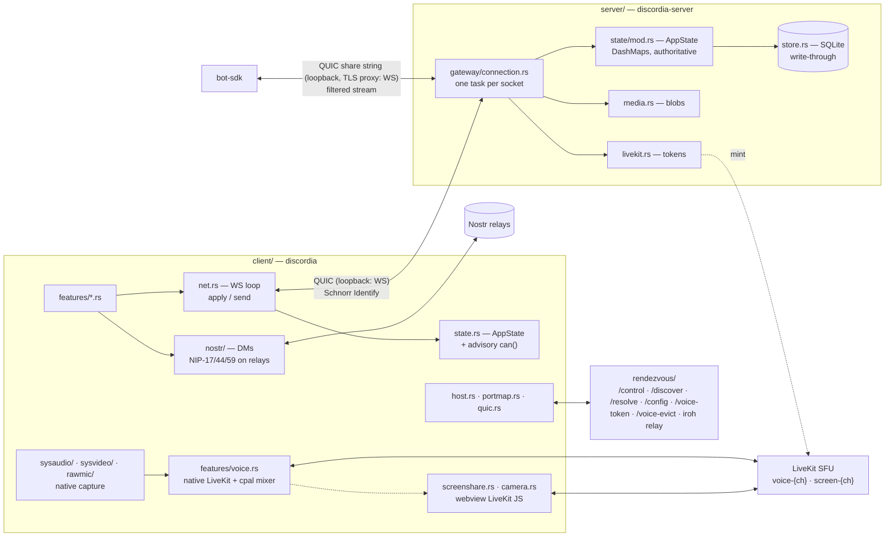

# Map

Where things are, so a reader greps once instead of three times. `CLAUDE.md`
carries what every session needs — the rules and the invariants; this carries
what only some do: where to open, what moves together, how the parts connect. It exists because a handful of files hold most of the tree,
and reading one whole to find one arm is the usual waste.

Symbols, never line numbers, and no hand-kept list that a commit can falsify:
a symbol can be grepped and a number cannot, and this file shipped three stale
numbers and seven miscategorised files before that rule was learned.

## Do not read these whole

15 files hold most of the tree. Opening one to find a single arm costs more
than every other document here put together, so grep the variant or the `fn`
name instead.

| File | Lines |
|---|---|
| `client/src/features/voice.rs` | 5365 |
| `server/src/state/mod.rs` | 3902 |
| `server/tests/owner_controls.rs` | 3456 |
| `server/src/gateway/connection.rs` | 3886 |
| `client/src/features/channels.rs` | 2662 |
| `client/src/features/screenshare.rs` | 3777 |
| `protocol/src/lib.rs` | 3654 |
| `client/src/state.rs` | 3105 |
| `client/src/update.rs` | 1052 |
| `client/src/net.rs` | 2819 |
| `client/src/features/chat.rs` | 3053 |
| `server/src/store.rs` | 1689 |
| `client/src/features/guild_settings.rs` | 1135 |
| `client/src/identity.rs` | 1239 |
| `client/src/features/discord_import.rs` | 1102 |

Everything else is small enough that `wc -l` answers faster than a list here
could stay true. There used to be rows for "under 300" and "300 to 800": they
were wrong about seven files across three review rounds, and being wrong in
that direction says a file is safe to open when it is not.

## Entry points

| To find | Open | At |
|---|---|---|
| Encrypted DM images | `client/src/nostr/dm_image.rs`, `features/dm_images.rs`, `nostr/service.rs`, `nostr/nip17.rs` | 10 MiB image limit, AES-256-GCM before Blossom upload, NIP-17 kind 15 inside existing gift wraps; captions are related kind-14 replies. Durable account-encrypted jobs recover uploads; cancellation markers prevent resurrection. Binary HTTPS requests pin public DNS addresses and bound redirects/downloads. Only accepted conversations load images. Ciphertext cache is bounded/expiring; decoded bytes use shared memory and local no-store assets. The file-server selector is independent of emoji uploads |
| DM edits and deletions | `client/src/nostr/service.rs`, `nostr/nip17.rs`, `state.rs`, `settings.rs` | Encrypted change rumors stay off the gateway. Consecutive local edits advance the prior edit timestamp; replay keeps the newest version. `apply_dm_change` validates recipients and authors, with bounded pre-original candidates keyed by target and author. Tombstones persist; encrypted pending operations recover and retry. Empty emoji tags clear previous mappings |
| Android guild media/history reception | `client/src/net/background_socket.rs`, `server/src/gateway/connection.rs` | The native transport accepts the server's full frame size; its byte queue holds two maximum frames and retains the frame-count cap. Regressions cover media batches above 8 MiB, subsequent chat updates, oversized frames and queue exhaustion. Diagnostic APK: `scripts/build-android.py --gateway-diagnostics` enables payload-free USB traces for admission, native transport and session send/receive (`DISCORDIA_GATEWAY_DIAGNOSTICS=1` at compile time). |
| Stream controls on video | `client/assets/stream-controls.js`, `stream-viewer.css`, `features/screenshare.rs`, `features/stream_viewer.rs`, `scripts/test-stream-controls.cjs` | Tile headers/footers overlay the full video in app, popouts and full screen. Local per-tile timers hide after 2.5 s or pointer leave; keyboard focus and active volume drags retain controls. Touch reveals controls without triggering video actions; explicit focus/mosaic buttons preserve touch navigation. Mutation cleanup cancels timers/listeners, and window blur releases drags |
| Desktop guild rail width | `client/src/features/workspace.rs`, `features/workspace_layout.rs` | One effect switches normal/stream layouts and keeps the left full-height rail at 96 px. Saved stream coordinates and the current layout normalize before merging, including simultaneous viewing/resize changes. Neighboring panels reclaim the width; moved rails retain placement and editing suspends adjustment. A VirtualDom regression covers repeated watch/stop/resize cycles |
| Voice invitation dialog | `client/src/features/voice_invite.rs`, `client/assets/voice-invite.css` | Clear-list modal: channel card, search, avatars, names/key suffixes and per-person send/Open DM actions. Queued means queued, not delivered. The 24-hour expiry appears only in the footer. Long lists scroll within the dialog; short landscape windows scroll the whole dialog |
| XP bar repainting | `client/src/features/channels.rs`, `features/profiles.rs`, `scripts/test-xp-bars.cjs` | Progress uses background-image/background-color longhands (trap 31). The regression uses the pinned Dioxus interpreter in Chromium to preserve the gradient through rename and successive percentage updates |
| Android settings | `client/src/features/settings_mobile.rs`, `features/settings_dialog.rs`, `features/settings_microphone.rs`, `assets/mobile.css`, `scripts/test-mobile-settings.cjs` | Bottom tabs group General, Audio, Video and App. General contains language, notifications and an always-visible Level card; Audio separates microphone from combined playback/sound volumes. App opens Updates before Diagnostics. Video refreshes native cameras on entry, including Home. Browser checks cover touch targets, scrolling, languages and large text |
| Native image transport | `client/src/image_assets.rs`, `features/profiles.rs`, `features/chat.rs`, `client/src/app.rs` | Avatars, banners and chat images use per-window asset URLs instead of repeating base64 in DOM edits. Equal payloads share storage; registrations hold weak references. Decode runs outside the UI thread; artwork keeps its 2 MiB budget and chat supports up to 10 MB. GIF bytes are preserved; expired registrations return 404 |
| Expanded image zoom | `client/src/features/image_viewer.rs`, `client/assets/image-viewer.js`, `image-viewer.css`, `scripts/test-image-viewer.cjs` | Shared desktop/Android viewer supports wheel, pinch, pan, double click/tap, keyboard and 44 px controls at 100–800%. Gestures update transforms locally. Escape, Android Back and background taps close; instance-scoped cleanup protects replacement viewers |
| Speaking indicator visibility | `client/src/state.rs`, `features/channels.rs`, `features/members.rs` | `connected_voice_channel` gates speaking/quality rings to the current connected media channel. Members and channel occupants hide stale rings while disconnected, connecting or in another channel |
| Chat opening and document styles | `client/src/features/chat.rs`, `client/src/features/markup.rs`, `client/src/app.rs`, `scripts/test-chat-scroll.cjs` | Channel/DM changes position the viewport before collecting page measurements, without a Rust round trip; resize/manual history retain the existing scroll policy. Plain lines share one text node, and closed emoji pickers do not copy image payloads. Static styles mount under the memoized `AppHead`, outside reactive dialogs |
| Android tab swipe navigation | `client/src/features/mobile_workspace.rs`, `client/assets/mobile-pager.js`, `client/assets/mobile.css`, `scripts/test-mobile-pager.cjs` | Native horizontal scroll-snap reveals Channels/Chat/Members during touch; Rust receives only preview/settled selection events, not per-frame movement. Chat/Channels retain DOM and scroll; Members mounts only when selected or peeking and is released after cancellation. Tabs, Back, resize, reduced motion and cleanup share the same pager bridge |
| Shared media cache memory | `client/src/media_cache.rs`, `client/src/net.rs` | `EmojiBlobs` shares immutable bytes between LRU entries and queued disk writes. Android uses a 64 MiB payload budget with 32 MiB for pending disk results; desktop uses 128 MiB each. Pending results are also entry bounded and overflow retries through existing requests. Budgets exclude WebView decoded images; tests cover sharing, eviction, release and stalled consumers |
| Android responsiveness and idle rendering | `scripts/measure-android.mjs`, `scripts/measure-android-startup.mjs`, `client/src/features/mobile_workspace.rs`, `client/src/identity.rs`, `scripts/test-globe.mjs`, `client/assets/globe.js`, `client/assets/mobile.css`, `docs/ANDROID_REVIEW.md` | USB CPU/PSS/window/WebView samples, Settings/navigation scenarios and cold/warm startup; both measurement scripts accept `--package com.discordia.app.debug` for the separate Debug install. JSON under `target/android-perf`; debug counters exclude isolated renderers. Mobile Chat/Channels retain DOM, scroll and composer through hidden inert panels; tests check mount/state/cleanup. Active identity load verifies derived pubkey before returning its canonical file; plaintext migration skips encrypted files. Logo/globe stop decorative idle animation while input/focus still repaint. Review records measurements and limits |
| Android chrome and Back navigation | `client/assets/mobile.css`, `client/src/app.rs`, `client/src/features/home.rs`, `client/src/mobile_back.rs`, `client/assets/android-back.js`, `client/android/MainActivity.kt` | Home and workspace headers share rail-aligned 44 px compact logos, safe-area spacing, centered 19 px icons and 44 px controls. Settings occupies the penultimate right-hand slot in both headers. `scripts/test-home-header.cjs` checks shared header geometry, keyboard order and accessible labels with Playwright (`NODE_PATH` can locate an external install; optional `BROWSER_PATH` selects a local browser). Bottom navigation retains its styles. Predictive/legacy Android Back routes through scoped priority handlers: Settings, Social conversation, Social or mobile tabs, then workspace ordered disconnect. Home without an active handler backgrounds the task instead of destroying the activity. `scripts/test-android-back.cjs` covers bridge delivery and stale-page cleanup |
| Android media UI and capture budget | `client/src/features/mobile_workspace.rs`, `client/src/sysvideo/android.rs`, `client/src/sysvideo/mobile_budget.rs`, `client/android/MainActivity.kt`, `vendor/dioxus-desktop/src/protocol.rs`, `vendor/dioxus-desktop/src/android_edits.js` | Media stays above the current guild chat; starting/watching opens it. Hidden panels stop video subscriptions without stopping publishing/audio. Admission precedes I420 conversion; measured cost, thermal status and low memory reduce the capture budget. Android starts at half resolution and up to 30 FPS without changing requested preferences; resolution recovers before sacrificing FPS, after 20 s with valid preparation/encoding costs, capture and encode FPS at least 90% of target and estimated headroom for the next level. Missing or idle counters never authorize an increase. Android publishing is capped at 1080p/30. Equal-stride I420 planes copy in one operation. Capture geometry follows default-display dimensions and MediaProjection content-resize callbacks, preserving the active budget when the source changes orientation; `scripts/test-android-capture.py` checks stale activity bounds and resize behavior after the Android build. Android edit sockets receive authenticated ArrayBuffers without asynchronous Blob conversion; non-headless acknowledgements also use a timer fallback when animation frames are suspended. Bytes apply before acknowledgement, exactly once; native logs retain pending batches and report delayed Android acknowledgements. `net/background_socket.rs` keeps gateway heartbeat/Ping/Pong on Tokio independently of WebView acknowledgements, with bounded buffers and cancellation on teardown. `service_task.rs` registers gateway/media services with `vendor/dioxus-desktop/src/service_tasks.rs`: native polls keep scoped services progressing only after a DOM acknowledgement has stalled for one second, without rendering or running pending DOM effects; fast acknowledgements retain normal initialization. `quic/network_monitor.rs` forwards default-network callbacks to iroh outside the UI executor |
| Release platform selection | `.github/workflows/ci.yml`, `scripts/release-tag.cjs`, `scripts/test-release-tag.cjs`, `docs/OPS.md` | Linux publishes only its server; AppImage packaging is paused while client CI remains enabled. The Linux release job skips desktop/WebRTC tooling. Pushes reserve an exact-commit tag before compilation; superseded queued runs skip publication and reruns reuse matching tags. Publication rechecks that tag and requires seven binaries and seven verified minisign signatures; Windows, macOS, Android and server container builds retain their release paths. |
| Android release publishing | `.github/workflows/ci.yml`, `scripts/build-android.py`, `scripts/sign-android.py`, `scripts/test_android_release.py`, `client/android/webrtc.init.gradle`, `client/android/release-signing.sha256`, `docs/OPS.md` | ARM64 release builds use dx's `android-release` Cargo profile; Gradle finalizes CI version metadata. PRs never use signing secrets. Master signs and verifies the APK certificate, then publishes it with the other minisign-verified release assets. Signing backups stay outside the repository |
| Android platform adapters and packaging | `client/src/android.rs`, `client/src/file_dialog.rs`, `client/android/MainActivity.kt`, `client/android/AndroidManifest.xml`, `client/android/DioxusForegroundService.kt`, `client/src/sysvideo/android.rs`, `client/src/syscamera.rs`, `client/Dioxus.toml`, `client/android/res/`, `scripts/build-android.py`, `docs/MOBILE_PLAN.md` | JNI/Keystore, WebRTC, runtime permissions, clipboard, documents and locale. Kotlin MediaProjection/Camera2 push I420 over JNI into LiveKit. A shared foreground service declares active microphone/camera/projection types and holds a bounded renewable partial wake lock. ActiveVoice owns a scoped BackgroundCall; camera and projection wait for service confirmation (projection after consent). Slot checks prevent stale teardown; stopping one medium preserves others. Variant manifest overlays use singleTask: reopening must reuse the activity because Tao owns one process-wide native context; packaging verifies the compiled launch mode. Picked documents are bounded private temporaries; downloads use ContentResolver. Packaging overlays launcher/splash, copies the service and verifies DEX/JNI/branding. MOBILE_PLAN tracks physical validation |
| Accept DM from guild voice (desktop/Android) | `client/src/voice_handoff.rs`, `features/account.rs`, `features/workspace.rs`, `features/dm_call.rs`, `features/dm_call_tests.rs` | Incoming calls ring without leaving guild voice. Accept enters Switching, waits for WebView/native teardown and server leave confirmation, then accepts the same DM call. Account-owned coordinator uses a scoped workspace route; missing/replaced routes, timeout, remote cancellation and stale completions cannot start a DM. Decline/expiry before acceptance preserve guild voice. During Switching, End call ends only the pending DM and explicitly does not rejoin the departed channel. Outgoing DM calls remain blocked while in guild voice |
| Voice channel DM invitations | `features/voice_invite.rs`, `features/channels.rs`, `features/server_rail.rs`, `features/account.rs`, `features/chat.rs`, `state.rs`, `net.rs` | Active voice row sends Nostr DM invitation cards expiring after 24 hours; new external-member access codes use the same lifetime. Expired messages are removed locally and filtered on live/history insertion; legacy links derive expiry from message time. Visible rows expire on a timer; account cleanup covers offscreen messages. Home and detached Social send connection requests through an account-owned inbox; connected sessions retain rail confirmation. The pending guild/channel/code/expiry resumes at Ready and the matching GuildJoined. In-place joins do not schedule a future guild selection. Codes are used only on the destination, expired pending joins stop, and disconnect clears intent. Hidden channels and sends recheck access/membership |
| Android call notification controls | `client/src/call_notifications.rs`, `features/account.rs`, `features/workspace.rs`, `features/dm_call.rs`, `client/android/DioxusForegroundService.kt`, `MainActivity.kt` | Account-owned native task routes microphone, call audio and hangup actions to guild voice or DM calls without opening the Activity. Explicit immutable service intents carry call/session/state tokens; stale buttons cannot affect a replacement call. Deafen preserves the previous mic state. CallStyle supplies hangup plus two custom actions; camera/projection-only notifications retain media ownership. Packaging verifies the action JNI export |
| Android screen audio | `client/src/sysaudio/android.rs`, `client/src/sysaudio/pcm.rs`, `client/android/DioxusPlaybackCapture.kt`, `client/android/MainActivity.kt`, `features/screenshare.rs`, `features/voice.rs` | API 29+ AudioPlaybackCapture reuses the screen capturer’s MediaProjection after video starts. Media/game/unknown usages exclude this app’s UID; fixed 48 kHz mono PCM packets use the bounded audio queue and existing encrypted screen-audio track. Slot checks protect replacement captures; projection stop also stops its audio. Settings retain the existing share-sound preference. Protected apps can return silence. Packaging verifies the class and JNI exports |
| Interface languages | `client/src/i18n.rs`, `client/locales/messages.json` | English source messages fall back verbatim; catalog columns are Spanish, Brazilian Portuguese, Simplified Chinese and Japanese. `ClientSettings.language` defaults to the OS UI language. `Locale` is a ROOT-owned shared signal, passed to Social and Streams; selectors in identity setup and General settings update it without rebuilding media. Translate interface labels at render, never member messages/names. Built-in activity pages take the launch language and include it in their content hash; external app names remain unchanged. Known legacy errors and connection labels are translated at display; permission failures resolve known wire codes to translated permission names. Unknown external diagnostics remain intact. Rust tests cover settings compatibility, interpolation, activity bundles and cross-window updates; `scripts/test-translations.mjs` checks unique keys, catalog arguments, literal labels including direct match arms, both plural forms and built-in scripts |
| Stream decoder diagnostics | `client/src/features/channels.rs`, `features/screen_stats.rs` | Incoming screen statistics label recognized decoder implementations as GPU/hardware or CPU/software, retaining the implementation name. Missing or ambiguous names remain unknown; browser power-efficiency flags alone do not prove hardware decoding. Receiver diagnostics expose per-sample decode cost, decoder/display drops, loss, freezes, buffering and frame assembly; stale intervals and replacement views cannot inherit rates. |
| Voice connection diagnostics | `client/src/connection_routes.rs`, `features/channels.rs`, `features/voice_menu.rs`, `features/voice_network.rs`, `client/assets/voice-tooltip.js` | Speaking rings stay green. `VoiceQualitySignal` appears only in voice-channel occupant rows, scoped to the connected voice channel. Member rows omit signal/speaker icons and voice-channel names; mute/deafen badges remain. Separate signal icons show server-reported quality. Hover and context-menu diagnostics label RTT as the local client's ping to the SFU, never the participant's ping. Outbound loss requires feedback matching the current microphone's local ID and SSRC; missing feedback stays unknown. `VoiceSignal` keeps its SVG in a leaf so quality updates cannot erase an open tooltip; its VDOM regression covers hover, icon replacement and removal. Hover diagnostics use a manual native popover in the browser top layer to escape channel clipping and guild-rail stacking; placement tracks scrolling, resizing and text changes within viewport bounds. Observers/listeners stop on removal; `scripts/test-voice-tooltip.cjs` checks clipping, overlap, long text and cleanup at mobile/desktop widths. |
| Moderator voice moves | `protocol/src/lib.rs`, `client/src/features/channels.rs`, `features/voice_drag.rs`, `client/assets/voice-drag.js`, `voice-drag.css`, `server/src/state/mod.rs`, `server/src/gateway/connection.rs` | Owners and roles with `MoveMembers` drag occupants directly onto voice channels; the context menu has no move selector. Native pointer tracking captures the gesture after a movement threshold, uses hit testing at drop, shows a floating name and destination highlight, and scrolls the list near its edges. Short clicks still open profiles. Escape, cancellation, blur and unmount clean up the gesture/listeners. Rust rechecks the current source and permission before sending `MoveVoice`; the server validates moderation, visibility, guild and live voice ownership under its lock. Moves preserve mute/deafen, clear camera/share, evict the old room and grant only the owning connection. `scripts/test-voice-drag.cjs` exercises real mouse gestures; Rust tests cover source markup/permissions and `server/tests/voice_move.rs` covers gateway delivery. |
| Game image in the profile popup | `client/src/presence/artwork.rs`, `features/profiles.rs` | Xbox GDK/package logos and Steam library cache (legacy and per-app hashed layouts) take priority over executable icon resources, which can be generic. `xbox.rs` reads bounded local manifests; `detect.rs` caches hits/misses, retries every 5 min. `Activity.image` carries a 64 px PNG; missing art uses a game symbol, with no remote image fetch |
| Animated profile/community images | `client/src/image_edit.rs`, `features/image_editor.rs` | Originals are capped at 8,000,000 bytes for profile/community avatars and 10,000,000 for banners; the picker and decoder share shape-specific limits. The crop viewport uses touch/mouse pointer capture and a square avatar guide on Android and desktop; only cancellation/lost capture from the active pointer ends dragging. A component test exercises both input types and verifies opaque square exports. `crop_image` reuses fitting unchanged GIFs; cropped exports stream frames without retaining the whole decoded animation, avoid upscaling and reduce resolution to fit 2 MiB, preserving frames, timing and repeat count. The shared `MAX_IMAGE_BYTES` caps profile/community artwork and default DM/sticker uploads at 2,097,152 bytes; community chat images use the guild file policy. Bounded decode/output cover avatars, banners and guild images; chat/stickers retain original bytes, emojis have a separate 256 KB cap |
| Community upload size policy | `protocol/src/lib.rs`, `client/src/chat_image.rs`, `features/chat.rs`, `features/chat_tools.rs`, `server/src/media.rs`, `server/src/state/chat_tools.rs`, `server/src/state/mod.rs`, `server/src/gateway/connection.rs`, `server/src/sanitize.rs` | `FilePolicy` defaults to 2,000,000 bytes; ManageGuild may raise it to `MAX_GUILD_UPLOAD_BYTES` (10,000,000). Picker, clipboard encoding, server validation/storage, frame envelope, downloads and archive sanitization share that ceiling. Profiles/stickers/DMs retain their separate 2 MiB limit. Existing large downloads remain available after lowering the upload policy. Server tests cover default, exact maximum, excess, permissions and transport |
| Chat files, stickers, pins and search | `client/src/features/chat.rs`, `client/src/features/chat_tools.rs`, `server/src/state/chat_tools.rs` | `Composer`'s **+** offers Image (preview) or File (download); a picked file is held like a pending image and sent with the typed text as `SendFile`, the draft kept until `FileUploadResult` answers. `FileAttachment` renders a responsive card with an extension badge, filename, size, expiry, Download button and inline failures; `.dxf-file-*` styles live in `app.rs`. `ChatTools` is the chat header's right-hand icons — search (author/date/text/attachment filters), pins and, for Manage guild, file limits — each opening one popover under the header. `StickerPicker` sits to the right of the composer emoji button and opens above the input, retaining guild sticker management. File uploads require a correlated acknowledgement; download is explicit and opens only the destination folder, never the file. `FilePolicy` defaults to 2 MB / 7 days; Manage guild can select up to 10 MB or change expiry; profiles and other artwork remain limited to 2 MiB, including reused media addresses |
| File expiration and host storage | `server/src/store.rs`, `server/src/media.rs`, `server/tests/chat_tools.rs` | Human members upload/download files without a special role, matching normal chat access; read-only channels, slowmode, visibility, membership and file policy still gate uploads. Attachments retain metadata after expiry. `live_file_channels` gates download by membership, visibility and expiry; `sweep_files` reclaims unreferenced `.bin` blobs every minute under `durable_writes`. Windows marks stored and saved files as Internet downloads; no malware scanner |
| Chat tools with older hosts | `protocol::ServerMessage::Ready`, `client/src/net.rs`, `features/chat.rs` | `Ready.chat_tools` defaults to false for legacy hosts. User connections advertise support; the client mounts tools and enables file/pin actions only when supported, preventing unknown-command errors on text or voice channel entry |
| What a `ServerMessage` does to the client | `client/src/net.rs` | `fn apply` — one arm per variant, exhaustive |
| Image attachment metadata | `protocol::ImageMetadata`, `server/src/media.rs`, `server/src/store.rs`, `client/src/features/chat.rs` | Optional metadata preserves a sanitized file basename and server-read dimensions through storage, history and search. Clipboard images have no original name; formats without a supported header reader retain the name with absent dimensions |
| What the server does with a `ClientMessage` | `server/src/gateway/connection.rs` | `handle_connection`, then ~50 `ClientMessage::` arms |
| Every wire type | `protocol/src/lib.rs` | grep the variant name; ~70 of them |
| Starting a server or rendezvous: flags, config file, `setup` | `server/src/bin/discordia-server/`, `rendezvous/src/run.rs`, `site/public/install.sh` | `ServerOptions` (`options.rs`) and `run::Options` are each one struct that is the clap flags, their variables and the TOML table, merged by `or` (flag > env > file); `drop_empty_env` runs before parsing because compose passes `${VAR:-}`. `serve.rs` is the old `main`; `share` prints the `quic://` string from `quic-secret` without minting one. `publish.rs` registers on each `publish_to` rendezvous as a `HostKey` derived from `quic-secret`, through `server/src/rendezvous.rs` — the host side of `/control` (`register`, `maintain`, `Signer`), shared with the desktop host, whose `client/src/rendezvous.rs` only makes `Identity` a `Signer`. `setup/` turns `Answers` into `Step`s (`native.rs` systemd, `docker.rs` compose) that `--dry-run` prints; `config_for` is the one place a role becomes config, and a rerun starts from the existing file so keys setup does not manage survive. The `cli` feature (default) gates the binary; the client embeds the library without it |
| Server state mutation + permissions | `server/src/state/mod.rs` | `durable_writes` stages serialized commands; `durable` rejects failed writes before memory changes; Store handles compound transactions |
| Client state + advisory `can()` | `client/src/state.rs` | `AppState`, `use_app_state`, `use_gateway` |
| Selective member/profile updates | `client/src/features/members.rs`, `features/profiles.rs`, `client/src/media_cache.rs`, `assets/activity-clock.js` | `MemberSources` compares metadata/voice/subtitle domains before notifying row selectors; roster input gates sorting. Avatars/banners share immutable cached bytes through `MediaCache::get_shared`. `ProfileActivity` isolates game changes; elapsed clocks update only their text while focused and visible, with no timer after the last card closes. Canonical `AppState` stays current; domain selectors still compare after state writes |
| UI update benchmarks | `client/src/features/ui_update_bench.rs`, `scripts/measure-ui-memory.py`, `scripts/test-activity-clock.mjs` | Ignored `benchmark_selective_ui`: 200 online members with cached avatars, 200 message/speaking/game-detail changes, seven samples; VirtualDom duration, process CPU time (Windows) and DOM edits, excluding WebView paint. `benchmark_ram_ui` exposes mounted/finished stages; the Windows collector runs fresh processes and records working set/private commit and peaks. Focused tests cover selective rows, image arrival and clock suspension |
| DMs end to end | `client/src/nostr/service.rs`, `nostr/delivery.rs` | `spawn_nostr`; `Routes::ready_at` skips the two-second discovery wait for known kind-10050 inboxes. Pending encrypted wraps survive restart, retries reuse event ids; relay acceptance is not a read receipt (a check mark, not a line of text); `Senders` keeps one socket per recipient relay for the account. Ignored `measure_encrypted_dm_publication_latency` measures local crypto/queue/relay stages, excluding disk, UI and Internet |
| Nostr connection recovery | `client/src/nostr/relay.rs`, `android.rs`, `dm_notifications.rs` | Android resume/network callbacks, including access unblocking without a network change, coalesce refreshes without WebView polling; every pool cancels stale sockets, dials or backoff and reissues its subscriptions. Writes time out after 5 s; transport heartbeat runs every 30 s with a 15 s response deadline. Pool ownership stops recovery tasks. Local socket tests cover refresh, backoff interruption and stalled peers; `scripts/test-android-network.py` executes the actual Kotlin callback registration and checks blocked/unblocked transitions |
| DM call history | `client/src/nostr/call_history.rs`, `nostr/service.rs`, `features/dm_call.rs`, `features/chat.rs` | Durable NIP-17 kind 14 records carry encrypted `discordia-call` metadata; the caller attests an attempt/missed outcome, the callee answers/declines/reports busy. One row per caller + call id; terminal outcomes arriving first wait for caller confirmation (128 unconfirmed entries maximum). Accepted calls override late missed outcomes across devices; acceptance does not prove media connected. Unfinished attempts expire after 45 s through a one-shot deadline, without idle polling. The encrypted outbox uses independent event IDs per outcome, retries with bounded backoff and recovers after reconnect/restart. Chat renders a system card with Call back; older clients show bracketed fallback text. Android push after process death remains #384 |
| Android DM notifications, process alive | `client/src/dm_notifications.rs`, `client/android/DioxusDmNotifications.kt`, `features/account.rs`, `features/settings_dialog.rs` | Explicit opt-in and Android permission; permission/settings callbacks finish the visible waiting state without polling. Fresh deduplicated Nostr inbox messages post a generic native alert in background, never the DM body. Foreground retains in-app sounds. Visibility prevents marking a background chat read; taps select the matching account's inbox DM without ending voice. Channel/packaging/JNI are checked; push after process death is tracked by issue #384 |
| Windows tray notifications | `client/src/windows_notifications.rs`, `client/src/dm_notifications.rs`, `features/dm_call.rs`, `features/settings_dialog.rs` | Native WinRT toast alerts for incoming calls and DMs when Discordia is minimized or hidden in the system tray. Settings toggle defaults to enabled. `windows_notifications/identity.rs` registers the Start-menu shortcut AUMID at startup and via the installer's `--register-notifications` helper before single-instance acquisition. Existing targets and arguments are preserved; shortcuts for another executable are not retargeted. DM notifications never expose message content, and toast activation restores and focuses the window into the corresponding inbox chat. Incoming call alerts hide automatically on answer, decline or drop |
| DM ICE discovery | `client/src/features/dm_call.rs`, `features/dm_call_tests.rs` | `local_description` waits up to 10 s for gathering, then tries collected candidates rather than cancelling a reachable call because STUN is unresponsive. Empty candidate sets fail explicitly; incomplete gathering never reports end-of-candidates. Regression exchanges audible Opus both ways with a silent local STUN endpoint |
| Account lifetime | `client/src/features/account.rs` | `AccountView` owns shared state, Nostr and call alerts across Home/server changes; `clear_server_session` removes guild data while preserving DMs, calls and audio preferences. Joining or hosting a server leaves DM calls active; joining guild voice still requires ending the call |
| Private DM voice calls | `client/src/features/dm_call.rs`, `features/voice_direct.rs`, `nostr/calls.rs` | `spawn_service` owns consent, device selection, deadlines and native WebRTC; `voice::direct::Audio` reuses microphone DSP and playback. Call freshness uses the learned sender clock offset bounded to 5 min, with a 60 s future tolerance matching DM clock learning; relay expiration includes skew allowance while the inner TTL stays 60 s. Rejected signals log their reason and clock offset. Separate, expiring NIP-59 call signals never enter chat history or its durable outbox; publication waits for each recipient relay and retries once with the same event ID. Cancelled IDs suppress delayed invitations, including cancellations received during another call. Incoming calls require a contact or existing DM, never a request (`DmStanding::Inbox`); guild voice and DM calls are mutually exclusive. `dm_call_tests.rs` covers state transitions and actual decoded peer audio, including level preservation within 2 dB. Call controls expose independent microphone and contact volumes; mic gain is applied after AGC and shares the saved microphone preference. Tests measure DSP and playback output at 50/100/200%, including mute/deafen. DM input/bypass changes reopen only capture and retain the published track; output changes reopen playback and voice quality updates the RTP sender; failed opens disable transmission, display a persistent warning and retry every 2 s. Changing input bypasses the retry wait; device tests verify new DSP frames. Settings meters include connected DM calls. Native DM audio logs pre/processed mic levels, settings and playback gain every 5 s while active |
| Social window | `client/src/features/social_window.rs`, `features/home.rs` | Desktop Home opens or focuses one native Social window with shared state, settings and the existing Nostr sender. Android opens Social inside Home's activity WebView: list and conversation are separate views with back/close controls, and only the visible conversation marks the DM pane open. Contacts and inline call controls occupy the desktop left column; chat keeps its full-height composer on the right. Closing Social keeps calls active; leaving Home closes the desktop window and server views dock call controls below the DM/channel list with bounded scrolling, leaving chat and members unobstructed. `CallAlert` belongs to the account owner, so opening Social does not repeat incoming-call sounds. Its shared `AppState` is ROOT-owned and dropped with the account (trap 32) |
| Microphone test | `client/src/features/voice_mic_test.rs`, `features/voice_mic_setup.rs`, `features/settings_mic_status.rs`, `features/settings_dialog.rs` | Microphone tab offers local playback and a meter without joining voice; reuses capture, DSP and output selection. Capture waits for background DSP preparation in channel calls, DMs and local monitoring. Adjustments apply live; device/bypass changes restart capture. Closing settings, leaving the tab or starting a call stops the test; testing is disabled during calls. The shared status card reports actual opened devices (including Windows raw capture), mute/deafen/zero-volume/device errors and sustained high input/output peaks; silence stays neutral. Device and volume actions focus their controls. Calibration rejections offer another adjustment instead of reporting device loss; raw input levels remain visible while recording. Recorded comparisons refill up to one second ahead from queue depth and bypass recovery, preserving PCM through scheduler jitter |
| Voice and audio settings | `client/src/features/settings_microphone.rs`, `features/settings_audio.rs`, `features/settings_dialog.rs` | One tab owns input/output selection, profiles, the local test, microphone volume and quality; advanced DSP expands below and app/soundboard sliders start expanded. The status card reserves its space and replaces its primary action with the applicable remedy. Output changes invalidate device-bound calibration; guided adjustment locks device, DSP and sound controls |
| Microphone profiles and calibration | `client/src/mic_profile.rs`, `features/settings_microphone.rs`, `features/voice_calibration.rs`, `features/voice_mic_setup.rs`, `docs/VOICE_PROFILES.md` | Natural/balanced/noisy/custom presets share one coherent DSP configuration across guild/DM/local tests. A 15 s local capture (1.5 s quiet, 6 s normal reading, 6 s soft reading, 1.5 s quiet) compares production DSP candidates and offers current/recommended playback before Apply; cancel/device changes discard drafts. Versioned calibrations are bounded and tied to device/backend/output context; legacy preferences remain Custom. Leaving Custom saves a separate persisted mic_custom_config; selecting Custom restores it across preset switches and restarts. PCM stays in memory. Gain uses voiced normal-speech frames so pauses do not reject an otherwise usable capture; capture failures remain distinct from unusable adjustment samples. Noisy-room suggestions retain suppression and a safe gate; gain and final audible noise are bounded against current output. Strong unclipped inputs may use volumes below 50%. Unsafe gates, unmeasurable soft speech or no improvement retain existing settings and hide Apply |
| Microphone noise suppression | `client/src/denoise.rs`, `features/voice_dsp.rs`, `features/settings_microphone.rs` | One suppressor at a time, none while muted. RNNoise is the sole suppressor and pauses after 100 net hops over 6 ms; the meter carries it to `AppState::denoise_fallback`, the Microphone tab says so, and its Retry (or toggling noise cancellation) bumps `denoise_retry`, which the capture loop reads to rebuild the denoiser. Strength blends filtered output with the previous original hop, preserving its 10 ms alignment and saved 6–60 dB settings. Mute and zero gain clear retained filter audio. A separate RNNoise `Vad` scores the post-echo hop; it is recorded as `speech=` and optionally drives voice activation. `features/voice_activity.rs` provides confidence/level hysteresis, bounded 30 ms lead-in with original capture stamps and privacy/device resets; legacy settings keep level-only gating. Settings and mute erase retained sound without dropping its capture time; disabling voice detection flushes retained silence. Calibration also uses probability as supporting evidence, with noise/gain and normal/soft-output checks preserved |
| Microphone gain and saturation | `client/src/agc.rs`, `features/voice_dsp.rs`, `vendor/webrtc-sys/src/apm.cpp` | libwebrtc's AGC2 (adaptive digital, its own voice detector) in a second APM after noise suppression, fed every hop: it sets one gain per speaker, moving at most 6 dB/s, and holds it through pauses. Guild calls, DMs and local microphone tests share the processor. `agc_gain_db` in the call recording is measured out/in, since AGC2 does not report its gain. Manual microphone volume follows AGC, then `agc::Limiter` holds a 0.98 peak ceiling per sample — instant attack, 50 ms release, state carried across hops in `Processor` — because one gain per hop stepped a hundred times a second on loud speech; tests cover 50/100/200% gain, gain continuity at hop boundaries, recovery after peaks and individually safe microphones still needing the final mix limiter. Speech tests use `agc::tests::speech`, because AGC2 ignores tones |
| Native echo cancellation | `client/src/echo.rs`, `features/voice_dsp.rs` | `Reference` resamples actual mixed playback into bounded 10 ms frames; configured echo/high-pass runs before denoise, gate detection, AGC, manual trim and limiter. Natural with headphones bypasses echo, high-pass and the activity gate; mute and zero volume still suppress output |
| Poor voice connections | `client/src/features/voice_network.rs`, `voice_network_tests.rs` | Loss never lowers the voice bitrate: Opus FEC and resends repair it, and a lower bitrate sends as many packets. Mono Opus is `VoiceAudioEncoder` (`vendor/webrtc-sys/src/voice_audio_encoder.cpp`), which always tells Opus to expect 30% loss, so FEC rides in every packet after speech from the first one; libwebrtc's own encoder smooths measured loss and caps it at 20%. Stereo stream audio keeps libwebrtc's encoder. The saved bitrate applies live through `set_max_bitrate`. Uplink loss of 5% or more caps native screen/camera bitrate for 20 s (`voice_uplink_congested`). Recent loss/discard counts/concealment use a 5 s window; NetEq discards include unused RED blocks, so never divide them by RTP packets to infer voice loss. Lifetime loss stays in a tooltip and concealment events remain cumulative. Silent concealment is excluded from the recent speech percentage; unavailable stats retain a labelled row. Server quality combines sent/received tracks and does not identify the failing direction. Closed gates feed digital silence to the direct audio source, preserving its clock; mute still feeds digital silence while the published track uses DTX. `voice loss:` log lines give the negotiated codec, loss, FEC, NACK and jitter-buffer figures on both ends of a lossy call. Ignored `a_live_sender_negotiates_fec_and_takes_a_new_ceiling_without_reconnecting` starts the bundled SFU |
| Recording a call to debug its level | `client/src/voice_record.rs`, `voice_record/playback.rs`, `voice_record/microphone.rs`, `settings_dialog::CallRecording`, `denoise_gate_loop`, `consume_remote_track`, `voice_network::spawn_stats_task` | Diagnostics → *Record calls*, never saved, writes `<config dir>/voice-recordings/<local time>/`. Sinks join the current recording mid-call. Microphone stages and correlation are in `docs/AUDIO_DIAGNOSTICS.md`: raw capture, processed DSP and WebRTC-accepted audio have separate files, capture indices, outcomes and loss counters. Waveform/position rows share a writer operation; fixed capture blocks leave recording/session work off the callback. `mic-dsp.csv` holds processing levels and settings. `recv-<who>-<kind>` is NetEq output before mixing; arrival gaps reset per recording; `rebuffered_samples` counts intentional recovery holds separately from starvation. `playback-mix`/`playback-out` are float32 WAVs at the output device rate, preserving overload before the limiter and actual output after it (including its 5 ms delay). `playback.csv` holds sample offsets, limiter reduction, callback gaps/frames, mixer lock wait, minimum queue depth, cumulative starvation and diagnostic drops; use offsets to detect missing recorded blocks. Device reopens create suffixed files. Playback files open through one queue operation to avoid partial opens under backpressure. Fixed blocks cross a bounded callback queue; allocation and session/file access run on workers. `net-*.csv` counters are cumulative; absent in DMs |
| Microphone and activity defaults | `client/src/settings.rs`, `features/account.rs` | AGC, noise cancellation, system processing bypass, game activity sharing and detection start enabled; Discord Rich Presence is unavailable on Windows. Missing saved fields use platform defaults, explicit disabled preferences remain disabled. System bypass is applied only on supported platforms |
| Voice preferences on entry | `VoiceSession::join_message`, `net::apply`, `server::state::set_voice_channel` | Optional `JoinVoice.preferences` applies mute/deafen before the first broadcast; the client corrects legacy join echoes without briefly enabling audio |
| Native voice regression tests | `client/src/features/voice_audio_tests.rs`, `voice_speech_tests.rs` | Gain, mute, deafen, room-tone AGC, buffering and resampling; opt-in human speech through the production worker exports WAV comparisons with noise and double talk |
| Native sample-rate conversion | `client/src/features/voice.rs`, `features/resampler_tests.rs`, `client/src/sound_decode.rs` | `AudioResampler` uses Rubato 5 fixed-input FFT and borrowed mono adapters at capture/playback/file boundaries; equal rates bypass conversion. Tests compare samples, counts and delay to test-only Rubato 0.16.2 and verify partial-input accumulation and warmed buffer capacities |
| Stream playback volume | `stream_audio::playback_gains`, `ScreenShareBridge`, `AudioControls::sync_stream_gains`, `features/voice_subscriptions.rs` | Watch-level volume/mute/deafen drives native and WebView audio even with every tile detached. Native rooms opt out of automatic subscriptions; a watch channel updates stream audio immediately while voice/soundboard subscriptions remain independent. Gains refresh before output and every service tick; volume commands use current state without first writing their stale gain. Unsubscribe cancels decoding and drops its mixer queue (bounded to 200 ms while active). WebView subscribes only selected inline/detached audio and detaches its output at zero gain; muted watches retain audio availability for unmuting. Viewer-only rooms stay silent. WebView output changes restore the default sink explicitly, reject stale device lookups and serialize pending sink applications per track. `scripts/test-stream-audio.mjs` covers selection/stop/mute/fallback; `bundled_sfu_preserves_screen_audio_source` checks opt-in, stop, resume, source and decoded-tone startup timings (ignored; real SFU) |
| Voice, capture, mixing | `client/src/features/voice.rs`, `features/voice_activity.rs`, `features/voice_playback_recovery.rs`, `client/src/playback_limiter.rs` | A remote track is resampled by `AudioResampler::adaptive` whatever the device rate, and `voice_drift.rs` nudges its ratio (±1 %, dead band, integral term) to hold the mixer queue at 40 ms: the device clock and libwebrtc's playout clock differ by parts per thousand, and dropping or repeating single samples to hide that wobbled the pitch. Past the 200 ms cap the queue is cut once to the target with a 10 ms crossfade. A live voice/stream track that empties mid-stream waits for a 25 ms reserve, capped at 25 ms holding available audio, and fades in over 5 ms on resume. After 80 ms with no queued audio, the next utterance starts immediately. Your own soundboard track and buffered clips bypass recovery (a remote one rebuilds like voice); an output-rate change clears queued PCM and recovery under the mixer lock once the stream has started, so a failed open leaves the queue alone; producer blocks carry their conversion rate and stale-rate pushes are rejected. `next_playback_sample` sums voice, stream and soundboard gains without clipping. Both output formats run the final mix through a sample-peak limiter: 5 ms lookahead, 0.5 ms attack, 100 ms recovery, rebuilt at the actual device rate. Echo reference uses the limited output; audio below full scale stays unchanged apart from the delay. Tests cover overlap, gain, rates, recovery and float/i16 output. For capture grep `ScreenAudioRoom`, `NativeVideoRoom`, `ScreenVideoRoom`, `forward_mic` |
| Audio RED under E2EE | `vendor/livekit/src/rtc_engine/rtc_session.rs`, `vendor/livekit/src/room/participant/local_participant.rs` | A track published without an explicit `red: false` offers opus+RED, so the publisher sends the redundant copy itself and the SFU forwards it rather than synthesizing one (which it cannot do over encrypted frames). E2EE no longer turns RED off, so guild voice keeps the loss resilience plain voice and DM calls have. `audio_red_survives_end_to_end_encryption` (ignored) starts a bundled SFU and checks the encrypted wire carries the extra bytes |
| Native track teardown errors | `vendor/webrtc-sys/src/peer_connection.rs`, `src/peer_connection.cpp`, `include/livekit/peer_connection.h`, `client/src/features/native_teardown.rs` | Removing tracks returns a structured `RtcError` across CXX; the Rust wrapper preserves libwebrtc's `what()` error format without the C++ exception-string callback. Real peer-connection tests cover removal after close and concurrent close/removal |
| The first screen | `client/src/features/home.rs` | `HomeView`; Windows leaves branding to the native title bar. The gear opens Settings (rightmost on desktop, penultimate on mobile); the bottom-right footer shows only the version. The centered connection panel fills available width up to 705.6 px; the form is `connect::ConnectForm` |
| Public servers on a globe | `client/src/features/globe.rs` | `Globe` — `globe_geometry.rs` generates land dots from `assets/globe-land.bin` and converts geographic coordinates; `assets/globe.js` draws Canvas on demand, animating only for motion/pulses, suspending while hidden and releasing observers/listeners on destroy; `connect::BrowseTab` feeds it every saved rendezvous's `/discover`, merged, under the host list (scrolls past six rows; a pin scrolls its row into view), and the Create tab reuses it in `pick` mode to place a host's own pin, pre-placed by `tzgeo::guess` from the machine's timezone |
| Experience, and the two numbers it makes | `server/src/state/mod.rs` | `award_xp` — amount, cooldown, channels and rank names all come from the guild's `Leveling`. `adjust_xp` is the hand-made change (`AdjustXp`: `XpChange::Set`/`Add`, added server-side, floored at 0, refused for a bot), under `ManageXp`. The cross-server sum is the client's: `client/src/xp_ledger.rs` adds it up, `nostr/xp.rs` signs and paces it (`Publisher`), `features/leveling.rs` joins the two, and its `progress` is the bar: toward the next rank, or the built-in level when the guild names none |
| What a guild calls its ranks, and who may say | `client/src/features/guild_leveling.rs` | `LevelingEditor` — the draft is the settings dialog's, so it saves with everything else. A `LevelTier` has a name, colour and a required emoji (a character or `:code:`, picked with `channels::TopicEmojiPicker`; `sanitize_leveling` fills `DEFAULT_TIER_EMOJI` when blank) |
| DM peer profile panel | `client/src/features/members.rs`, `features/profiles.rs`, `features/guilds.rs`, `features/mobile_workspace.rs`, `client/src/state.rs` | `MembersPanel` mounts the embedded `ProfileCard` in DM mode, retaining the same panel slot and omitting guild ranks/roles. `preferred_dm` preserves an explicit DM or chooses the newest inbox conversation. Mobile preselection retains the list view and labels the member tab Profile. Guild rosters remain unchanged |
| How ranks show | `client/src/features/members.rs`, `client/src/features/chat.rs`, `client/src/state.rs` | A member row draws no rank, only a right-hand `LvN` below every rank; `MemberSort::Rank` groups online members under `group_by_rank` headers (emoji and name), highest first. In chat, `rank_of` paints a ranked author's name in the rank's colour (else `signature_accent`) and puts the rank emoji after it, the rank's name in a `features::tooltip::Tooltip` (instant, styled; never the browser's `title`), the picture's own `:code:` title dropped by `EmojiText { untitled }`. The key-verified ✓ is drawn only in the profile card |
| Profile and chat image selection | `client/src/file_dialog.rs`, `features/profiles.rs`, `features/chat.rs`, `client/android/MainActivity.kt` | Avatar/banner and chat Image buttons use the native document picker. Android temporary documents live until reading finishes. Profile reads are bounded and detect MIME from bytes; a shared avatar/banner generation discards stale picker/read successes and errors. Closing, reopening, saving, removing or cancelling invalidates pending profile selections. Chat keeps its byte/pixel/upload limits and composer generation guard. Cancellation preserves the saved draft and never sends automatically |
| Home account avatar | `client/src/profile.rs`, `features/account.rs`, `features/home.rs`, `features/profiles.rs`, `assets/mobile.css` | The account button prefers the personal cached avatar over server/guild images. When a device has only the server's global avatar, resolved bytes recover a missing local avatar without changing metadata timestamps, publishing an edit, replacing an existing personal image or undoing a newer deletion. The copy survives leaving the server and restarting. Android's avatar button matches the 44 px workspace exit button and aligns to its center; its image fills the bordered slot |
| Account names | `client/src/features/account.rs`, `client/src/profile.rs`, `client/src/nostr/profile.rs`, `client/src/nostr/service.rs`, `server/src/gateway/connection.rs`, `server/src/state/mod.rs` | The key file's name has no edit time, so devices sync it through the synced profile: a rename (`RenameAccount`) stamps `LocalProfile::name` and publishes it, and `AccountView` applies a newer one adopted from another device through the unstamped `on_rename`. Kind 0 waits for every relay's replay (`OwnName`, `newest_name`) so a stale device cannot republish its old name. Account name changes reach the existing Nostr service without restarting calls and publish newer signed kind-0 metadata. Local self/roster labels update together. Human Identify refreshes every persisted community membership before Ready and MemberJoin; bot install names remain unchanged. Shared-server roster names keep precedence over Nostr metadata |
| Owner permissions and self roles | `client/src/features/members.rs`, `client/src/state.rs`, `server/src/state/mod.rs`, `server/tests/owner_controls.rs` | Guild ownership grants every permission independently of assigned roles. The owner can edit their own roles from the member menu; self kick/ban/disconnect stay hidden. Only the owner sees "Adjust XP…" there (`can_adjust_xp`, `XpAdjust`: Add, negative removes, or Set), though the server still accepts `AdjustXp` from any `ManageXp` holder. A role named Leader grants only its configured permissions. Server tests cover full-permission self assignment/removal and existing escalation protections |
| Owner and operator badges | `client/src/features/members.rs`, `features/profiles.rs`, `server/src/state/mod.rs` | `MemberRow` draws a crown for the guild's `owner_pubkey` and a blue screen for `Profile::operator`, which only `shown_profile` sets: false under `hide_operator`, so a hidden operator is not one on the wire. `profiles_snapshot` adds a stub for an operator who connected but never saved a profile. `hide_guild_owner` hides only the crown; `owner_pubkey` is still sent. `ProfileEditor` shows each toggle only to an owner or operator; `LocalProfile` carries both to every server |
| A profile on a second device | `client/src/profile.rs`, `client/src/nostr/profile.rs`, `nostr/service.rs`, `nostr/relay.rs`, `server/src/state/mod.rs` | Account caches live at `profiles/<pubkey>.json`, written atomically; startup moves legacy `profile.json` to the signed-in account once and archives the original. The cache goes to every server on connect, stamped `updated_at`; startup and Nostr updates reuse the destination server's avatar/banner references only when their SHA-256 matches the local image bytes, avoiding repeated bulk uploads on slow connections; `set_profile`/`newer_profile` reject stale edits. Saving publishes kind 30078 `discordia:profile`, NIP-44 encrypted to ourselves, pictures by hash on `emoji_blob_server` (`Picture::Unshared` when off or failed; an unreachable blob keeps the current picture while the rest is adopted). Only EOSE for `SUB_DM` completes profile/history replay. `AccountView` loads shared `profile::Pictures` into `AppState::account_pictures` before Home mounts; editor saves and Nostr adoption update it reactively, and server teardown preserves it. `Avatar`/`ProfileBanner` fall back to these account-owned pictures only when no server profile exists. `IdentityCard` reuses `Avatar`. `adopt_profile` also bumps `AppState::profile_synced_at`, which `WorkspaceView` sends to the connected server |
| Channel dividers | `client/src/features/channels.rs`, `server/src/state/mod.rs` | One list in `position` order, every kind dragged among every other; `Category` (a former voice-list divider) is drawn as a `Divider` (`ChannelKind::is_divider`). Each takes no messages, no call and no topic, and draws its name via `DividerLabel` per `Channel::divider`: `Title` (name, then a rule) or `Centered` (name inside the rule). `UpdateChannel { divider: None }` keeps the style |
| What someone is playing, and who says so | `client/src/presence/mod.rs` | `PresenceService` owns RPC tasks and `ScanWorker`; `detect.rs` scans every 15 s and observes custom-game edits without restarting. `processes.rs` uses ToolHelp and limited queries on Windows, sysinfo elsewhere. `installed.rs` caches Steam manifests (all platforms), Epic manifests and Ubisoft registry entries (Windows), refreshing every 5 min; helpers/tools are excluded. `ipc.rs::listen` owns connected games; Windows binds only private RPC names. Session teardown cancels listeners and wakes the scanner |
| Registering additional games | `client/src/features/settings_dialog.rs` | Activity tab shows the published activity and `GameDetectionOverrides`; executable/name pairs persist in `detect_extra`, override the fallback catalogue and update an enabled detector on its next scan |
| Guild settings, and what its one Save writes | `client/src/features/guild_settings.rs` | `GuildSettingsDialog` — every field is a draft signal; `save_all` sends only the messages whose values moved. `GuildTab` only chooses which drafts are on screen, so one Save covers every tab. Tabs follow permissions: the guild menu's Roles entry opens it on `GuildTab::Roles` (`roles::RolesEditor`, which saves per role) for someone with Manage roles alone. The member-list order is a `Leveling` field but is chosen on the Roles tab and saves at once; `AppState::members_of` sorts by it and `members::group_by_top_role` draws a heading per role. A role's `position` only orders display — `ReorderRoles` grants nothing |
| The settings dialog | `client/src/features/settings_dialog.rs`, `settings_microphone.rs`, `client/assets/settings.css` | `SETTINGS_TABS` + `SettingsTab`; 920 × 660 responsive dialog with a fixed sidebar and scrolling content. Audio owns output/app sounds/soundboard; Microphone owns input/profiles/test/calibration/volume/voice quality and collapsed processing controls. Mounted at the workspace root (trap 22). `AppState::audio_settings` opens it |
| Text, chat emoji and reaction sizes | `client/src/features/appearance.rs`, `client/src/ui_size.rs`, `client/src/features/chat.rs` | Local text scale (80–140%), chat emoji scale and reaction emoji scale (both 50–250%) persist independently (`SizeKind`); Rust generates text rules without scaling panel geometry. Unicode grapheme clusters preserve joined emoji, flags and modifiers; custom emoji images use the same setting as unicode. `EmojiText { reaction: true }` reads the reaction slider and the pill grows with `min-h-6`; `EmojiText { compact: true }` (topics) ignores both sliders at `COMPACT_EMOJI_EM`. Both bases are `EMOJI_EM` (1.8em) rather than `1em`, because emoji glyphs draw small in their box |
| Last text channel | `client/src/channel_selection.rs`, `settings.rs`, `features/account.rs`, `state.rs` | Local preferences remember one text channel per server origin and guild. Community/DM switches and server teardown retain it; reconnect restores it before fetching history. First visits and deleted/inaccessible channels fall back to the first text channel. Voice and DM selections never replace it |
| Personal guild order | `client/src/features/guilds.rs`, `client/src/ui_size.rs` | Drag guild tiles to reorder locally; saved IDs take precedence over the default owner-first order. Moves preserve other servers' saved IDs and ownership controls use actual ownership. The drag is pointer-based, not HTML5 DnD, which Windows turns off while the wry file-drop handler that attaches dropped files is installed. The same pointer drag reorders channels (`features/channels.rs`) and roles (`features/roles.rs`) |
| Other servers on the guild rail, and switching to one | `client/src/known_servers.rs`, `client/src/features/server_rail.rs`, `client/src/features/guilds.rs`, `client/src/features/account.rs`, `client/src/net.rs` | `servers.json` holds each server's mode and the guilds it had at its last Ready (`use_server_rail` records them); the rail draws them in that order, the connected one in place. `net::probe` checks one without signing in: rendezvous listing for a code, QUIC handshake for a share string, TCP for `wss://`. A click runs `SwitchHost`: probe → confirm if a guild call or a hosted server would end → `Leaving` (trap 17) → `on_switch`. `AccountView` keeps the last session as `Fallback` and reconnects to it if the new one ends before Ready with a reason (`undo_switch`); `open_guild_on_ready` picks the guild in Ready. Dialogs mount at the `WorkspaceView` root (trap 22) |
| Where this session's data goes | `client/src/features/topology.rs` | `TopologyDialog` — per-leg, per-session; opened from the transport chip |
| Panel arrangements | `client/src/features/workspace.rs`, `features/stream_layout.rs` | `LAYOUT_TEMPLATES` + `LayoutButton`; `persist_layout` writes cell/free snapshots. Watching opens an independent Streams grid item above the current chat at 75/25 height; normal and watching arrangements persist separately. Restoring saved stream/chat geometry preserves the current Lobby and Members positions. Stopping or detaching all watches restores the normal arrangement |
| The website | `site/` | Next.js 16 static export (`output: "export"`), no Tailwind. `components/Globe.tsx` redraws the app's globe in three.js from `lib/land.ts`, the land mask as base64 — regenerate it from `client/assets/globe-land.bin`, never edit. `Downloads.tsx` reads the GitHub releases API at load. Deploy: `.github/workflows/site.yml` or `site/deploy.sh`; `docs/OPS.md` "The website" |
| Panel drag rendering | `grid-layout/src/item.rs`, `grid-layout/src/grid.rs` | `GridItem` derives snap-mode transforms/z-order through a Rust memo; pointer moves update `Interaction`, and commit/cancel clears it. Free positioning, snapping and resize retain their Rust layout policy; no JavaScript style mutations |
| Watching several screen shares | `client/src/features/screenshare.rs`, `client/src/features/stream_viewer.rs` | `ScreenWatchWindow` is the Streams grid module; keyed tiles share its measured size and stay attached when clicking video to toggle focus/mosaic. Focus/mosaic is available only with multiple streams in that viewer and clears when one remains. Inline and detached viewers support Enter/Space on video; controls remain separate. Full screen uses the grid item's viewport overlay without changing its saved rectangle; inline and detached viewers hide all chrome and margins via `assets/stream-viewer.css` in shared `AppHead`. A window-capture WebView Escape listener exits even when native keyboard events are consumed; teardown removes it (`client/tests/stream_fullscreen.cjs`). Video click/tap also exits. Inline visibility is reset explicitly because Dioxus retains omitted properties. `use_stream_drag` protects the self preview with release/focus/exit/Escape cancellation and native Windows button checks. `grid_style` maximizes 16:9 video area. `use_popouts`, owned by the workspace, opens one native window with Discordia's icon for detached screens, with focus, volume, pinning and full screen; volume controls are centered in each footer. A single detached stream places Pin, Full screen and Return to app at the footer right and hides the empty top toolbar; multiple streams keep window controls at the top and show individual Return buttons. Closing it docks the streams. Stopped watches and voice epoch changes clear detachment selections. Watch channels synchronize state and keys across independent VirtualDOMs; generation-tagged commands reject old windows. `#viewer` is subscribe-only; the main window retains audio and unsubscribes detached video. Legacy servers leave in-app viewing available |
| Stream viewers | `VoiceState::screen_watching`, `SetScreenWatching`, `screenshare::StreamViewers` | The workspace reports selected watches once per account across inline/external windows. The server accepts only active other sharers in the same voice channel, deduplicates identities, clears stopped watches and masks hidden voice states. Eye badges show counts and resolved names on hover in self-preview and both viewers. Requires updated hosts and viewers; legacy voice states default to an empty list |
| Selecting a screen share | `client/src/features/screenshare.rs` | `ScreenSourcePicker` mounts `ScreenShareDialog`; `ScreenSourceTile` loads an in-memory PNG through `sysvideo::thumbnail`, at most two native captures at once, refreshed on request. Source, resolution, FPS and audio are drafts until Share. Selecting 4K resets FPS to 30; 4K60 shows a processing/network demand warning. `source_resolution_notice` explains limits above the source resolution without upscaling; native capture preferences stay fixed for the active room/target/voice epoch and apply on the next share. `ScreenSelfPreview` uses native focus/visibility/minimize events with a cancellable one-second Rust debounce before changing its own preview subscription; brief focus switches avoid keyframe churn, while stop/identity changes clean up immediately without stopping publication. `sysvideo/windows.rs` uses Windows Graphics Capture without borders where supported, `sysvideo/macos.rs` ScreenCaptureKit, `sysvideo/android.rs` MediaProjection (no picker, the consent dialog is the picker); `selected_capture_settings` feeds the native LiveKit publisher |
| GIF playback | `client/assets/gif-playback.js`, `client/src/app.rs` | `AppHead` installs one observer per window, including Social. GIF `img` sources switch to a PNG poster outside the viewport, while hidden or on window blur; playback requires visibility and window focus (`document.hasFocus` initially, then `focus`/`blur`). Guild tiles/settings icons carry `data-gif-hover` and also require hover; banners retain normal playback. Removal releases handlers/posters. Remote GIFs without CORS retain playback if canvas cannot read them. `scripts/test-gif-playback.mjs` covers lifecycle and policy |
| Cropping avatars and banners | `client/src/image_edit.rs`, `client/src/features/image_editor.rs` | Native PNG/JPEG/GIF/WebP decoding, EXIF orientation, bounded PNG preview and crop/export run through `spawn_blocking`; the WebView draws the preview and drag/zoom controls. Avatars preserve PNG alpha; JPEG banners flatten on white. Invalid input stays in the editor with an error |
| Copying keys and invites | `client/src/clipboard.rs` | `copy_text` writes to the native system clipboard through arboard; a thread-local owner keeps X11 contents available. Copy buttons report success only after the native write succeeds |
| Text context menu | `client/src/text_menu.rs`, `client/assets/text-menu.js`, `text-menu.css`, `client/tests/text_menu.cjs` | `AppHead` installs a themed body-level menu in main, Social and Streams windows. The context listener runs on body before the release document-level native-menu blocker; the eval returns its async lifetime and teardown wakes its receiver. Raw message text and existing toolbar buttons supply copy, reply, reaction, pin, edit and delete according to availability. Selections, cut, paste and select-all retain the caret. Scrolling inside the menu keeps it open; page scrolling dismisses it. Native clipboard replies cannot edit dismissed menus or unmounted fields. Composer image paste reuses the attachment bridge; passwords hide copy/cut |
| Personal saved messages | `client/src/bookmarks.rs`, `features/bookmarks.rs`, `client/assets/bookmarks.css` | Account-owned ROOT state is shared with Social. Snapshots are encrypted per identity under `bookmarks/<pubkey>.sealed`, written atomically before UI success, never sent to a server or relay. Group keys distinguish DM peers and server origin/guild/channel; author names resolve at render. Home, server toolbar and chat header open per-window dialogs; context menus save/remove. Cached images are retained with snapshots; file attachments retain metadata |
| Reacting with a guild emoji | `server/src/gateway/connection.rs`, `client/src/features/chat.rs` | `React { emoji }` carries `:code:` unchanged on the wire; `reaction_emoji` accepts it only for an emoji of the channel's guild and cuts anything else to eight characters, so a reaction never stores a code nobody can draw. `GuildReactionPicker` lists the guild's emoji under the quick row; `EmojiText` already renders the pill. `server/tests/reactions.rs` |
| A channel topic | `client/src/features/channels.rs`, `client/src/features/chat.rs` | `Channel::topic` is drawn under a voice row and beside a text channel's name in the chat header, both through `EmojiText { compact: true }`, so a guild `:code:` is a picture wherever it shows, at text size whatever the chat emoji slider says. Set from the channel context menu, where `TopicEmojiPicker` appends the guild's emoji or one of `EMOJIS`; `TOPIC_MAX_CHARS` mirrors the server's `sanitize::TOPIC` |
| Custom emoji in a DM | `client/src/emoji.rs`, `client/src/nostr/nip17.rs`, `client/src/features/chat.rs`, `client/src/features/profiles.rs` | A DM has no guild and no gateway, so only *saved* emoji travel: a right-click on a custom emoji in either picker opens `EmojiSaveForm`, `AppState::save_emoji` keeps it under the person's own shortcode (clashes refused) and copies the picture to `emoji::saved_dir`, `use_saved_emoji_persistence` writes `ClientSettings::saved_emoji`, and the profile editor's `SavedEmojiSection` lists and removes them (never the profile card others see). `use_saved_emoji_pictures` loads the copies into the media cache. `dm_emoji_tags` turns the `:code:`s in a DM into NIP-30 `emoji` tags on the kind 14 rumor — the entry's `blossom_url`, filled on first use by `nostr::blossom::upload` (BUD-02, a kind 24242 auth signed with the account key, the descriptor's hash checked against ours; meanwhile the message shows with the clock as a `NostrCmd::Hold` that `Send { replaces }` swaps out, and later sends in that DM wait in `dm_send_queue`) to `ClientSettings::emoji_blob_server` (default `blossom::PRESETS[0]`; `connect::BlobServerField`, on the account card and in that section, offers the presets, added servers and off), else a data URL under `DM_INLINE_MAX`/`DM_INLINE_BUDGET` so the wrap stays under NIP-44's 64 KiB, else text with a toast. On receipt `emoji_tags` fills `AppState::dm_emoji` (memory only; relays replay the tags) and `EmojiText { extra }` draws them |
| DM order and unread badges | `client/src/state.rs`, `client/src/features/channels.rs`, `client/src/features/home.rs`, `client/src/features/workspace.rs` | `AppState::dms_by_recency(DmStanding::Inbox)` orders both DM lists, newest first, each row with its `dm_unread` badge. `note_dm_arrival` counts a message only when its conversation is not on screen: `dm_pane_open` is the home drawer's state on Home (`social()`) and true under `WorkspaceView`, where the chat panel always shows the selected DM. `mark_dm_read` clears the count and moves the watermark the relay replay is checked against |
| DM requests (#311) | `client/src/state.rs`, `client/src/features/dm_requests.rs`, `client/src/nostr/nip51.rs` | `AppState::dm_standing`: muted (kind 10000) → dropped in `service::insert_message`; accepted, contact or non-bot roster member → inbox; else a request, never counted in `dm_unread` nor rung. Writing or `NostrCmd::Open` accepts; `use_dm_standing_persistence` keeps accepted (guild-mates included, since rosters vanish on Home), ignored and a blocked cache in `ClientSettings`. `RequestList` is the Social panel's Requests tab and the workspace DM list's Requests section; Block is `NostrCmd::SetMute`, read-modify-written whole (trap 9) |
| Editing a message | `server/src/state/mod.rs`, `server/src/store.rs`, `client/src/features/chat.rs`, `client/src/state.rs`, `server/tests/message_edit.rs` | `EditMessage` → `AppState::edit_message`: author only, still a member who sees the channel, read-only unless `writes_when_read_only` (shared with `SendMessage`); `Store::edit_message` refuses emptying a message with nothing attached. `MessageUpdate` goes to `channel_audience` with `edited_at`; a refused edit sends the author the stored text instead. The client shows an edit at once (`edit_locally`, `pending_edits` clock) and any `MessageUpdate` settles it; `MessageRow` draws "(edited)". Server channels only — a DM is on Nostr relays |
| Message formatting | `client/src/features/markup.rs`, `client/src/features/chat.rs`, `server/src/state/mod.rs` | `MessageContent` hands every message to `Markup`: `inline` reads `**bold**`, `*italic*`/`_italic_` and `__underline__` everywhere, DMs included; a text channel with `Channel::markdown` (set through `UpdateChannel { markdown: Some(_) }`, Manage channels, text only) goes through `markdown` instead — pulldown-cmark with strikethrough, `__` still underline. HTML stays text, images become links, only http(s) links open. Plain runs keep URL, mention and emoji handling (`PlainRun`); ordinary lines use a single text node instead of an element per word. Composer emoji images are collected only while its picker is open; `.dxf-md` styles live in `app.rs` |
| Typing a message | `client/src/features/chat.rs`, `client/src/features/chat_mentions.rs`, `client/tests/chat_composer.cjs` | `Composer` is a multiline contenteditable whose children belong to `COMPOSER_JS` (trap 34). Selecting or reselecting a DM requests focus after mount and restores its caret; incoming messages do not refocus it. Enter sends or picks a suggestion; Shift+Enter inserts a newline and text paste preserves line breaks. Ctrl/⌘+B, I and U wrap the selection in `**`, `*` and `__` — marks, never the browser's `<b>`, which serialization would drop. Custom emoji chips serialize to `:code:`; browser BR/block boundaries and caret prefixes preserve newlines. `active_token` finds `:ab…` at the caret; `emoji_suggestions` ranks guild emoji and named `EMOJIS` (prefix before substring, eight at most). `@` opens member completion immediately, filtered by current guild or DM participants, prefix before substring; selection inserts the canonical username. Names and avatars share the bounded suggestion list with emoji. ↑↓, Tab and Escape control suggestions while `suggest(true)` |
| Attaching chat images | `client/src/chat_image.rs`, `client/src/features/chat.rs` | Native clipboard RGBA becomes bounded PNG; Dioxus drop/file-picker events provide paths for bounded Rust reads and content validation. Workers prepare data URLs under the current guild file policy (2 MB by default, up to 10 MB); DMs retain the 2 MiB cap; keyed composers and request generations discard stale loads. The WebView only signals image paste and displays previews |
| Notification and UI sounds | `client/src/native_sounds.rs`, `client/src/features/sounds.rs`, `features/settings_audio.rs` | Rust synthesizes/caches 23 tones in a bounded CPAL worker. One app-volume control covers all 23 events; legacy per-event/category filters are ignored on load. Account-owned `MessageSounds` uses `AppState::account_is_dnd`, refreshed by local/synced profile saves and retained across server resets; passive alerts stop, including active incoming rings, while own-action cues and soundboard playback remain independent. Viewer diffs use identities and stream/session boundaries, with no initial/stop/reconnect notifications. Android background DMs use a quiet channel when app sounds are disabled; Windows toasts defer audio to the app. Explicit preview bypasses DND while keeping the app volume. Output idles after 1.5 s; callbacks neither allocate nor block |
| Camera capture and publication | `client/src/syscamera.rs`, `client/src/camera_preview.rs`, `client/src/features/voice_camera.rs`, `client/src/features/camera.rs`, `client/src/features/camera_setup.rs`, `client/src/camera_quality.rs` | The camera button opens a root-mounted local setup preview with device, 480p/720p/1080p and 15/30/60 FPS selection; `CameraQuality` normalizes persisted values and derives the automatic encoding budget. Shared native `preview_controller` serializes device changes and acknowledges release before publication, using a one-frame queue and bounded JPEG previews without an SFU track. Setup checks channel and voice route after release: the first successful voice connection advances the media epoch but must not cancel setup; a changed call closes the dialog. Native capture and browser publication apply the same quality settings. `NativeVideoRoom` shares `#video` with the screen, stopping tracks independently. `camera_preview_bridge.cjs` covers browser preview cancellation, stale permission results, quality changes and call teardown. A browser camera is published once per webview room (`cameraRoom`): a start that races the room's join and the rejoin republish would otherwise publish the track twice, and the second publish times out and ends the camera; `camera_publish_bridge.cjs`. A camera start waits for the channel key, like the room it publishes into. On Android the camera is captured natively with Camera2 and pushed into the same native publisher; the setup dialog now uses the shared bounded JPEG preview (480x270/5 FPS on Android), rotates native frames and awaits device release before publication |
| Keys on this machine | `client/src/identity.rs` | `detected` derives and deduplicates pubkeys from the secret, skipping unreadable keys; `sign_in` / `forget`; one file per key under `identities_dir()` (default `config_dir()/identities/`, `identities-dir` overrides), `identity.json` names the active one |
| Host connection routes | `client/src/features/host_connections.rs`, `client/src/host.rs`, `client/src/net.rs`, `server/src/connection_routes.rs`, `server/src/state/mod.rs`, `server/src/quic.rs` | The host Server button lists advertised routes separately from authenticated active gateway connections. Local-only `GatewayShutdown::connections` snapshots selected QUIC paths every 5 s: IPv4, IPv6, relay or unknown; TCP loopback is local/proxy. Excludes the host identity on loopback, retains its other-device sessions, removes disconnected/refused sockets and shows no IP addresses. No new wire message or remote endpoint; voice/media routes stay separate. `server/tests/bot_quic.rs` checks real direct IPv4/IPv6, relay entry and teardown |
| Gateway admission and diagnostics | `client/src/net.rs`, `client/src/features/connect.rs`, `client/src/features/workspace.rs`, `server/src/gateway/connection.rs` | `gateway_ready` waits for admission before profile/heartbeat writes. Failed sends recover buffered server reasons; `ConnectionErrorPanel` copies version, platform, UTC time, transport, operation and payload size. Reconnects omit the banner for host stops and unattributed transport interruptions, retaining that first display decision until Ready; raw reasons remain logged. Socket cap admits two image fields; server warnings retain refusals and receive failures |
| Keys at rest | `client/src/keyvault.rs` | NIP-49 `ncryptsec` under a random passphrase; `seal`/`unseal` hold the phrase's entropy beside it; `backend()` picks keychain or `vault.key` once and `vault.backend` remembers (trap 23) |
| Seeing the phrase again | `client/src/features/connect.rs` | `RecoveryPhrase` on `IdentityCard` — reveal, confirm, hides after a minute; only the home screen mounts the card |
| Which rendezvous are browsed, asked and published on | `client/src/features/connect.rs`, `client/src/settings.rs`, `client/src/net.rs` | `ClientSettings::rendezvous_servers` is a list, all of it browsed: `BrowseTab` merges each `/discover` and keys a row and its pin by rendezvous + code, since a code is unique only within one. A picked row joins on its own rendezvous; a typed code goes to `net::find_code`, the first to resolve it. A host still registers on one, `publish_rendezvous` (falls back to the first). `RendezvousList` adds by host + port + wss toggle; `settings::split_rendezvous` takes a pasted URL apart and `normalize_rendezvous` gives every address one spelling (`ws` → 7700, `wss` → 443 unwritten); `rendezvous_label` shows it as the host, with the port only when not the default |
| Actual chat and voice connection routes | `client/src/connection_routes.rs`, `client/src/route_reporting.rs`, `client/src/quic.rs`, `client/src/features/workspace.rs` | `watch_route` follows selected QUIC paths; `selected_media_route` follows selected WebRTC pairs, separate from signaling; a peer-reflexive remote has no address (or no stats), so family and protocol fall back to the local candidate. Click Voice for local and same-channel caller reports. A reactive reporter sends on route/voice phase changes, session recovery and caller joins, never on a timer; route discovery still polls native stats. `ConnectionRouteReport` carries labels only; the gateway checks membership and label vocabulary before forwarding. Every decision on the way logs a `voice route:` line (host plan, offered addresses, grant issued/received, each endpoint tried, caller reports, the move to shared voice, the selected ICE pair): `grep 'voice route:' <config dir>/logs/discordia.log` on host and caller follows one call end to end. |
| Choosing the keys folder | `client/src/features/identity_setup.rs` | `FolderSettings` — the cog on the setup screen; `DetectedIdentities` rescans on every render, `rev` forces one |
| Inviting people to a guild | `client/src/features/invite.rs`, `features/guilds.rs`, `features/channels.rs`, `server/src/state/mod.rs` | `can_invite` (Create invites or Manage guild, the server's own rule in `get_or_create_invite`) shows Invite people in the guild menu and a header icon; `InviteDialog` (root-mounted via `GuildDialog::Invite`) asks `CreateInvite { rotate: false }` and pairs the code with `server_addresses`: a remote server's dialled URL (never loopback), a rendezvous code and the `quic://` it resolved to (`AppState::resolved_share`), or a self-host's code and `quic://` share. `WorkspaceView` provides `SessionMode` as context for it |
| Add a guild | `client/src/features/guild_hub.rs`, `client/assets/guild-hub.css` | One rail + opens root-mounted `AddGuildDialog`; Create / Explore / Discord panels stay mounted to preserve drafts. Creation/join waits for server state; gated joins hand off to root rules dialog. `catalog_revision` marks responses including empty catalogs; `guild_join_confirmation` distinguishes fresh acknowledgements, even for an already joined invite. CSS is embedded with `include_str!`. |
| Bringing a Discord server over | `client/src/features/discord_import.rs` | `read_plan` fetches with a bot token, `flatten_channels`/`plan_roles` map, `run_import` replays `CreateGuild`→`SetGuildProfile`→`CreateChannel`→`CreateRole`→`CreateGuildEmoji` one write per 450 ms; embedded as `DiscordImportPanel` in `guild_hub::AddGuildDialog` via `GuildDialog::AddGuild` |
| CPAL device configuration and callback recovery | `client/src/audio_device.rs` | CPAL 0.18.2 keeps ALSA PCM names and other backends' description names for saved selections; supported PCM defaults remain intact, unsupported ones select a compatible format/rate. Transient underruns, automatic route changes and priority refusal keep streams open. Tests cover integer defaults, Bluetooth rates and fatal/transient errors. `rawmic/windows.rs` owns WASAPI events across startup errors/timeouts; a timed-out opener returns without joining a blocked driver, and late opens release their devices without starting capture delivery. Default RAW inputs follow endpoint-ID notifications and reopen through the existing session fault path; explicit devices remain selected |
| A device that stays busy after voice | `client/src/features/voice.rs` | `pick_device`, and the `Drop` impls of `MicCapture` / `PlaybackMixer` (trap 24); `client/src/audio_diag.rs` prints CoreAudio's view in debug builds |
| Capture audio queues | `client/src/audio_queue.rs`, `client/src/sysaudio/frames.rs`, `client/src/features/voice.rs` | Mic/DSP and system-audio publication use fixed 480-sample blocks, eight-frame bounded queues and nonblocking offers; blocks older than 100 ms are discarded before DSP/publication. `FrameCutter` reuses a fixed partial block and counts dropped blocks for the Windows silence clock. SDK/network buffers are separate |
| Bundled voice server size and integrity | `server/build.rs`, `server/src/livekit_bundle.rs` | Build compresses the SFU as gzip and emits original size/full SHA-256. `ensure_binary` reuses a verified cached executable or streams bounded decompression into a temporary file, checking size/hash before rename, inside `spawn_blocking`. `wait_for_ready` requires authenticated room listing with bounded requests and checks child liveness; an open TCP port alone cannot establish readiness. `real_sfu_readiness_requires_the_configured_credentials` verifies correct/incorrect credentials and a real UDP bind conflict (ignored). `LIVEKIT_BUNDLE_SKIP` remains an empty bundle. `build.rs` pins the LiveKit version; every key `config_yaml` writes must exist in that version's schema, because the server parses strictly and exits on an unknown one — which the host then reports as "local voice server failed to start" and hands calls to the rendezvous (`skip_external_ip_validation` needs ≥ 1.13) |
| Bisecting audio without the app | `client/examples/bt_probe.rs` | `cpal`, `livekit`, `room` modes; `room` spawns the bundled LiveKit on loopback |
| Which accent wins, and where | `client/src/features/workspace.rs`, `client/src/features/guilds.rs`, `client/src/features/accent_palette.rs`, `client/assets/accent-palette.css` | `guild_accent_to_apply` chooses the guild override; `workspace_accent_style` resets all three variables to `inherit` in DMs, unbranded guilds or under `keep_my_accent`. Guild menu opens the root-hosted `GuildDialog::Accent` palette. Its HSV/RGB/hex controls, theme reset and Apply/Cancel share one dialog; edits remain local, and only Apply sends one changed value after checking guild existence/permission. Escape, outside click and Android Back cancel. `accent_palette::tests` covers conversions and staged event flows; `scripts/test-accent-palette.cjs` checks footer containment and scrolling in desktop/mobile portrait/landscape layouts |
| Activities | `client/src/features/activities.rs`, `client/src/activity_window.rs` | `ActivityHost` opens a launched activity in a bare wry window (`activity_window::open`), never the main webview. `use_activity_instance_watch` fetches the selected guild's instances once (`FetchGuildActivityInstances`, which replaces every channel of that guild), resumes after reconnect and stays idle outside a Ready server session; pushes keep other channels current, so neither a channel switch nor a reply refetches. The page is served from `dxapp://<bundle hash>/` under `content_policy` (no network but its own origin); `HARDEN_JS` strips WebRTC and device APIs; `SDK_JS` is `window.discordia.call`. `call_allowed` refuses IPC from any other frame, and `handle_rpc` checks consented capabilities. `on_event` is the app's custom event handler — the only place these windows are built and closed. `client/tests/activity_sdk.cjs` tests both scripts |
| Chat scroll policy | `client/src/features/chat_scroll.rs`, `client/src/features/chat.rs` | `MessagePage` virtualizes 50-row pages, retaining measured heights outside a 1200 px viewport margin; `ChatView` borrows history and clones only mounted rows. `ScrollState` decides following and row anchors in Rust; `SCROLL_JS` measures pages/reflow through ResizeObserver and rejects stale sequences, channels and replaced nodes |
| The soundboard | `client/src/features/soundboard.rs`, `client/src/native_sounds.rs` | `SoundSettings` takes several files at once (`checked` validates each, `UPLOAD_SPACING` keeps the batch under the write limit) and previews a pending or stored sound through `native_sounds::play_clip` — the app-sound output at the soundboard volume, nothing sent. `SoundboardPopover` plays (a non-blocking popover headed by a name filter; Rust pointer/key events in `WorkspaceView` close it on an outside click or Escape; the popover and toggle stop pointer propagation; a right-click, or `soundboard_adjusting`, swaps the sounds for the volume slider), `SoundSettings` uploads (Manage guild only). A play is decoded by `sound_decode.rs` (Symphonia for MP3/WAV/Vorbis; Opus through WebRTC's bundled libopus in `vendor/webrtc-sys/src/soundboard_decoder.{rs,cpp}`), sent as `VoiceCmd::PlaySound` to `soundboard_loop` in `voice.rs`, which publishes a track named `soundboard`, paced by a timer that makes up late ticks (up to 200 ms) so its RTP clock keeps real time; listeners find it with `TrackKind::of` and give it `soundboard_pct`. Opus pre-skip/header gain apply once; invalid packets fail visibly. Over-range clips are scaled before playback to prevent peak clipping, and non-finite samples are rejected. Synthetic waveform references cover complex stereo Opus. The gateway only stores the library and relays `SoundPlayed` |
| Who sees a voice channel or divider | `server/src/state/mod.rs` | `can_see_channel`, for the kinds `ChannelKind::can_be_hidden` allows; the gateway's `send_voice_state`, `viewers_of`, `channel_sight` and `apply_sight_change` carry it out (trap 30). Configured in `client/src/features/channel_access.rs`, opened from the channel menu |
| A ban | `server/src/state/mod.rs` (`ban_member`), `server/src/store.rs`, `client/src/net.rs` | A target is a canonical key (trap 12) and a guild holds at most `MAX_GUILD_BANS`; startup lowercases older rows and drops ones no key could match. The moderator gets `GuildBanUpdate`, one entry; the whole list only answers `FetchBans`. `AppState::audit` applies the import's `sanitize::audit` caps. Tests: `server/tests/bans.rs` |
| Taking someone out of a call, or turning them down | `server/src/gateway/connection.rs`, `client/src/features/voice_menu.rs` | A right-click on a voice row (`VoiceOccupant`) opens `VoiceMenuHost` at the workspace root with the volume slider, local mute, profile and `DisconnectVoice` (Disconnect from voice permission); the members list offers the same disconnect; every exit calls `evict_from_call` → `livekit::evict`, proven against a real SFU by `client/tests/live_sfu.rs` |
| Where a self-host's calls go, and what outlives a rendezvous restart | `client/src/host.rs`, `client/src/portmap.rs`, `client/src/portmap/pcp.rs`, `client/src/features/voice_endpoints.rs`, `server/src/livekit.rs` | `sfu_plan` prefers usable IPv4 mappings or global IPv6, and stays bundled without either when the rendezvous offers a TURN relay; `portmap::discover` asks UPnP, NAT-PMP and PCP at once alongside the QUIC bind, then `request` maps through the routers that answered (a second round only for those), or a manually forwarded address. `probe_hairpin` is diagnostic; bundled LiveKit retains internal and public candidates, and UDP/ICE-TCP grants are selected independently. `urls_for_client` interleaves IP families; `try_endpoints` prefers a reachable literal-IP endpoint using staggered TCP probes, then joins LiveKit sequentially. Each voice endpoint gets 4 s for initial signaling, including SDK validation, before trying the next address or loopback tunnel; ICE/media retains its own deadlines. `RoomOptions::signal_connect_timeout` bounds only the initial signaling exchange. `VoiceFallback` can move the whole session to shared voice before remote local confirmation. Route revisions reject stale tokens. `rendezvous::maintain` refreshes grants; banner tooltips explain the route. |
| Reaching a host's SFU behind NAT | `rendezvous/src/turn_relay.rs`, `server/src/livekit_bundle.rs`, `client/src/features/voice.rs` | `turn_relay::Issuer` mints coturn-style time-limited credentials per registration (`Registered.turn`, renewed by `RenewTurn`/`Turn`); the host runs its SFU with `Advertise::Stun` and puts the credentials in `LiveKitConfig::ice_servers`, which `mint_voice_frames` attaches to both grants; `voice::rtc_config` and the `iceServers` argument of `dxScreen.connect` hand them to every room. `handshake.rs` and `turn_relay` tests cover issuing, renewal and a loopback allocation. Signaling for a caller who can route to none of the host's addresses: `server/src/sfu_proxy.rs` serves the bundled SFU's `/rtc` under `/sfu/*` (404 on a shared SFU, the SFU's own 401 passed through); `client/src/sfu_tunnel.rs` is the loopback listener whose every connection is one QUIC stream to the gateway, offered as the last alternate when `voice_location` is `host` and kept last by `try_endpoints`, which probes and interleaves only direct addresses; `server/tests/sfu_proxy.rs` drives it against a stand-in SFU |
| QUIC and relay transport | `client/src/quic.rs`, `server/src/quic.rs`, `bot-sdk/src/quic.rs`, `rendezvous/src/relay_server.rs` | Workspace Iroh/iroh-relay 1.3 (Rust 1.91+); app-owned keys, route selection, session recovery and SFU signaling tunnel remain unchanged. Relay-only regression exchanges data before and after restarting the local relay. The bot SDK dials a `quic://` share string itself, without the server crate (`protocol::GATEWAY_ALPN` is the shared piece) and signs `quic_origin(key)`; `server/tests/bot_quic.rs` joins direct, relay-only, and is refused by a host whose identity set lacks the key |
| The guild newcomers land in | `server/src/state/mod.rs`, `server/src/store.rs`, `client/src/features/guilds.rs`, `server/tests/default_guild.rs` | `SetDefaultGuild` is operator-only and public-only; `server_settings` holds it and `delete_guild` refuses it — an operator picks another first. Once no system guild is left it can be changed but not unset. While one is set, `snapshot_for` stops auto-joining system guilds (the Lobby) and `offer_default_guild` runs before Ready, once per person (`default_guild_offers`), so leaving or a kick sticks; a lockdown defers it unrecorded. Only then may an operator delete a system guild — without a default, newcomers land there, through `join_system_guild` on every login: never a banned key, and a newcomer only into a public, open, unlocked one (a member keeps their seat). An open guild is joined, a gated one gets its `JoinChallenge` right after Ready. `Ready.default_guild` is where the client lands when it is not reconnecting and the rail asked for nothing. The rail's menu toggles it |
| Published name ownership | `rendezvous/src/registry.rs`, `rendezvous/tests/handshake.rs` | A name is free text (≤ `MAX_NAME_CHARS`), listed as written; what is reserved is `protocol::rendezvous::join_code` of it — ASCII, so another script's lookalike cannot squat a code — and `/resolve` and the client's code box apply the same function to what is typed. A reservation lapses a day after its last session; the owner's own registration replaces a lingering session (`HostEntry::superseded`, `release` only removes its own entry); `connect::ReservedNames` lists and releases over `rendezvous::list_names`/`release_name`. `claim_host` reserves the name and session under one lock, including quotas and persistence. Reservations live only in SQLite (`reservations.db`, no memory copy), so an operator's edit applies at once; live sessions stay in memory. Every signature is over `protocol::rendezvous::ownership_payload`: its own domain tag, the operation (`Proof`), the host name the host dialled (`rendezvous_audience`, which must be in `Config::audiences`), a base58 nonce and the key, so one proof cannot be spent as another operation, at another rendezvous, as a login or as a Nostr event. Hex key casing does not change ownership; disconnect clears the session/grants, while the signed owner keeps its reservation until `release_name`. Reopen, an outside edit and concurrent claims are tested. |
| A bot's buttons | `server/src/state/commands.rs` | `invoke_command` — every check a press passes before the bot sees it; `protocol::validate_commands` and `check_args` hold the declaration and the args, and the client form runs the same `check_args`. An option with `when` (`ShownWhen`, builder `shown_when`) exists only while an earlier choice holds one of its values: `option_shown` decides it for the form, `build_args` and `check_args` alike, and an answer to a hidden option is refused. Drawn by `features/bot_commands.rs`: `BotCommandsSection` is the buttons on the profile card; a command with fields closes the card and opens `CommandDialog` (`AppState::command_form`, mounted by `CommandDialogHost` at the `WorkspaceView` root), whose members fields are a search-by-name-or-npub picker; `CommandNotes` for private replies under the chat |
| What a bot may do to members | `server/src/state/mod.rs`, `gateway/connection.rs` | Roles never apply to a bot, so `acting_permissions` reads its install's grants; `AssignRole`/`UnassignRole` and `AdjustXp` check that, not `effective_permissions`. `authorize_role_touch` then refuses any role carrying a permission the install lacks, or manage roles/guild at all. `may_grant_to_bot` stops an installer (and `approve_app_update`) granting `ManageRoles`/`ManageXp` they do not hold. Without `Intent::MessageContent`, `withhold_content` blanks text, files and reply excerpts in a bot's `FetchMessages` and in `filter_for_bot`'s live frames, edits included. An install refuses a key that is not lowercase hex or that a person holds in the guild (`seat_for` never converts a person's row), and `UninstallBot` removes only an installed bot's row. A row removed by an uninstall, a vacated seat or `delete_guild` ends the key's call there (`end_call_in`; a seat carries it in `Seat::Vacated` to `announce_seat`), and `ShareMediaKey` routes only between members. Tests: `server/tests/bot_powers.rs`, `app_installs.rs` |
| A bot's picture, banner and bio | `server/src/gateway/connection.rs` (`SetProfile` arm), `bot-sdk/src/lib.rs` | `SetProfile` is on the bot allowlist, but a bot's status, custom status and badge flags are dropped: its presence is its connection. `Bot::set_profile` takes image bytes and names the type from them (`image_data_url`); the host stores them like a person's (`image_reference`). Test: `profile_badges.rs` |
| A guild's own name and look for an app | `server/src/state/apps.rs` (`set_app_look`), `client/src/features/integrations.rs` (`AppLookRow`), `client/src/state.rs` | A profile is one per key for the whole host, so a guild dresses its row instead: `SetAppLook` (manage guild) writes `BotInstall::look` and name, and `seat_for` copies both onto the bot's `Member` — `Member::look` is the only way members see it, since only managers get installs. The members table keeps no look; load copies it from the install, and `referenced_media` reads `bot_installs.look`. An empty name is the manifest's again, which `adopt` then follows. The client's `avatar_address`/`banner_address`/`bio_of` and `user_of` prefer the open guild's row. Tests: `app_manifest.rs`, `persistence.rs` |
| An app calling an app | `server/src/state/commands.rs`, `client/src/features/integrations.rs` | `app_call_chain` — the caller's install lists the callee in `may_call` (`SetAppCalls`, `AppCallsRow`), the command is `callable_by_apps`, a `parent` must be an invocation the caller is handling, `via` may not repeat a key or exceed `MAX_CALL_DEPTH`, the command's permission is held to the calling install **and** the person at `via[0]`, and `spend_call` caps each pair per minute. `RespondToCommand::data` is JSON text for the calling app. SDK: `Bot::invoke`, `respond_with_data`, `BotCommand::callable_by_apps` |
| App blocklists | `server/src/state/blocklists.rs`, `server/src/auth.rs`, `client/src/features/integrations.rs` | A curator signs a NIP-51 kind 30000 set (`d` = `discordia-app-blocklist`, `p` per app key; SDK `BotIdentity::sign_blocklist`). A guild follows curators with `SetGuildBlocklists` — none by default. The host has no relays, so `BlocklistsSection` fetches followed lists (`NostrCmd::FetchBlocklists`) and hands newer ones over (`UploadBlocklist`); `verify_blocklist_event` checks them and `upload_blocklist` keeps the newest per followed curator. `install_bot` refuses a listed key (`blocked_by`); the consent card and installed rows warn |
| An app's manifest and its pin | `server/src/state/apps.rs`, `server/src/auth.rs`, `client/src/features/integrations.rs` | `protocol::AppManifest` is a kind 31990 event (`d` = `discordia-app`) signed by the app key; `verify_manifest_event` checks it on the host, `read_manifest` on the client before the consent screen. `BotInstall::app` is what was approved; `register_manifest` → `apply_newer` applies a newer version that `AppManifest::widens` nothing, else parks it in `pending` for `approve_app_update`; either way `adopt` renames the install with the manifest unless the guild named it itself. A bot already connected when installed is seated online (`seat_for`). `InstallForm` asks the host (`FetchAppManifest`) and the account's relays (`NostrCmd::FetchAppManifest`) and takes the higher version. Every change to the pin passes through `seat_for`: an `activity_only` manifest (activity, no commands, intents or permissions) has no member row, any other app has one, and the row is written in the install's transaction (`store::Seat`) and announced by `announce_seat`; load drops rows left from before. SDK: `BotIdentity::sign_manifest`, `Bot::register_manifest` |
| An app's activity bundle | `server/src/state/apps.rs`, `client/src/activity_bundle.rs`, `client/src/features/activities.rs` | The app delivers it: the host sends its bot `BundleWanted` (on its Ready, on install, on a new manifest or approval — `ask_for_bundles`) and keeps an `OfferActivityBundle` only if it hashes to a manifest some guild installed (`offer_bundle`). An admin may still upload the zip or page (`UploadActivityBundle`, `BundleRow`). The host stores it as `media:<sha>.dxa` only if the hash is the pinned or pending manifest's. `guild_activities` lists the held ones to any member (`FetchGuildActivities`, `GuildActivities`); `FetchEmoji` serves a `.dxa` only through `bundle_available`. The client refuses bytes that do not hash to the manifest (`verified_bytes`) and unpacks with path and size limits (`unpack`) before `activity_window::open` |
| A shared activity (rock paper scissors) | `server/src/state/instances.rs`, `client/src/features/activities.rs` | `ActivityStart`/`Join`/`Leave`/`Send` → `start_instance` etc.; an instance lives in memory, ends with its last participant, and goes to `viewers_of` its channel via `share_instances` (plus the app's bot, its backend). Spectators never `ActivitySend`; `ActivityEvent` is dropped, not fatal, on a full queue. On the client one coroutine in `ActivityHost` owns the window's calls and the instance's frames: `instance.commit`/`reveal` hash in Rust (`commit_hash`), and a reveal is `valid` only against the commitment this client saw. `Session::backlog` holds frames until the page first calls in. `InstanceCard` (open channel, bottom-left) and the chat header's `OpenActivities` (every channel of the guild, until the game ends) offer Join/Watch through `request_join`, which asks consent in `ActivityHost` or focuses a window already open. `client/tests/activity_rps.cjs` plays a match |
| An example app end to end (Wizards) | `bot-sdk/examples/wizards/` | `main.rs` is the bot: it registers its manifest on connect (the activity's sha256 is computed from `index.html`, so bump `VERSION` with every page change), keeps one `game::Game` per instance from `ActivityInstances`, answers `BundleWanted` with `index.html`, and is the only one that rolls. `index.html` is the bundle; it trusts game state only from `info.app`. Run: `cargo run -p discordia-bot --example wizards -- [SERVER_URL]`. `game.rs` tests run with `cargo test` |
| Voice session ownership | `server/src/gateway/connection.rs`, `server/src/gateway/voice_ownership_tests.rs` | `set_voice_channel_owned` assigns the call to a connection. Owner cleanup expires after the reconnect grace even with chat siblings; atomic ownership checks preserve a handed-off call and reject sibling publication updates. Presence still follows the last session |
| Concurrent self-hosts | `server/src/livekit_bundle/ownership.rs`, `client/src/host.rs` | `HostLease` excludes hosts sharing a data directory; each SFU owns its directory and TCP/UDP ports until its subprocess drops. Lease guards explicitly unlock on drop so inherited descriptors cannot extend ownership. Concurrent hosts use separate configuration directories and disjoint `DISCORDIA_LIVEKIT_PORT` blocks. Windows verifies the full executable path before reclaiming an orphan; other platforms retain scoped executable names. These checks prevent stale PID records from reclaiming another directory's SFU; two real SFUs are covered by the existing ignored-test CI step |
| Guild unread indicators | `client/src/state.rs`, `client/src/features/guilds.rs`, `client/src/features/channels.rs` | `channel_unread` tracks new messages outside the open guild channel, excluding self and duplicates. Guild dots aggregate its channels; opening a channel clears only its dot. History pages do not add unread state; leaving the server clears it |
| A socket that went quiet | `server/src/watchdog.rs` | `ArmWatch` — both socket loops name the branch they are in; `loop step still running` in the log names the arm that never returned, `gateway send dropped` a client loop that is gone |
| Leaving a server, quitting, and stopping an embedded one | `client/src/app.rs`, `client/src/features/workspace.rs`, `client/src/net.rs` | `QuitRequest` routes application exit through `Leaving`; notify `LeaveVoice`, close media, then await the bounded WebSocket/QUIC shutdown before `on_disconnect` and window destruction. Windows tray hiding preserves the session (trap 17) |
| Finding a newly published app release | `client/src/app.rs`, `client/src/version.rs`, `client/src/update_ui.rs`, `client/src/update.rs`, `update_android.rs`, `client/android/DioxusUpdater.kt` | Root-owned `Updates` checks at startup and after disconnect/sign-out; Settings → Updates offers manual checks during server sessions too. `UpdateBanner` appears above Home and servers; dismissal preserves the offer. Checks distinguish current/local/error and retain known offers on failure. Verified downloads stop at Ready; explicit restart/install is disabled during calls and waits for the existing ordered session teardown. Android releases use installed versionCode, stream-verify the private APK, and request a user-confirmed PackageInstaller session. Native checks bind package/version/certificate; cancellation restores Ready. Debug cannot install release updates |
| Host/join form navigation | `client/src/features/connect.rs` | `ConnectForm` prevents the submit default before dispatching any connection action, keeping the desktop document and edit socket alive. `hosting_submission_keeps_the_current_document_alive` dispatches real mode-click and submit events through the VirtualDom and checks both the self-host request and navigation prevention |
| A second Windows launch, and the updater's restart | `client/src/single_instance.rs`, `client/src/app.rs`, `client/src/lib.rs`, `client/src/update.rs` | A `Local\com.discordia.app` mutex marks the primary. A second launch grants foreground permission to the primary and signals `Local\com.discordia.app.restore`; the tray restore receiver shows both window and WebView, unminimizes and focuses it. Native `ShowWindow` alone leaves the WebView hidden. Requests queue before the UI mounts; an auto-reset event accepts repeated launches. The updater's `--replaced` waits up to 30 s on the old mutex and takes over on `WAIT_ABANDONED`; timeout requests restoration and exits. `--ensure-webview2` skips the guard |
| Desktop loading screen | `app::desktop_config`, `client/assets/desktop.html`, `client/assets/startup.js` | Main, Social and stream windows embed CSS in their initial HTML and use a dark native background. The initial document language and loading text use the selected locale. An accessible loading indicator covers the inert app until its `.dxf-ui` root mounts and fonts settle, then reveals it on an animation frame. `scripts/test-startup.mjs` covers delayed mounting/fonts, repeated mutations and unavailable fonts |
| Empty desktop window at startup | `vendor/dioxus-desktop/src/edits.rs`, `vendor/dioxus-desktop/src/windows_diagnostics.rs`, `client/src/lib.rs` | The local edit socket acknowledges only applied batches and requeues every unacknowledged batch on disconnect. Reconnects check the previous reader's liveness before accepting/rejecting; queue retirement precedes takeover. `accept_connection` dispatches handshake/registration off the shared listener. Logs distinguish webview creation, initialization IPC, first batch acknowledgement per connection, navigation failure and WebView2 process failure. `edits::tests` covers abrupt/graceful cuts, immediate/idle reconnection, duplicates and an unrelated window connecting during a busy reconnect; it does not establish the cause of a GPU or renderer failure |

## Change recipes

Ordered file lists. Trap 1 in `CLAUDE.md` is the protocol one and is not
repeated here.

| Task | Touch, in order |
|---|---|
| New UI surface | `client/src/features/<new>.rs` → `client/src/features/mod.rs` → mount in `features/workspace.rs` (in a session) or `features/home.rs` (before one) |
| New Tailwind class | write it → `dx build --package discordia` → commit `client/assets/tailwind.css` (trap 13) |
| New Nostr event kind | `client/src/nostr/<kind>.rs` → `client/src/nostr/mod.rs` → subscribe/handle in `nostr/service.rs` → new field in `client/src/state.rs` |
| New server permission | `protocol/src/lib.rs` (`Permission`) → `server/src/state/mod.rs` (`can`) → the handler arm in `gateway/connection.rs` → `client/src/state.rs` `can()` for hiding UI |
| A name shown anywhere | `AppState::display_name` (trap 8); `display_name_or` keeps the recorded name as fallback for message authors and replies, including search/pins. `note_name` refreshes human roster rows with newer kind 0. `account::RenameAccount` lets the in-server profile editor save the account name through App; errors keep the editor open. `WorkspaceView` sends the account name through `UpdateUsername` when ready; Identify and explicit renames deliver `MemberUpdate` with stamped XP |
| A new free-text or name field | cap and filter it in the gateway arm, then mirror the cap in `server/src/sanitize.rs`, which is what an import or a legacy row gets instead |
| A new `Guild` field | `protocol` → a column and an `ALTER TABLE` in `store.rs` (schema *and* migration list, load, upsert) → `sanitize::guild` → the `Guild { .. }` literals in `state/mod.rs` and `server/tests/{retention,archive}.rs` |
| A new `Channel` field | `protocol` (`#[serde(default)]`) → a column and an `ALTER TABLE` in `store.rs` (migration list, load, upsert) → `sanitize::channel` → the `Channel { .. }` literals in `state/mod.rs`, `server/tests/{retention,archive}.rs` and the client tests |
| A new *ephemeral* field | cap it in the gateway arm only — `sanitize.rs` is for rows that come back from disk, and this kind never goes there (trap 19) |
| A server or rendezvous setting | a field in `ServerOptions` / `run::Options` (flag, variable and TOML key at once) → its `or` → read it in `serve.rs` / `run` → `setup::config_for` if setup writes it → the OPS.md table |
| Deferred work | a GitHub issue, never only a commit message |

## Tests

| Kind | Where | Note |
|---|---|---|
| Wire, end to end | `server/tests/*.rs` | spawn a real gateway, drive it through the bot SDK; copy a helper block |
| Partial failure | `server/tests/voice.rs` | `ScriptedMinter` answers per request — the delegation seam doubles as a fault injector |
| Platform paths | `client/tests/live_sfu.rs`, `#[ignore]`d unit tests | need an SFU, an audio device or a screen grant — hence ignored, not optional |
| Windows native screen capture | `client/src/sysvideo/windows.rs` | ignored `selected_windows_and_monitors_feed_livekit_and_stop` needs an interactive desktop; validates selected sources, video handoff, dimensions and teardown |
| A received screen share at half size and 3 FPS | `client/src/features/voice.rs` | `screen_video_options` uses one quality by default. Optional `screenshare_adaptive_quality` adds an explicit 720p/360p layer capped at 30 FPS instead of LiveKit’s 3 FPS default; two RTP layers use high/medium RIDs. Native metrics broadcast actual source and primary dimensions every 3 s; `previewStats` waits 2.5 s before showing connection notices, discards stale reports, and feeds inline/external `StreamQualityNotice`. Viewers initially request full quality. A sustained receiver-side reduction pins Medium once, then probes High after 30-120 s even while receiving the lower layer; each probe gets 12 s before failure/recovery is decided. The SFU may still reduce it per connection; `scripts/test-stream-quality.mjs` covers recovery without rejoining |
| Stream health warnings | `client/src/features/screenshare.rs`, `screen_stats.rs`, `voice.rs`, `stream_viewer.rs` | Inline/external viewers and sender preview poll without Diagnostics. Health notices wait 4 s after startup and 3 s of sustained evidence/recovery; track changes, hidden viewer intervals and polling gaps reset them. Packet loss with playback symptoms suggests the receiving network path; measured decode/display pressure suggests the receiving device. Native/browser publishers share bandwidth/CPU state every 3 s; native processing pressure accompanies slow capture/encoding. Reports expire after 10 s; unknown interruptions remain unattributed. Simulcast resolution notices retain the existing layer policy. `scripts/test-stream-quality.mjs` and `screen_stats` tests cover attribution, false positives and recovery |
| Native screen-share FPS | `client/src/sysvideo/windows.rs`, `client/src/features/voice.rs`, `client/src/features/screenshare.rs` | `FramePacer` keeps deadlines across callback jitter; `ScreenVideoRoom` samples per-capture `metrics::Metrics` and encoder stats once per second; capture size/FPS, processing ms/frame and encoding ms/frame identify separate bottlenecks. Windows debug fields separate source callbacks, pacing skips, largest callback gap, GPU readback and conversion costs; stage/frame totals share one snapshot lock. `ScreenSelfPreview` shows CPU/GPU for known encoder implementations; unreported or unknown implementations remain unclassified. Debug logs identify track SIDs, native keyframes/retransmissions and WebView freezes/NACK/PLI counters; inbound polling discards reports for replaced tracks |
| Release optimization experiment | `Cargo.toml`, `docs/OPS.md` | `release-lto` inherits release with thin LTO and debuginfo stripping; default release is unchanged. Protocol tests pass in both profiles; this comparison is not a full-client size/performance benchmark |
| Native GPU-frame investigation | `docs/VIDEO_PIPELINE.md` | Existing macOS CVPixelBuffer handoff; Windows GPU readback/I420/upload boundaries and SDK/encoder requirements for a texture path |
| Native screen-share quality | `client/src/features/voice.rs`, `client/src/features/screenshare.rs` | `upload_budget` sets adaptive caps by resolution/FPS: 720p 8/8, 1080p 14/17, 1440p 21/34, 4K 42/50 Mbps (YouTube H.264 recommendations) at 30/60 FPS; 15 FPS retains the 30 FPS detail budget. `sysvideo::codec_capabilities` caches native codec names per hardware/software backend off the UI thread. The picker disables unsupported codecs with “Not compatible”; codec Automatic defaults to H.264, then VP8 if unavailable. Explicit saved choices persist; publication resolves and validates again. Encoder Automatic/GPU/CPU remains independent; GPU requires hardware and no software fallback. Receiver-dependent codec switching is not implemented. `Settings::priority` preserves motion/detail/balanced tradeoffs. `native_screen_codecs_reach_a_real_decoder` starts a bundled SFU (ignored; `DISCORDIA_TEST_REQUIRE_NVENC=1` verifies hardware); `compare_screen_conversion_cost` compares Windows downscaling paths (ignored) |
| Screen-share startup bitrate | `vendor/livekit/PATCHES.md`, `client/src/features/voice.rs` | Native startup hints are independent of the cap: 720p 2/3, 1080p 4/6, 1440p 8/10 and 4K 12/14 Mbps at 30/60 FPS; 1440p15 uses 5 Mbps. Optional simulcast adds the fallback budget to the startup hint and maximum upload budget; each encoding retains its own cap. The patched SDK applies the hint to SDP without setting a minimum. The pure policy runs in client unit tests; `DISCORDIA_TEST_LEGACY_START=1` compares the original startup in the real-SFU test |
| Windows installed-app icon | `client/nsis/hooks.nsh`, `client/nsis/display-icon.nsh`, `client/Dioxus.toml` | NSIS writes DisplayIcon to the same SHCTX uninstall key as Dioxus, pointing to the quoted installed executable and icon index 0. The existing application icon resource supplies the logo; install/upgrade refreshes the entry |
| Windows NVENC build | `vendor/webrtc-sys/PATCHES.md`, `.github/actions/setup-windows-nvenc/action.yml`, `client/build.rs` | Cargo patches webrtc-sys 0.3.49 locally; CUDA_PATH headers/import library enable NVENC, CUDA is delay-loaded at runtime. Windows CI/release jobs install build dependencies; drivers remain optional in Automatic/CPU mode |
| Client dependency features | `docs/DEPENDENCIES.md`, `vendor/dioxus-desktop/PATCHES.md` | Counts, validation and patch maintenance; Dioxus keeps launch/UI/assets while the app owns logging. Desktop limits image formats and makes developer tools opt-in with `--features devtools`; LiveKit API shares the workspace version, and the WebRTC helper pin belongs to build dependencies. |
| Windows process identity | `client/build.rs`, `client/Dioxus.toml`, `client/src/lib.rs`, `server/src/livekit_bundle.rs` | `embed_windows_identity` links the Discordia icon and version metadata into plain Cargo builds; when `DX_RUSTC` is set, dx owns those resources using the bundle configuration to avoid duplicate VERSIONINFO/icon IDs. `init_windows_identity` sets `com.discordia.app` before UI startup. The bundled SFU starts with `DETACHED_PROCESS`, null stdin and piped logs, avoiding the headless `conhost.exe` created by `CREATE_NO_WINDOW`; process handles still own shutdown. `windows_sfu_needs_no_console_for_startup_logs_or_shutdown` checks real startup, logs, child processes and shutdown in the existing Windows SFU CI step. The bundled SFU uses `Discordia-RTC.exe` under `livekit/rtc-<digest>/` on Windows. PID records store its absolute path; native process-image queries verify that path and its owning data directory before reclamation. Legacy `Discordia-media-*` and `livekit-server-*` records remain supported, and stale bundle folders are swept without recursive deletion. WebView2 names and Task Manager grouping are controlled by Windows/runtime, not the taskbar AppUserModelID |
| NVENC bitrate adaptation | `vendor/webrtc-sys/src/nvidia/h264_encoder_impl.cpp`, `client/src/features/voice.rs` | `SetRates` budgets reach NVENC through upstream `NvEncoder::SetRates`; successful changes update bitrate, VBV and FPS together. `DISCORDIA_TEST_REQUIRE_NVENC=1 DISCORDIA_TEST_NVENC_RATES=1` enables the real-SFU motion test, which checks sent bitrate follows an increased target and video decodes. Add `DISCORDIA_TEST_NVENC_1440P=1` for 1440p30/12 Mbps over 30 seconds; checks full dimensions, FPS and reaching the cap |
| NVENC quality and codec probes | `vendor/webrtc-sys/src/nvidia/h264_encoder_impl.cpp`, `client/src/features/voice.rs` | P5 low-latency, quarter-resolution multipass and spatial AQ; no B-frames/lookahead, five-frame VBV and requested keyframes retained. The motion test rejects repeated keyframes. `DISCORDIA_TEST_MODERN_CODEC=av1` or `h265` probes negotiated codec and real decoding; `DISCORDIA_TEST_MODERN_NO_E2EE=1` isolates encryption in the test only. Windows AV1 currently decodes without E2EE but not with it; HEVC negotiates VP8 instead. Neither codec is offered in the picker |
| Windows Intel/AMD hardware encoders | `vendor/webrtc-sys/src/windows/mf_encoder_factory.cpp`, `src/windows/{realtime_encoder,mf_input_buffer}.h`, `vendor/webrtc-sys/src/video_encoder_factory.cpp` | Automatic prefers NVENC then hardware-only Media Foundation MFTs on their D3D11 adapter. Intel gets one temporal layer when supported; input buffers honor MFT size/alignment. Temporary input rejection retains the sample, capture time and keyframe request. Fresh queues and a two-second output watchdog bound overload; incompatible H.264 encryption headers still request software fallback. MFT failures reach the normal log through `webrtc.rs`. `scripts/test-mf-encoder.ps1` covers MF memory, retry/queue/timing/watchdog/header contracts without a GPU; `DISCORDIA_TEST_REQUIRE_MF=1` checks real hardware and `DISCORDIA_TEST_MF_FALLBACK=1` encrypted recovery |
| Windows screen downscaling | `client/src/sysvideo/windows.rs` | `BgraConverter` reuses full-size I420 scratch storage when downscaling; only the scaled buffer reaches WebRTC. Keeps row stride and source aspect ratio. `resizing_bgra_ignores_row_padding_and_preserves_colors` guards channel order and window size changes |
| Windows capture timing | `client/src/sysvideo/windows.rs`, `sysvideo/pacing.rs`, `sysvideo/mod.rs`, `features/voice.rs` | `FramePacer` uses a half-interval phase margin and resynchronizes after stalls; Windows source timestamps survive conversion and reach WebRTC's timestamp aligner. Diagnostics separates source callback FPS, cumulative capture pacing skips (including intentional FPS limiting) and WebRTC adapter drops |
| Frame pacing probe | `scripts/measure-frame-pacing.ps1`, `scripts/frame-pacing-probe.rs`, `client/src/sysvideo/pacing.rs` | Compiles the production `FramePacer` alone — the same one Windows capture and Android's MediaProjection capture use to reach the requested rate; 180 deterministic 120-second scenarios cover 15/30/60 FPS, 59.94–165 Hz callbacks and 0–4 ms callback delays. Checks near-target frame retention, output rate bounds and stalls; CSV under `target/frame-pacing-probe`. Synthetic timings isolate pacing, not actual capture, encoding or network performance |
| Android frame processing timings | `client/android/MainActivity.kt`, `client/src/android.rs`, `sysvideo/metrics.rs`, `features/channels.rs` | Kotlin times `toI420`; JNI times allocation/plane copying; capture metrics expose per-stage measured-frame averages in connection diagnostics alongside encode time. Unmeasured stages stay unknown; paced-out frames do not dilute timings |
| Android local screen preview | `client/android/DioxusScreenPreview.kt`, `client/assets/native-screen-preview.js`, `features/screenshare.rs` | `SurfaceViewRenderer` shares capture EGL textures at up to 15 FPS before I420 admission, independently of publication FPS; native self-video subscriptions stay disabled. Event-driven geometry follows the WebView, hides for occlusion/partial swipes/background and rejects older revisions. Warnings/stats occupy separate rows. Renderer release precedes capturer EGL teardown. The bridge regression runs through `native_ui_bridges.cjs`; real device compositing remains to validate |
| Screen-share audio scope | `client/src/sysaudio/mod.rs`, `client/src/sysaudio/windows.rs`, `client/src/sysaudio/macos.rs` | Windows permits sharing Discordia windows as video; `supported_for` disables their audio in the picker and at share start. Monitor capture excludes the Discordia process tree; other window capture includes only its owner process tree and rejects roots overlapping Discordia. Missing/invalid targets fail without system-audio fallback; WASAPI startup runs through `spawn_blocking`. macOS uses the selected ScreenCaptureKit filter with `excludesCurrentProcessAudio`; audio is application-scoped, so sibling windows/tabs may be included. `own_window_can_share_video_without_discordia_audio` verifies native capture and audio exclusion on Windows (ignored; interactive desktop) |
| Stream audio presence | `client/src/stream_audio.rs`, `client/src/features/voice.rs`, `client/src/features/screenshare.rs` | `Presence` unions voice-room, screen-room and WebView audio independently; clearing one source preserves the others. Native publisher suffixes share the viewer's volume/mute key |
| Screen preview measurements | `client/src/features/screenshare.rs` | `AppHead` installs `SCREEN_JS` once; commands send only arguments. `previewStats` shares recent/in-flight reports with Diagnostics; `ScreenWatchTile` skips minimized/hidden windows and unchanged labels |
| WebView screen statistics | `client/src/features/screen_stats.rs`, `client/src/features/screenshare.rs` | `WebViewStats` computes bitrate, FPS fallback and units from raw browser counters; separate inbound/outbound baselines reset on inactivity, track/report/session changes and invalid samples. Diagnostics activation survives bridge initialization; removing the sampled screen falls back to another subscribed screen. Reports accept `kind` or legacy `mediaType`; missing receiver counters are reported separately from missing video. Browser FPS takes precedence, including zero; native publisher metrics remain in `voice.rs` |
| WebView video connections | `client/src/features/video_lifecycle.rs`, `client/src/features/screenshare.rs` | Native-capture platforms connect the WebView video room only for screen capture/viewing or cameras, not idle voice joins. Rust owns target changes and cancellable retries (1.5-15 s), deduplicates failures and ignores old attempt generations; encryption setup failures block retries, and a room joins only once the channel key has arrived — the wait is bounded (10 s) and reports `retry` rather than joining in the clear. `SCREEN_JS` executes SDK operations and reports status, protecting replacement rooms from late joins/teardown. SDK internal reconnect and DOM attachment stay in the WebView |
| Client media cache | `client/src/media_cache.rs`, `client/src/net.rs` | `MediaCache` queues misses on lookup, shares payloads across state clones and limits data URLs to 128 MiB/2048 entries using LRU. `Updates::ready` wakes the socket only for demand/completions; its retry tick scans pending requests only. A bounded disk worker loads/stores emoji and sounds without blocking the socket |
| Everything else | beside the code | the suite stays headless and green |
| Screen-share webview lifecycle | `client/tests/screenshare_bridge.cjs`, `scripts/test-stream-quality.mjs` | `node client/tests/screenshare_bridge.cjs`; simultaneous video/audio, independent volume, teardown, native-audio switching and stale track/room events; includes `video_lifecycle_bridge.cjs` for connection failure/cancellation, overlapping teardown, encryption guards and the wait for the channel key. `node --test scripts/test-stream-quality.mjs` covers quality notices, report expiration, camera dimensions and viewer subscriptions; both run in CI |
| Native UI bridges | `client/tests/native_ui_bridges.cjs` | `node client/tests/native_ui_bridges.cjs`; scroll races/remount/cleanup and globe geometry handoff, pending setters and teardown |
| Chat image paste bridge | `client/tests/chat_attachment_bridge.cjs` | `node client/tests/chat_attachment_bridge.cjs`; only image paste in the chat is intercepted, remounts reuse one listener, no image bytes cross the event bridge |
| Critical bridge mutation checks | `scripts/test-bridge-mutations.cjs`, `.github/workflows/ci.yml` | `node scripts/test-bridge-mutations.cjs`; nine in-memory mutations cover composer keyboard/IME, multiline paste/serialization and attachment targeting/type/remount guards. Baselines must pass; survivors, missing anchors, syntax errors and timeouts fail the dedicated CI job |

## Architecture

## Not in this repo

Messages in memory (DB only, trap 2) · a browser client (P3) · cluster mode
(P7) · issue tracker (GitHub issues).
