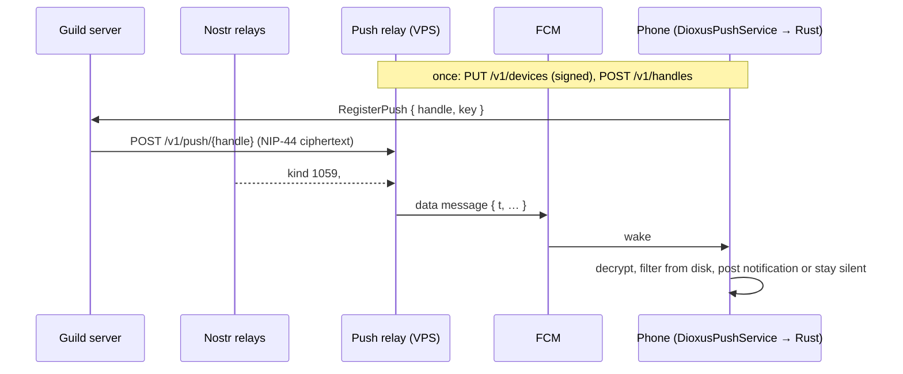

# Push notifications (Android)

Plan for the implementer. Goal: a person installs only Discordia and is alerted
to a DM or a mention when the app is backgrounded or its process is dead. No
second app, no permanent notification, no running cost beyond the existing VPS.

Tracking: #384 covers DMs and excludes mentions; open one issue for mentions and
one per row of [Later](#later) before starting. Delete this file when the last
phase merges — `docs/MAP.md`, `docs/OPS.md` and `CLAUDE.md` carry what stays true.

## Decisions

| Decision | Why |
|---|---|
| Firebase Cloud Messaging wakes the phone | The only route with one app, no foreground service, delivery after process death. Free. The APK already links Play services (`DioxusDriveAuth.kt`). |
| One project-run **push relay** holds the Firebase credential | A self-hosted server cannot hold it. Servers and the DM watcher reach phones only through the relay. |
| Push bodies are ciphertext end to end | The relay and Google see a device, a time and a size; for a DM also the recipient's key and the gift wrap, which any relay subscriber can already read. Never a sender, name or text. |
| Every filter that needs private state runs **on the phone** | Mutes, read marks, DM standing and DND are device-local or encrypted to the person's key; the relay cannot read them and must not be given them. |
| A guild server calls one operator-configured relay URL, never a client-supplied one | No SSRF surface. This is server config, not a guild install, so trap 39 is not engaged; say so in the new trap. |
| DM pushes come from a relay-side watcher on kind 1059, not from the sender | A sender-side "poke" would show the relay the sender's address beside the recipient's key, which gift wraps exist to hide. The watcher sees only what relays already publish. |
| Mention payloads use a per-server symmetric key, not the identity key | No vault unlock (scrypt) per mention, and the server needs no key agreement. |
| Alerts stay generic: who and where, never the message body | Existing DM policy (`dm_notifications.rs`, `Notice`). |
| Only the active account alerts | Existing rule in `DioxusDmNotifications.show`. One registration per install at a time. |
| No push for phones without Play services in this plan | See [Later](#later). |

## What the Slack chart gives us

Slack's published notification flowchart is one ordered decision: cheapest and
most decisive checks first, one YES/NO out. Take that shape — **one pure function per
place, returning a reason, table-tested** — and split it by where the data lives.

| Slack step | Discordia now | Runs on |
|---|---|---|
| Channel muted? | `muted_channels`, `muted_guilds`, DM mute | phone (mutes never leave it) |
| User in DnD? | profile status `dnd` | server (`profiles`) for mentions, phone for both |
| DnD override | none | — |
| `@channel` / `@everyone` / `@here` | do not exist | — |
| Thread message and subscribed? | no threads; a reply to you is the analogue | [Later](#later) |
| Channel pref: Nothing / Everything / Mentions / Default | mute = Nothing, otherwise Mentions | [Later](#later) |
| Global pref: All / Mentions / DMs / Never | two toggles: DMs, Mentions | phone, and whether it registers at all |
| Highlight words | none | — |
| User presence active? | new per-connection `attended` flag | server |
| Mobile: past push timing threshold? | no delay; rate limit only | server, relay |
| Desktop "mark as read" suppresses mobile push | read marks are encrypted on relays, so only the phone can honour them | phone (local mark), [Later](#later) for a fresh fetch |

Leave room for the missing rows: the mention payload carries a `k` (reason) field and the
decision functions return an enum, so "reply", "everyone" or a per-channel level is a new
variant, not a new path.

## Architecture



| Part | Where | Role |
|---|---|---|
| `discordia-nostr` | new crate `nostr/` | `event`, `nip44`, `relay` moved out of `client/src/nostr/` so the relay and server can use them. Client re-exports; no call site changes. |
| `discordia-push-relay` | new crate `push-relay/` | Device registry, handles, `/v1/push`, FCM sender, DM watcher. Own Dockerfile, compose service and `deploy-images` row, like the rendezvous. |
| `protocol/src/push.rs` | protocol | Signed-request payload, relay DTOs, FCM data shapes, mention payload. |
| `server/src/push.rs` | server | Registration store, `decide`, `PushRelay` trait and HTTP impl, bounded send queue. |
| `client/src/push/` | client | Registration (all platforms compile it; only Android registers), and `headless` — the wake handler. |
| `DioxusPushService.kt`, `DioxusNotifier.kt` | `client/android/` | FCM service; Context-only notification posting split out of `DioxusDmNotifications`. |

## Wire formats

### Signed relay requests

Same construction as the rendezvous ownership proof (`protocol/src/rendezvous.rs`,
`rendezvous/src/verify.rs`): BIP-340 over SHA-256 of a domain-separated payload.

```
discordia-push-v1\n{method}\n{path}\n{audience}\n{unix_secs}\n{pubkey}\n{sha256_hex(body)}
```

Headers `X-Discordia-Pubkey`, `X-Discordia-Time`, `X-Discordia-Signature`. `audience` is
the relay's host as the client dialed it. It is not sent: the relay tries each of its own
names (`DISCORDIA_PUSH_PUBLIC_HOSTS`, plus loopback). Time window ±300 s. Pubkey must pass `is_canonical_pubkey`.

### Relay API

| Call | Auth | Body → reply | Notes |
|---|---|---|---|
| `PUT /v1/devices` | signed | `{token, package, dm, relays, replaces?}` → `{expires_at}` | Upsert by (pubkey, token). A token belongs to one key: a PUT under another key moves it, since only the install and the relay know a token. `replaces` carries handles from a rotated token. ≤ 4 devices per key, oldest evicted. Expires 30 days after the last PUT. |
| `DELETE /v1/devices` | signed | `{token}` | Sign-out, account switch, notifications off. Drops its handles. |
| `POST /v1/handles` | signed | `{token}` → `{handle}` | 32 random bytes, base64url. ≤ 64 per device. One per server the person registers with, so one can be revoked and a noisy one is rate-limited alone. |
| `DELETE /v1/handles/{handle}` | signed | — | Leaving a server. |
| `POST /v1/push/{handle}` | the handle | raw ciphertext ≤ 2800 bytes → 202 | Answered before the send, so a dead token shows as 404 on the *next* push. 404 unknown or expired (caller deletes its registration), 413, 429. |
| `GET /` | — | version | Health. |

### FCM data messages

Data-only (no `notification` block, or `onMessageReceived` is skipped in the background),
`android.priority = HIGH`, `ttl = 86400s`. FCM caps data at 4096 bytes.

| `t` | Fields | Sent when |
|---|---|---|
| `dm` | `p` recipient key, `e` the wrap as JSON | wrap JSON ≤ 3000 bytes (a text DM is about 1.7 KB) |
| `dm` | `p`, `id` event id, `r` relay URL | larger; the phone fetches it |
| `m` | `h` handle, `c` ciphertext | a server pushed |
| `ping` | — | `discordia-push-relay ping <pubkey>` diagnostic |

### Mention payload

JSON, then `nip44::encrypt(&key, json)` with the handle's 32-byte key used directly as
the conversation key — authenticated, padded, already covered by `nip44.vectors.json`.

```json
{"v":1,"k":"mention","guild":…,"channel":…,"message":…,"author":"<pubkey>",
 "author_name":"…","guild_name":"…","channel_name":"…","at":1700000000}
```

No origin: the phone maps handle → origin from its own `push.json`.

### Gateway protocol (trap 1 applies to each)

| Message | Fields | Meaning |
|---|---|---|
| `ServerInfo.push` | `#[serde(default)] Option<String>` | The relay base URL this server pushes through. `None` = no push. |
| `ClientMessage::RegisterPush` | `handle`, `key` (base64, 32 bytes) | Upsert for the connection's pubkey. Re-sent on every Ready as the refresh. |
| `ClientMessage::UnregisterPush` | `handle` | — |
| `ClientMessage::SetAttention` | `attended: bool` | Someone is looking at this client. Per connection, memory only, default `true`. |

A client registers with a server only when `ServerInfo.push` names the same relay the
client itself uses; otherwise the handle would be useless there.

## The decision, three places

**Server — `push::decide(recipient, message, …) -> Option<Reason>`**, called once per
candidate after the commit and the `deliver`:

1. Recipient is not the author, is a guild member, is not a bot (`member.bot || bot_install(..).is_some()`).
2. Has a registration.
3. `can_see_channel` (text channels cannot be hidden today; keep the check so a future ACL cannot leak through push — trap 30).
4. `protocol::mentions_name(content, member.user.username)`.
5. Profile status is not `dnd`.
6. No session of the recipient is `attended`. A desktop in the tray or behind another window is unattended, so the phone is pushed; a focused client is not.
7. Under the per-recipient rate limit (20 per minute).

Candidates are the registered pubkeys that are members of the guild, not every member.

**Relay — DM watcher**: wrap carries no `expiration` tag (only call signals do,
`wrap_with_expiration`), id not seen before *on that relay*, not yet pushed to that
recipient, (relay, pubkey) already baselined, pubkey under its rate limit (30 per minute).

**Phone — `push::headless`**, from disk only:

| Check | Source | DM | Mention |
|---|---|---|---|
| Recipient is the active account | `identity.json` | ✓ | via `push.json` |
| Category toggle on, permission granted | `SharedPreferences` | ✓ | ✓ |
| App not resumed | process-level flag in `DioxusNotifier` | ✓ | ✓ |
| Rumor is a kind 14/15 chat message — not a call signal, call record, edit or delete | unwrap | ✓ | — |
| Author is not me (self-copies from other devices arrive too) and `author == peer` | unwrap | ✓ | — |
| Not blocked or ignored; standing is Inbox | `settings.json` `dm_blocked`/`dm_ignored`/`dm_accepted`, `push-peers.json` | ✓ | — |
| Not muted | `muted_channels` (`conversation_id(peer)` for a DM), `muted_guilds` | ✓ | ✓ |
| Not DND | `profiles/<pubkey>.json` | ✓ | ✓ |
| Newer than the read mark | `dm_read_at` with `dm_clock_offset` (trap 18); `channel_read_at` | ✓ | ✓ |
| Not already alerted | `SharedPreferences` tag → last alerted `at`, 64 entries | ✓ | ✓ |

The last row is also what dedups against the live in-process path: both end in
`DioxusNotifier.show`, which drops anything at or before the recorded `at` for its tag.

## Phases

One branch and PR per phase, branched from `origin/master` (every master push publishes
a pre-release). CI is the Android build; the devcontainer cannot produce an APK.

### 0 — Spike: Rust from a service with no Activity

Throwaway branch; the outcome decides whether phases 3–5 stand as written.

Today Rust only starts from tao's `create`, and three things abort the process if a
service calls into it cold: `ndk_context::android_context()` panics uninitialised;
`android::config_dir()` calls `process::exit(1)` before `android::initialize()`;
initialising `ndk_context` from a service makes tao's later `create` assert.

Prove on a phone:

1. A `FirebaseMessagingService` calls `System.loadLibrary("main")` with the Activity never started, then a JNI export that takes `JNIEnv`, `Context` and the files dir as arguments and touches no `ndk_context`, `with_env`, `with_activity`, `on_ui` or `config_dir()`.
2. Opening the Activity afterwards in the same process does not abort; neither does a push after the Activity is destroyed.
3. The export derives the vault passphrase from AndroidKeyStore with the passed env (the HMAC key has no user-auth requirement) and decrypts the identity. Record wall time for scrypt `LOG_N = 16`; budget is 20 s total per push.
4. Check whether the Android profile sets `panic = "abort"`. If so `catch_unwind` is useless and the path must be panic-free by construction.

If loading `libmain` cold is not viable, the fallback is a second small `cdylib` holding only the headless code; decide before phase 3.

### 1 — Extract `discordia-nostr`

Move `event.rs`, `nip44.rs` (+ vectors), `relay.rs` to `nostr/`. `relay.rs` calls
`crate::android::nostr_wakeups()`; pass that in as a hook. Client `nostr/mod.rs`
re-exports. Pure move: existing tests pass unchanged, add the crate to the second clippy
group (trap 14).

### 2 — Push relay

- `run::Options` pattern from the rendezvous: flag > env > TOML. `rusqlite` for `devices` and `handles`. Copy `limits::Limiter`; do not depend on the rendezvous crate.
- `trait Sender` with an FCM HTTP v1 implementation (service-account JWT → OAuth token cached to expiry, `POST …/v1/projects/{id}/messages:send`) and a recording fake. `UNREGISTERED`/`INVALID_ARGUMENT` delete the device; 429 and 5xx retry with backoff.
- Limits: per IP on every route, per handle 20/min and 300/day, body size, device and handle caps.
- Registration is the one route a stranger can grow state through: any fresh key signs a valid request. `PUT /v1/devices` checks the token with an FCM `validate_only` send before storing it, registrations are limited per IP per day, and a total device cap refuses new ones rather than evicting old.
- No `/v1/push` request or FCM response is logged with a token, handle or key in full.
- `Dockerfile.push-relay`, compose service with a data volume, `deploy-images` matrix row.

| Env | Meaning |
|---|---|
| `DISCORDIA_PUSH_ADDR` | Listen address, default `127.0.0.1:7720` behind nginx. |
| `DISCORDIA_PUSH_DATA_DIR` | SQLite. |
| `DISCORDIA_PUSH_PUBLIC_HOSTS` | Accepted audiences. |
| `DISCORDIA_PUSH_TRUSTED_PROXIES` | Whose `X-Forwarded-For` to believe, as the gateway's `DISCORDIA_TRUSTED_PROXIES`. nginx on the VPS fronts the relay, so without it every caller is one address to the limiter — under compose that address is the bridge gateway, not 127.0.0.1. |
| `DISCORDIA_PUSH_FCM_CREDENTIALS` | Path to the service-account JSON (on the VPS: `/opt/discordia/secrets/fcm-service-account.json`, mounted read-only). Unset: the relay starts, accepts registrations and logs sends instead of making them. |
| `DISCORDIA_PUSH_DM_RELAYS` | Relays the watcher may dial. Default: `relay::DEFAULT_RELAYS`. |

### 3 — Android plumbing and registration

- `firebase-messaging` in **both** `webrtc.init.gradle` and `webrtc.dx.init.gradle`, beside `play-services-auth`. Pin a version that builds with compileSdk 34 / AGP 8.7.
- No `google-services` plugin (dx's root build has no classpath for it). `build-android.py` writes the four values as string resources (`google_app_id`, `google_api_key`, `gcm_defaultSenderId`, `project_id`) from env — `FIREBASE_PROJECT_ID`, `FIREBASE_SENDER_ID`, `FIREBASE_API_KEY`, `FIREBASE_APP_ID`, `FIREBASE_APP_ID_DEBUG` — release values into main `res`, the `.debug` app's ID into `client/android/debug/res`. Unset: the build ships without push and the setting is hidden, the `GIPHY_API_KEY` rule. Firebase lives in the Google Cloud project that already holds the Drive sign-in client (`discordia-513801`); the owner's `google-services*.json` at the repo root is git-ignored and is only where those five values come from.
- `DioxusPushService` in the overlay manifest (`com.google.firebase.MESSAGING_EVENT`, not exported), the `package_sources` copy list, `REQUIRED_CLASSES`, `REQUIRED_SYMBOLS`, a `-keep` in `discordia.pro`, and `test_android_release.py`.
- Split `DioxusDmNotifications`: `DioxusNotifier` (an `object`, Context only) creates channels, posts, dedups and holds `resumed`; the Activity-bound class keeps permission prompts and tap intents. Channel names come from Rust today — persist the last localized names so a cold process has them.
- Rust `push::registration`: relay URL from `option_env!("DISCORDIA_PUSH_RELAY_URL")` with a runtime override, default `https://push.discordia.world`. On account mount: token → `PUT /v1/devices`. On token rotation: PUT with `replaces`. On sign-out or switch: `DELETE` signed by the outgoing key *before* it is dropped. State in `<config_dir>/push.json` (token, per-origin handle and key), written atomically like `write_private`.
- Settings: the existing DM opt-in becomes Notifications with DMs and Mentions toggles. Turning both off deletes the device.
- `ping` reaches a killed app and posts a test notification.

### 4 — DMs

Relay watcher:

- One `RelayPool` per allow-listed relay a watched key's devices name (or all, if a device names none): a pool's events do not say which relay sent them. Filter `{kinds:[1059], "#p":[…], since: now − 2 d − 60}`, pubkeys chunked, resubscribed (debounced) when the set changes.
- A wrap's `created_at` is backdated up to 2 days (`nip59::MAX_BACKDATE`), so `since: now` would miss everything, and every resubscribe replays the backlog. Rule: a bounded record keeps, per id, the relays that delivered it and the recipients pushed; a (relay, pubkey) pair is *baselined* at the first EOSE of a subscription that included it; push when the pair is baselined, that relay had not sent the id before, and it is not yet pushed to that pubkey. A copy first seen on a relay still replaying is then pushed from the next baselined one. A restart re-baselines — no storm, and what arrived while down is not pushed.

Phone:

- `handle_push` for `t = dm`: read `identity.json` and `identities/<p>.json` with a loader that has no side effects (`Identity::load` migrates and rewrites; do not call it), derive the passphrase with the passed env, `keyvault::decrypt`, take the wrap inline or fetch it by id (10 s budget, current-thread runtime), `nip59::unwrap`, `nip17::open_rumor`, run the table above, return the existing `Notice` shape or nothing.
- `dm_standing` also grants Inbox to contacts and guild-mates, which live only in memory. The running app writes `push-peers.json` — pubkeys currently in Inbox with the name it resolved — debounced, whole-file. It is a notification cache only; nothing in the UI reads it (trap 8).
- The handler never writes a file the app owns.

### 5 — Mentions

Server:

- `DISCORDIA_PUSH_RELAY` in `ServerOptions` (and `ServerOptions::or`), `ServerConfig`, `host.rs` for the embedded self-host. Default: the project relay; empty turns it off. Give `ServerConfig` a default for the field — every integration test builds a literal.
- Table `push_registrations(handle PRIMARY KEY, pubkey, key, updated_at)`, ≤ 4 per pubkey, pruned after 30 days. Commit before the in-memory map changes (trap 2). Excluded from export.
- `AppState::notify_offline_mentions(guild, &Message)` after the `deliver` at the three sites that commit a text message: `SendMessage`, `CompleteImageUpload`, `SendFile`. Not `BeginImageUpload` (nothing is committed), not edits.
- `trait PushRelay` on `ServerConfig`, shaped like `VoiceTokenMinter`; the HTTP impl sits behind a bounded queue and worker so no socket loop waits on it (trap 26's rule, `watchdog::ArmWatch`). Full queue drops. 404 deletes the registration. Read what you need out of each `DashMap` before any await or write (trap 27).
- `attended` beside the other per-connection flags (`set_progressive_image_uploads` is the model).

Client:

- On Ready: if `ServerInfo.push` matches, ensure a handle and key for this origin, send `RegisterPush`. Leaving a server: `UnregisterPush`, `DELETE /v1/handles/{handle}`.
- `SetAttention` from `app_foreground` (`use_foreground` on desktop, `resumed` on Android), sent on change and after Ready when false.
- `handle_push` for `t = m`: handle → origin and key from `push.json`, `nip44::decrypt`, filters, notice. Channel `discordia-mention-v1`, tag `discordia-mention:<account>:<origin>:<channel>`, title guild · channel, text "<author> mentioned you".
- Tap: `discordia://mention/…` → a JNI export beside `onDmNotificationOpened` → the account task selects the guild and channel, connecting to that saved server first if it is not the live session.

### 6 — Docs and validation

- `docs/MAP.md` rows; `docs/OPS.md` env tables, the relay's deployment, what the relay and Google can see; `docs/MOBILE_PLAN.md` row; `CLAUDE.md` crates table and one trap (handle is a capability; filters run on the phone; the headless path may not touch `ndk_context`); `docs/DEPENDENCIES.md`.
- `docs/MAP.md` names a `chat::mentions_user` that does not exist — the client calls `protocol::mentions_name`. Fix it in this pass.
- On a physical phone, Release build: DM and mention with the app foreground (no alert), background, screen locked, swiped away; token rotation; sign-out; account switch; two devices on one key; relay restart; airplane mode for an hour then back (one alert per conversation, not a storm). Record idle battery with and without push.
- Document, do not promise: nothing after a force-stop from Settings; some manufacturers restrict background delivery.

## Tests

| Layer | Test |
|---|---|
| `protocol` | Signed-payload round trip and tamper cases; legacy `Ready` without `push` still parses (model: `ready_negotiates_chat_tools_without_breaking_legacy_hosts`). |
| relay | Registration auth, replay window, caps, rate limits, 404 on unknown handle, token eviction on `UNREGISTERED` — recording `Sender`. Watcher against an in-process fake relay (`delivery.rs` `fake_relay` is the model): backlog not pushed, post-baseline pushed once across two relays, `expiration` skipped. |
| server | `decide` table test, one row per numbered rule. Integration with a recording `PushRelay` (`server/tests/voice.rs` `RecordingMinter`): offline mention pushes once; attended session, DND, bot, author, non-member do not; ciphertext opens with the registered key. |
| client | `headless` core is plain Rust over a directory: self-copy, blocked, muted, DND, read, call signal, edit all return nothing; a clean DM returns a notice without the body. |
| Android | `test-android-notification-dispatch.py` pattern for `DioxusNotifier` dedup and the cold-channel path. |

## Risks

| Risk | Handling |
|---|---|
| Cold `libmain` load aborts | Phase 0 gates everything; fallback is a second `cdylib`. |
| High-priority pushes that show nothing (self-copies, edits, muted) make FCM deprioritise the app | Unavoidable for DMs — the relay cannot tell a self-copy from a message. Measure the ratio in phase 6; if delivery degrades, see Later. |
| A stranger floods a key with gift wraps | Relay rate limit; the phone alerts only for Inbox peers. |
| A server floods its members | Per-handle limit; the person revokes that one handle. |
| The relay's address is public and unproxied, like every other name on the VPS | Nothing is reachable without a signature or a handle, and neither route returns data. Flooding is the per-IP limiter's job, plus `limit_req` on the nginx vhost when the relay is deployed. |
| The relay is down | No mobile push anywhere; in-app delivery unaffected. Document it as the single shared dependency. |
| Scrypt per DM push is slow on old phones | Measured in phase 0. Do not cache the secret key on disk to avoid it. |

## Human prerequisites

| Step | State |
|---|---|
| Firebase in `discordia-513801`; Android apps `com.discordia.app` and `com.discordia.app.debug` | done |
| The five `FIREBASE_*` GitHub secrets | done |
| Service account `push-relay` (Firebase Cloud Messaging API Admin only); key on the VPS at `/opt/discordia/secrets/fcm-service-account.json` | done |
| `push.discordia.world`: DNS-only record, nginx vhost to `127.0.0.1:7720`, its own certificate | done; answers 502 until phase 2 deploys the relay |
| A physical Android phone with Play services, for phase 0 and phase 6 | repo owner |

## Later

| Item | Note |
|---|---|
| A reply to you notifies | `Message.reply_to.author_pubkey` is already there; must also count in `channel_mentions` so the badge agrees. |
| Per-channel level (Everything / Mentions / Nothing) and a guild default | Needs a server-side preference, or it costs a wake per message. |
| Incoming DM call rings through push | The watcher skips `expiration` wraps today; a call needs a full-screen intent and its own design. |
| Fresh read marks on wake | Fetch `discordia:read` before alerting so a DM read on desktop stays quiet. |
| Desktop tells the relay it is attended | Would quiet DM pushes while the person is at their desk; costs the relay a presence signal. |
| Live in-process mention alert | Covers servers with no relay configured. |
| Phones without Play services | Opt-in keep-alive foreground service, or UnifiedPush behind the same `/v1/push` contract. |
| iOS | APNs as a second `Sender`; the registry, handles and payloads carry over. |
