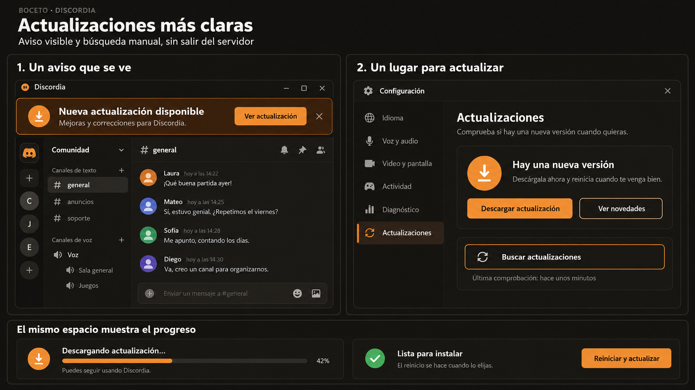

# Actualizaciones: propuesta

| Elemento | Comportamiento propuesto |
|---|---|
| Aviso superior | Visible en Inicio y dentro de servidores. «Ver actualización» abre Configuración → Actualizaciones. Se puede ocultar; la oferta sigue accesible desde Configuración. |
| Buscar actualizaciones | Botón manual disponible sin desconectarse. Muestra el resultado y la última comprobación; evita solicitudes simultáneas. |
| Disponible | Acción principal «Descargar actualización» y acceso a novedades. |
| Descargando | Progreso real cuando se conoce el tamaño; permite seguir usando la app. |
| Lista para instalar | «Reiniciar y actualizar» es una acción explícita, separada de descargar. Respeta el cierre ordenado de llamadas y sesiones. |
| Sin novedades | «Estás al día», versión instalada y botón para volver a comprobar. |
| Error | Mensaje visible y «Reintentar». Un fallo al comprobar no borra una actualización ya encontrada. |

El boceto propone una interfaz; no modifica el actualizador. La implementación
requiere compartir su estado entre Inicio, servidores y Configuración, y separar
la descarga verificada de la instalación, que actualmente se inicia al descargar.
